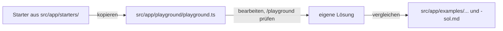

# Lab 1.1: Kurs-Workspace und Angular 22

**Leitfragen:**

<details>
<summary>Welche Angular-Version läuft im eigenen Projekt, und was hält ein Update auf?</summary>

`ng version` oder `package.json` (`@angular/core`) zeigen die Version. Typische Bremsen: Bibliotheken ohne passende Version, große NgModule-Codebasis, fehlende Tests als Sicherheitsnetz.

</details>

<details>
<summary>Welche Dateien öffnet man zuerst, um eine fremde Angular-App zu verstehen?</summary>

`package.json` (Versionen, Skripte), `angular.json` (Build), `src/main.ts` (Start), danach die App-Konfiguration und die Routen. In heutigen Projekten heißen sie `app.config.ts` und `app.routes.ts`, in älteren `app.module.ts` und `app-routing.module.ts`.

</details>

<details>
<summary>Was fehlt einem neuen Teammitglied am ersten Tag am häufigsten?</summary>

Ein lauffähiges Projekt mit Testdaten, die Startbefehle und eine Karte, wo was liegt. Das Kurs-Repo liefert genau das: Mock-API, Beispiele, Starter und Playground.

</details>

- `ng new` erzeugt in Angular 22 kein `AppModule` mehr, sondern `main.ts` + `app.config.ts` + `app.routes.ts`.
- Neue Apps laufen ohne zone.js (zoneless), Komponenten ohne Angabe von `changeDetection` sind `OnPush`.
- Bis Modul 6 gilt deshalb: asynchrone Daten (HTTP) immer über die `async`-Pipe ins Template.

## Begriffe

| Begriff | Bedeutung |
| --- | --- |
| Standalone-Komponente | Komponente, die ihre Abhängigkeiten selbst in `imports` nennt und kein NgModule braucht; Default seit Angular 19 |
| `app.config.ts` | Datei mit der `ApplicationConfig`: Liste aller app-weiten Provider (Router, HTTP, eigene Dienste) |
| Provider | Eintrag, der der Dependency Injection sagt, wie ein Dienst erzeugt wird |
| zone.js | Bibliothek, die früher jede asynchrone Aktion (Klick, Timer, HTTP) abfing und danach die Ansicht prüfen ließ |
| zoneless | Betrieb ohne zone.js: Angular prüft die Ansicht nur nach konkreten Anlässen (Event im Template, `async`-Pipe, Input-Änderung, Signal) |
| Mock-API | kleiner Node-Server mit Testdaten, ersetzt das echte Backend im Kurs |

## Was `ng new` heute erzeugt

Ein mit Angular CLI 22 erzeugtes Projekt (Grundlage des Kurs-Projekts `output/project/`):

```text
project/
├── angular.json            Build- und Serve-Konfiguration (Builder @angular/build)
├── package.json            Versionen und npm-Skripte
├── public/                 statische Dateien, z. B. favicon.ico, config.json
└── src/
    ├── index.html          enthält <app-root>
    ├── main.ts             Start: bootstrapApplication(App, appConfig)
    ├── styles.css          globale Styles
    └── app/
        ├── app.ts          Root-Komponente (Dateiname ohne .component seit v20)
        ├── app.config.ts   Provider der App
        └── app.routes.ts   Routen als Array
```

`src/main.ts` startet die App direkt mit der Root-Komponente:

```ts
import { bootstrapApplication } from '@angular/platform-browser';
import { appConfig } from './app/app.config';
import { App } from './app/app';

bootstrapApplication(App, appConfig).catch((err) => console.error(err));
```

`src/app/app.config.ts` des Kurs-Projekts (Lab 2.2 erklärt jeden Eintrag):

```ts
export const appConfig: ApplicationConfig = {
  providers: [
    provideBrowserGlobalErrorListeners(),               // unbehandelte Fehler an den ErrorHandler
    provideRouter(routes, withComponentInputBinding()), // Router; Routen-Parameter als @Input
    provideHttpClient(withFetch()),                     // HttpClient auf Basis von fetch
  ],
};
```

Eine Komponente bringt ihre Abhängigkeiten selbst mit (`imports`), statt sie aus einem Modul zu erben. Lab 2.1 vertieft das.

```ts
@Component({
  selector: 'app-root',
  imports: [RouterOutlet, RouterLink],   // was das Template verwendet
  template: `<router-outlet />`,
})
export class App {}
```

### Vergleich mit einem Projekt aus der NgModule-Ära

| Thema | Angular ≤ 16 (typisch) | Angular 22 (`ng new`) |
| --- | --- | --- |
| Start | `platformBrowserDynamic().bootstrapModule(AppModule)` | `bootstrapApplication(App, appConfig)` |
| App-Konfiguration | `AppModule` mit `imports`/`providers` | `app.config.ts` mit `providers` |
| Routen | `app-routing.module.ts` mit `RouterModule.forRoot` | `app.routes.ts` als `Routes`-Array |
| Komponenten | in `declarations` eines Moduls | standalone, eigene `imports` |
| Template-Syntax | `*ngIf`, `*ngFor` | `@if`, `@for` (seit v17) |
| Change Detection | zone.js in `polyfills` | zoneless (Default seit v21), kein zone.js im `angular.json` |
| Strategie ohne Angabe von `changeDetection` | `Default` | `OnPush` (v22); `Default` heißt jetzt `Eager` |
| Unit-Tests | Karma + Jasmine | Vitest über `ng test` (`@angular/build:unit-test`) |
| Build | `@angular-devkit/build-angular` (webpack) | `@angular/build:application` (esbuild/Vite) |

Geprüft gegen die installierten Pakete (`@angular/core` 22.2, Stand: 28.10.2026): `ChangeDetectionStrategy` kennt `OnPush`, `Eager` und das veraltete `Default`; `bootstrapApplication` richtet zoneless Change Detection ohne eigenen Provider ein.

## Zoneless: Warum die `async`-Pipe jetzt Pflicht ist

Ohne zone.js erfährt Angular nicht mehr automatisch, dass eine HTTP-Antwort angekommen ist. Die Ansicht wird nur aktualisiert, wenn Angular einen Anlass bekommt:

| Anlass | Aktualisiert die Ansicht? |
| --- | --- |
| Event-Binding im Template, z. B. `(click)` | ja |
| `async`-Pipe erhält einen neuen Wert | ja |
| neuer Wert für ein `@Input` | ja |
| `subscribe(...)` in der Klasse schreibt in ein normales Feld | nein, die Anzeige bleibt alt |
| `setTimeout` schreibt in ein normales Feld | nein |

```ts
// funktioniert nicht zuverlässig (zoneless, OnPush)
sessions: Session[] = [];
ngOnInit() { this.api.getSessions().subscribe((s) => (this.sessions = s)); }

// Regel bis Modul 6: Observable im Feld, Auflösen im Template
sessions$ = this.api.getSessions();
// Template: @if (sessions$ | async; as sessions) { ... }
```

> **Merksatz:** Bis Modul 6 kommen asynchrone Daten ausschließlich über die `async`-Pipe ins Template. Ab Lab 6.1 übernehmen Signals diese Aufgabe.

## Control Flow im Recap

Die Kurs-Beispiele nutzen ab dem ersten Tag die eingebaute Template-Syntax (stabil seit Angular 17). Sie braucht keinen Import. Lab 3.1 vertieft sie (`track`, `@empty`, `@switch`, `@let`) und migriert Altcode.

| Klassisch | Seit v17 |
| --- | --- |
| `<div *ngIf="sessions$ \| async as sessions; else loading">` | `@if (sessions$ \| async; as sessions) { … } @else { … }` |
| `<li *ngFor="let s of sessions">` | `@for (s of sessions; track s.id) { <li>…</li> }` |

`track` ist bei `@for` Pflicht und nennt den eindeutigen Schlüssel eines Eintrags, meist die `id`.

## Das Kurs-Repo

```text
output/project/
├── api/                  Mock-API: npm run api -> http://localhost:3000
├── public/config.json    Laufzeit-Konfiguration (Lab 2.2)
├── src/app/
│   ├── launcher/         Startseite mit Links zu allen Beispielen
│   ├── shared/           models.ts (Session, Speaker …), api.ts (SessionApi)
│   ├── examples/mNN-…/lNN-…/   fertiges Ergebnis je Lab
│   ├── starters/         Startdateien der Übungen
│   └── playground/       eigener Arbeitsbereich: playground.ts
└── workspaces/           eigene Projekte, z. B. legacy-ngmodule (Lab 2.3)
```

| Adresse | Inhalt |
| --- | --- |
| `http://localhost:4200/` | Startseite mit allen Beispielen |
| `http://localhost:4200/playground` | eigene Arbeit aus `src/app/playground/playground.ts` |
| `http://localhost:4200/examples/<modul>/<lab>` | fertiges Beispiel, z. B. `/examples/m01-angular-recap/l01-workspace` |
| `http://localhost:3000/sessions` | Rohdaten der Mock-API |

Arbeitsweise in jedem Lab:



Das Beispiel erst nach der Übung öffnen. Es ist zugleich der Wiederaufsetzpunkt, falls eine Übung nicht fertig wird.

`src/app/shared/api.ts` stellt den Service `SessionApi` bereit (`getSessions()`, `getSession(id)`, `getSpeakers()`), der Observables liefert. Die Modelle stehen in `src/app/shared/models.ts`.

## Typische Fehler

| Symptom | Ursache | Lösung |
| --- | --- | --- |
| Liste bleibt bei „Lade Sessions …“, Konsole zeigt `ERR_CONNECTION_REFUSED` | Mock-API läuft nicht | Terminal 1: `npm run api` |
| `Port 4200 is already in use` | anderer `ng serve` läuft | alten Prozess beenden oder `npm start -- --port 4300` |
| `NG8004: No pipe found with name 'async'` | `AsyncPipe` fehlt in `imports` der Komponente | `import { AsyncPipe } from '@angular/common'` und in `imports` eintragen |
| Daten kommen an (Network-Tab), Anzeige bleibt leer | `subscribe` schreibt in ein Feld (zoneless) | Observable im Feld halten, im Template `async`-Pipe |
| Warnung `NG8113: All imports are unused` | `AsyncPipe` steht schon in `imports`, das Template nutzt `async` aber noch nicht | Warnung verschwindet, sobald das Template `\| async` verwendet |
| `@for loop must have a "track" expression` | `track` fehlt | `@for (s of sessions; track s.id)` |
| Kein Tab „Angular“ in den DevTools | Erweiterung fehlt oder Produktions-Build | Angular DevTools installieren, `npm start` (Entwicklungsmodus) |

## Fazit

- Angular 22 startet mit `bootstrapApplication`, `app.config.ts` und `app.routes.ts`; kein `AppModule`.
- Neue Apps sind zoneless, Komponenten ohne Angabe von `changeDetection` sind `OnPush`: asynchrone Daten laufen über die `async`-Pipe.
- `@if`/`@for` ersetzen `*ngIf`/`*ngFor`; die Kurs-Beispiele nutzen sie von Anfang an.
- Gearbeitet wird im Playground, verglichen mit dem Beispiel unter `src/app/examples/`.

Die Übung bringt Mock-API und App zum Laufen und zeigt die Session-Liste im Playground an.
