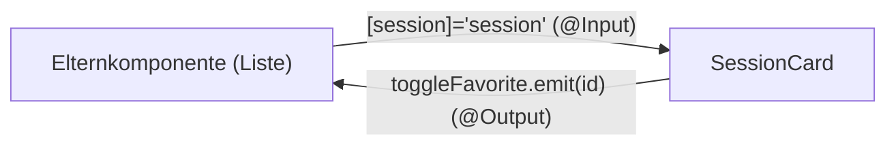

# Lab 1.2: Recap: Komponenten, Bindings, Services, Routing

**Leitfragen:**

<details>
<summary>Woran erkennt man an einer Fehlermeldung, ob das Problem im Template oder in der Klasse liegt?</summary>

Am Dateipfad mit Zeile und am Fehlercode: `NG8xxx` meldet der Template-Compiler (unbekanntes Element, fehlende Pipe, falsches Binding), `TS2xxx` ist ein TypeScript-Fehler. `NG0xxx` erscheint erst zur Laufzeit in der Browser-Konsole, z. B. ein fehlender Provider.

</details>

<details>
<summary>Wie kommt ein Wert von einer Eltern- in eine Kindkomponente und zurück?</summary>

Hinein per Property-Binding auf ein `@Input` (`[session]="s"`), heraus per `@Output` mit `EventEmitter`, das die Elternkomponente mit einem Event-Binding abonniert (`(toggleFavorite)="…"`).

</details>

<details>
<summary>Wo gehört ein HTTP-Aufruf hin, und warum nicht in die Komponente?</summary>

In einen Service. Dann teilen sich mehrere Komponenten denselben Zugriff, die URL steht an einer Stelle, und Tests können den Service ersetzen.

</details>

- Der Recap nutzt bewusst die klassische Schreibweise (`@Input`, `@Output`, `EventEmitter`), die in den meisten Projekten steht. Die Signal-Varianten folgen in Modul 6.
- Neu gegenüber älteren Projekten: `inject()` statt Konstruktor-Injection.

## Begriffe

| Begriff | Bedeutung |
| --- | --- |
| `inject()` | Funktion, die einen Dienst aus der Dependency Injection holt; ersetzt den Konstruktor-Parameter |
| `providedIn: 'root'` | der Service wird einmal für die ganze App bereitgestellt, ohne Eintrag in einer Provider-Liste |
| Query-Parameter | Teil der URL nach `?`, z. B. `/playground?id=3` |
| `withComponentInputBinding()` | Router-Option: Pfad- und Query-Parameter landen automatisch in gleichnamigen `@Input`s der Routen-Komponente |

## Die vier Bindungsarten

| Art | Syntax | Richtung | Beispiel |
| --- | --- | --- | --- |
| Interpolation | `{{ ausdruck }}` | Klasse → Template (Text) | `{{ session.title }}` |
| Property-Binding | `[eigenschaft]="ausdruck"` | Klasse → Element/Kind | `[session]="session"` |
| Event-Binding | `(ereignis)="anweisung"` | Template → Klasse | `(click)="onFavorite()"` |
| Zwei-Wege-Binding | `[(ngModel)]="feld"` | beide | Formularfeld (Modul 4) |

Ohne eckige Klammern ist der Wert immer ein fester Text: `session="session"` übergibt den String `"session"`, nicht das Objekt.

## Eltern und Kind: `@Input` und `@Output`



```ts
// Kind: session-card.ts
@Component({
  selector: 'app-session-card',
  imports: [DatePipe, RouterLink],
  template: `
    <strong>{{ session.title }}</strong>
    <button class="btn" (click)="onFavorite()">Merken</button>
  `,
})
export class SessionCard {
  @Input({ required: true }) session!: Session;            // Pflicht-Eingabe
  @Output() toggleFavorite = new EventEmitter<number>();   // Ereignis nach oben

  onFavorite(): void {
    this.toggleFavorite.emit(this.session.id);             // ohne emit erfährt die Elternkomponente nichts
  }
}
```

```html
<!-- Eltern-Template; SessionCard muss in imports der Elternkomponente stehen -->
<app-session-card [session]="session" (toggleFavorite)="favorites.toggle($event)" />
```

`$event` enthält den Wert aus `emit(...)`.

## Pipes

Pipes formatieren Werte im Template. Jede Pipe muss in `imports` der Komponente stehen, auch die eingebauten.

| Pipe | Import | Beispiel | Ergebnis |
| --- | --- | --- | --- |
| `date` | `DatePipe` | `{{ s.start \| date: 'dd.MM.yyyy, HH:mm' }}` | `10.03.2027, 09:30` |
| `async` | `AsyncPipe` | `{{ sessions$ \| async }}` | aktueller Wert des Observables |
| `uppercase` | `UpperCasePipe` | `{{ s.track \| uppercase }}` | `FRONTEND` |
| `currency` | `CurrencyPipe` | `{{ s.price \| currency: 'EUR' }}` | `€390.00` (Locale `en-US`) |

Im Datumsformat steht `MM` für den Monat und `mm` für Minuten; `HH` ist die Stunde im 24-Stunden-Format.

## Services mit `inject()`

```ts
// src/app/shared/api.ts (Ausschnitt)
@Injectable({ providedIn: 'root' })
export class SessionApi {
  private readonly http = inject(HttpClient);

  getSessions(): Observable<Session[]> {
    return this.http.get<Session[]>(`${API_URL}/sessions`);
  }
}
```

| Klassisch | Heute |
| --- | --- |
| `constructor(private http: HttpClient) {}` | `private readonly http = inject(HttpClient);` |
| funktioniert nur in Klassen mit Konstruktor | funktioniert auch in Funktionen, die Angular aufruft (Provider, Guards) |

`inject()` darf nur beim Erzeugen laufen (Feld-Initialisierung, Konstruktor), nicht später in einer Methode. Ein Service ohne `providedIn` braucht einen Eintrag in einer `providers`-Liste; sonst meldet die Konsole `NG0201: No provider found for …`.

## Routen mit Parametern

```ts
// Pfad-Parameter: /sessions/3
export const routes: Routes = [
  { path: 'sessions', component: SessionList },
  { path: 'sessions/:id', component: SessionDetailPage },
];
```

```html
<a [routerLink]="['/sessions', session.id]">Details</a>                 <!-- /sessions/3 -->
<a [routerLink]="[]" [queryParams]="{ id: session.id }">Details</a>     <!-- aktuelle Route + ?id=3 -->
```

Mit `withComponentInputBinding()` (steht in `app.config.ts`) kommt der Parameter direkt als `@Input` in der Routen-Komponente an, ohne `ActivatedRoute`:

```ts
export class SessionDetailPage {
  @Input() id?: string;   // aus :id oder ?id=, immer als Text
}
```

| Lesart | Code | Hinweis |
| --- | --- | --- |
| Input-Binding | `@Input() id?: string` | nur in der Komponente, die der Router anzeigt |
| klassisch | `inject(ActivatedRoute).snapshot.paramMap.get('id')` | Wert beim Erzeugen; Wechsel ohne Neuerzeugung bleibt unbemerkt |

Der Playground ist eine einzelne Route (`/playground`). Die Übung wählt die Session deshalb über einen Query-Parameter (`/playground?id=3`); das Prinzip ist dasselbe wie bei `:id`.

## Wann reagiert eine Kindkomponente auf neue Inputs?

Eine Komponente, die im Template stehen bleibt, wird nicht neu erzeugt, wenn sich nur ein `@Input` ändert. Die beiden Lifecycle-Hooks verhalten sich dabei unterschiedlich:

| Hook | Läuft | Geeignet für |
| --- | --- | --- |
| `ngOnInit()` | einmal, nach dem ersten Setzen der Inputs | einmalige Vorbereitung |
| `ngOnChanges()` | bei jeder Input-Änderung, auch beim ersten Setzen (vor `ngOnInit`) | Werte, die aus Inputs abgeleitet werden |

```ts
export class SpeakerInitials implements OnChanges {
  @Input({ required: true }) name!: string;
  protected initials = '';

  ngOnChanges(): void {
    // neu berechnen, sobald ein anderer Name hereinkommt
    this.initials = this.name.split(' ').map((part) => part[0]).join('');
  }
}
```

Stünde die Berechnung in `ngOnInit`, zeigte die Komponente nach einem Namenswechsel weiter die alten Initialen.

## Fehler lesen

| Wo | Kennung | Beispiel | Ort |
| --- | --- | --- | --- |
| Terminal (`npm start`) und Browser-Overlay | `NG8001` | `'app-session-card' is not a known element` | Template: Komponente fehlt in `imports` |
| dto. | `NG8004` | `No pipe found with name 'date'` | Template: Pipe fehlt in `imports` |
| dto. | `TS2322` | `Type 'string' is not assignable to type 'Session'` | Binding ohne `[ ]` |
| Browser-Konsole | `NG0201` | `No provider found for …FavoritesService` | Klasse/DI: Provider fehlt |
| nirgends | – | Klick ohne Wirkung | Logik: fehlendes `emit`, fehlender Parameter |

Die Zeile `src/…/session-card.ts:12:43` nennt Datei, Zeile und Spalte. Steht die Fehlerstelle in einem `template:`-Text, liegt das Problem im Template.

## Typische Fehler

| Symptom | Ursache | Lösung |
| --- | --- | --- |
| `NG8001 … is not a known element` | Kindkomponente nicht in `imports` | Klasse importieren und in `imports` eintragen |
| `NG8004 No pipe found with name 'date'` | `DatePipe` fehlt | `DatePipe` aus `@angular/common` in `imports` |
| `TS2322 Type 'string' is not assignable …` | `session="session"` statt `[session]="session"` | eckige Klammern setzen |
| `NG0201: No provider found for …` in der Konsole, Seite leer | Service ohne `providedIn` und ohne Provider | `@Injectable({ providedIn: 'root' })` |
| Link „Details“ ändert nichts | Parameter fehlt im Link | `[queryParams]="{ id: session.id }"` bzw. `['/sessions', id]` |
| Klick auf Kind-Button ohne Wirkung | `emit` fehlt oder `(output)` nicht gebunden | `this.output.emit(wert)` und im Eltern-Template binden |

## Fazit

- Property-Binding braucht `[ ]`, Events `( )`; ohne Klammern wird Text übergeben.
- Jede verwendete Komponente und Pipe steht in `imports`; jeder Service braucht einen Provider (meist `providedIn: 'root'`).
- `inject()` holt Dienste ohne Konstruktor; HTTP gehört in einen Service, das Template nutzt die `async`-Pipe.
- Routen-Parameter kommen mit `withComponentInputBinding()` als `@Input` an.
- `ngOnInit` läuft einmal, `ngOnChanges` bei jeder Input-Änderung.

Die Übung repariert eine kleine EventHub-App mit sechs typischen Fehlern und hält zu jedem die Ursache fest.
