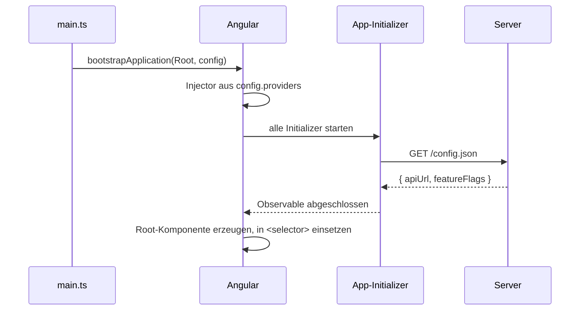

# Lab 2.2: Bootstrapping mit app.config.ts und app.routes.ts

**Leitfragen:**

<details>
<summary>Wo stand in alten Projekten die globale Konfiguration, und wie hat man sie gefunden?</summary>

Verteilt: `providers` im `AppModule`, `forRoot()`-Aufrufe in `imports`, Werte in `environment.ts`. Gefunden hat man sie über die Modul-Imports, oft über mehrere Dateien. Heute steht alles App-Weite in einer Liste in `app.config.ts`.

</details>

<details>
<summary>Wie stellt man sicher, dass eine API-URL bekannt ist, bevor die erste Komponente lädt?</summary>

Mit einem App-Initializer: eine Funktion, auf die Angular beim Start wartet. Erst wenn sie fertig ist (Promise erfüllt, Observable abgeschlossen), entsteht die Root-Komponente.

</details>

<details>
<summary>Was sollte in einer Umgebung austauschbar sein, ohne neu zu bauen?</summary>

Alles, was sich je Umgebung unterscheidet und kein Code ist: API-URLs, Feature-Flags, Client-IDs. Diese Werte gehören in eine Datei, die zur Laufzeit geladen wird (`public/config.json`), nicht in `environment.ts`, das beim Build fest eingebaut wird.

</details>

- `main.ts` startet die App mit `bootstrapApplication(Root, config)`; `config` ist eine `ApplicationConfig` mit einer Provider-Liste.
- Eigene `provideXyz()`-Funktionen bündeln Provider wie `provideRouter` oder `provideHttpClient`.
- `provideAppInitializer` lässt den Start auf Vorarbeit warten, z. B. auf `config.json`.

## Begriffe

| Begriff | Bedeutung |
| --- | --- |
| Bootstrapping | Starten der App: Injector anlegen, Initializer ausführen, Root-Komponente in `index.html` einsetzen |
| `ApplicationConfig` | Objekt `{ providers: [...] }`, das `bootstrapApplication` übergeben wird |
| Environment-Provider | Provider für den App-weiten Injector (Typ `EnvironmentProviders`); nur in `app.config.ts` oder an Routen erlaubt, nicht in `@Component.providers` |
| `makeEnvironmentProviders` | verpackt eine Provider-Liste als `EnvironmentProviders`; Basis eigener `provideXyz()`-Funktionen |
| App-Initializer | Funktion, auf deren Ergebnis Angular vor dem Erzeugen der Root-Komponente wartet |
| Feature-Flag | Schalter in der Konfiguration, der eine Funktion an- oder abschaltet |

## Vom Modul zur ApplicationConfig

```ts
// vorher: main.ts + app.module.ts
platformBrowserDynamic().bootstrapModule(AppModule);

@NgModule({
  imports: [BrowserModule, HttpClientModule, AppRoutingModule],
  providers: [{ provide: APP_INITIALIZER, useFactory: …, deps: [ConfigService], multi: true }],
  bootstrap: [AppComponent],
})
export class AppModule {}
```

```ts
// heute: src/main.ts
bootstrapApplication(App, appConfig).catch((err) => console.error(err));

// src/app/app.config.ts der Kurs-App
export const appConfig: ApplicationConfig = {
  providers: [
    provideBrowserGlobalErrorListeners(),
    provideRouter(routes, withComponentInputBinding()),
    provideHttpClient(withFetch()),
  ],
};
```

| Eintrag | Wirkung | Ersetzt |
| --- | --- | --- |
| `provideBrowserGlobalErrorListeners()` | leitet unbehandelte Fehler und abgelehnte Promises an den `ErrorHandler` | – (neu, seit v20) |
| `provideRouter(routes, withComponentInputBinding())` | Router mit Routen; Parameter kommen als `@Input` an (Lab 1.2) | `RouterModule.forRoot(routes, { bindToComponentInputs: true })` |
| `provideHttpClient(withFetch())` | `HttpClient` auf Basis von `fetch`; Ort für Optionen wie Interceptors | `HttpClientModule` |
| `provideHttpClient(withInterceptors([...]))` | Interceptors als Funktionen (Lab 9.2) | `HTTP_INTERCEPTORS` |
| `provideZonelessChangeDetection()` | zoneless Change Detection; in Angular 22 Default, Eintrag nicht nötig | zone.js in `polyfills` |
| `provideZoneChangeDetection({ eventCoalescing: true })` | Betrieb mit zone.js; nur für Altprojekte (Lab 2.3) | – |
| `provideAppInitializer(fn)` | wartet beim Start auf `fn` | `APP_INITIALIZER` (veraltet) |

Geprüft gegen `@angular/core` 22.2 (Stand: 28.10.2026): `bootstrapApplication` richtet zoneless Change Detection intern ein; `provideAppInitializer(initializerFn: () => Observable<unknown> | Promise<unknown> | void): EnvironmentProviders`. In `@angular/common` 22.2 ist `HttpClient` mit `providedIn: 'root'` und dem Fetch-Backend registriert: Ohne `provideHttpClient()` ist er trotzdem injizierbar; der Eintrag bleibt nötig für Optionen wie `withInterceptors` und macht die Konfiguration lesbar (`prüfen` bei Updates).

## app.routes.ts

```ts
import { Routes } from '@angular/router';
import { Home } from './launcher/home';

export const routes: Routes = [
  { path: '', component: Home, title: 'EventHub – Kurs-Beispiele' },
  { path: 'playground', loadComponent: () => import('./playground/playground').then((m) => m.Playground) },
  { path: 'examples/m01-angular-recap', loadChildren: () => import('./examples/m01-angular-recap/routes') },
  { path: '**', redirectTo: '' },
];
```

`Routes` typisiert das Array: Tippfehler in `path`, `component` oder `loadComponent` meldet der Compiler. Eine Routen-Datei mit `export default [...] satisfies Routes` kann `loadChildren` direkt laden (Vertiefung in Lab 8.1).

## Ablauf beim Start



Schlägt ein Initializer fehl, wird die Root-Komponente nie erzeugt und das Promise von `bootstrapApplication` wird abgelehnt.

## Eigener Provider mit App-Initializer

Muster: ein Service lädt eine Datei, eine eigene `provideXyz()`-Funktion registriert ihn und lässt den Start warten. Beispiel: UI-Texte aus `public/i18n/de.json`, die vor der ersten Komponente feststehen müssen.

Dateien unter `public/` liegen im Build unverändert unter ihrem Pfad (`/i18n/de.json`) und lassen sich je Umgebung austauschen:

```json
{ "greeting": "Willkommen bei EventHub", "logout": "Abmelden" }
```

```ts
// ui-texts.ts
export type UiTexts = Record<string, string>;

@Injectable()
export class UiTextService {
  private readonly http = inject(HttpClient);
  private texts: UiTexts = {};

  load(lang: string): Observable<UiTexts> {
    // tap: Nebenwirkung (merken), der Wert läuft unverändert weiter
    return this.http.get<UiTexts>(`/i18n/${lang}.json`).pipe(tap((texts) => (this.texts = texts)));
  }

  text(key: string): string {
    return this.texts[key] ?? key;              // fehlender Schlüssel: Schlüssel selbst anzeigen
  }
}

export function provideUiTexts(lang = 'de'): EnvironmentProviders {
  return makeEnvironmentProviders([
    UiTextService,                                                     // Service registrieren
    provideAppInitializer(() => inject(UiTextService).load(lang)),     // Start wartet auf load()
  ]);
}
```

Einsatz in einer `ApplicationConfig`:

```ts
providers: [
  provideHttpClient(withFetch()),   // HttpClient für load(), explizit mit fetch
  provideUiTexts('de'),
]
```

- `makeEnvironmentProviders([...])` bündelt beliebig viele Provider; die Funktion liefert sie als ein Paket wie `provideRouter()`.
- Die Initializer-Funktion läuft im Injektionskontext, deshalb darf sie `inject()` nutzen.
- Rückgabe Observable oder Promise: Angular wartet. Rückgabe `void` (z. B. ein Block `{ … }` ohne `return`): kein Warten.
- Weil der Wert vor der ersten Komponente feststeht, darf eine Komponente ihn in ein normales Feld lesen. Daten, die später kommen (HTTP), laufen weiter über die `async`-Pipe (Lab 1.1).

Die Übung wendet dasselbe Muster auf `public/config.json` (API-URL, Feature-Flags) an.

## Die Mini-App im Playground

Die Kurs-App ist beim Öffnen von `/playground` längst gestartet, und ihre `app.config.ts` gehört allen Beispielen. Damit ein Start mit eigener Konfiguration sichtbar wird, startet der Playground eine zweite, kleine Angular-App, genau wie `main.ts`:

```ts
const root = document.createElement('eventhub-mini-app');     // wie <app-root> in index.html
this.host.nativeElement.append(root);
await bootstrapApplication(MiniApp, createMiniAppConfig(this.configUrl));
```

| Kurs-App | Mini-App im Playground |
| --- | --- |
| `src/main.ts` | `playground.ts` (`ngAfterViewInit`) |
| `src/app/app.config.ts` | `mini-app.config.ts` |
| `App` (`app-root`) | `MiniApp` (`eventhub-mini-app`) |

Die Mini-App hat einen eigenen Injector: Provider aus der `app.config.ts` der Kurs-App (Router, Interceptor-Optionen) gelten dort nicht, nur was in `mini-app.config.ts` steht. Sie hat bewusst keinen Router, damit nur ein Router auf die Browser-URL hört. Router und `withComponentInputBinding()` zeigt deshalb nur die `app.config.ts` der Kurs-App; die Übung liest sie dort.

## Typische Fehler

| Symptom | Ursache | Lösung |
| --- | --- | --- |
| `NG0201: No provider found for …` (eigener Service) | Service nicht in `makeEnvironmentProviders([...])` | Service eintragen |
| Service meldet „noch nicht geladen“ oder liefert leere Werte | kein Initializer oder Initializer gibt nichts zurück (`() => { service.load(…); }`) | Observable zurückgeben: Pfeilfunktion ohne `{ }` |
| Initializer lädt nichts, Network-Tab leer | `load()` liefert ein Observable, das niemand abonniert | Observable zurückgeben; Angular abonniert es |
| `Http failure response for …/config-fehlt.json: 404 Not Found` | Datei fehlt | Datei in `public/` anlegen oder URL korrigieren |
| `provideHttpClient` in `@Component.providers` meldet einen Typfehler | `EnvironmentProviders` sind dort nicht erlaubt | in `ApplicationConfig` oder Routen-`providers` |

## Vertiefung

- Alternative zum Service: `InjectionToken<EventHubConfig>` mit `useFactory`, das den geladenen Wert liefert; Komponenten injizieren dann das Token.
- Mehrere Initializer laufen parallel; Angular wartet auf alle.
- `provideEnvironmentInitializer(fn)` läuft beim Erzeugen eines Injectors, wartet aber nicht auf asynchrone Ergebnisse.

## Fazit

- `bootstrapApplication(Root, { providers })` ersetzt `bootstrapModule(AppModule)`; die Provider-Liste in `app.config.ts` ist die zentrale Konfiguration.
- Eigene `provideXyz()`-Funktionen bündeln Provider mit `makeEnvironmentProviders`.
- `provideAppInitializer` hält den Start an, bis das zurückgegebene Observable abgeschlossen ist; ein Fehler verhindert den Start.

Die Übung baut `provideEventHubConfig()` und die `ApplicationConfig` einer Mini-App, die erst nach geladener `config.json` startet.
