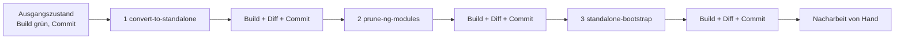

# Lab 2.3: Bestandsprojekt migrieren

**Leitfragen:**

<details>
<summary>Was muss vor einer Migration feststehen, damit man danach weiß, dass nichts kaputt ist?</summary>

Ein reproduzierbarer Ausgangszustand (sauberer Git-Stand, Build grün) und ein Prüfmittel: Tests, ein E2E-Durchlauf oder mindestens eine Checkliste der wichtigsten Seiten. Ohne Vergleich ist „läuft noch“ nur ein Gefühl.

</details>

<details>
<summary>Migriert man eine große App in einem Rutsch oder schrittweise?</summary>

Schrittweise: je Schritt ein Commit mit grünem Build, bei großen Apps zusätzlich Ordner für Ordner (Feature für Feature). Standalone und NgModule arbeiten zusammen (Lab 2.1), deshalb bleibt die App zwischendurch lauffähig.

</details>

<details>
<summary>Welche Teile eines Projekts lassen sich nicht automatisch umbauen?</summary>

Alles, was ein Werkzeug nicht sicher deuten kann: Routing-Module mit eigener Logik, `forRoot()`-Konfigurationen, Module mit Providern, dynamisch erzeugte Komponenten, Tests mit `TestBed`-Modulen und Bibliotheken, die nur NgModules anbieten.

</details>

- Angular liefert ein Migrations-Schematic: `ng generate @angular/core:standalone`, ausgeführt in drei Modi nacheinander.
- Nach jedem Modus: bauen, Diff prüfen, committen.
- Das Ergebnis läuft, ist aber nicht fertig: Routing-Module und `importProvidersFrom(...)` bleiben Handarbeit.

## Begriffe

| Begriff | Bedeutung |
| --- | --- |
| Schematic | Programm der Angular CLI, das Dateien erzeugt oder umschreibt; aufgerufen mit `ng generate <paket>:<name>` |
| Migration | Schematic, das bestehenden Code auf eine neue Schreibweise umstellt |
| `importProvidersFrom(...)` | Brücke: holt die Provider aus NgModules in eine `ApplicationConfig` |
| Diff | Gegenüberstellung alter und neuer Zeilen, z. B. `git diff` |

## Der Workspace `legacy-ngmodule`

`project/workspaces/legacy-ngmodule/` ist eine kleine EventHub-App im Stil Angular 15, technisch auf Angular 22:

```text
src/
├── main.ts                         platformBrowser().bootstrapModule(AppModule)
└── app/
    ├── app.module.ts               AppModule: BrowserModule, HttpClientModule, AppRoutingModule, SharedModule
    ├── app-routing.module.ts       RouterModule.forRoot, 'sessions' lazy per loadChildren -> SessionsModule
    ├── app.component.ts            standalone: false, Header mit routerLink
    ├── about.component.ts          nutzt <app-level-badge>
    ├── shared/
    │   ├── shared.module.ts        LevelBadgeComponent, DurationPipe, exportiert CommonModule
    │   ├── level-badge.component.ts
    │   └── duration.pipe.ts
    └── sessions/
        ├── sessions.module.ts      Feature-Modul: SessionListComponent, SessionDetailComponent
        ├── sessions-routing.module.ts   RouterModule.forChild: '' und ':id'
        ├── session-list.component.ts    *ngIf, *ngFor, async-Pipe
        ├── session-detail.component.ts  ActivatedRoute, Konstruktor-Injection
        └── session.service.ts      HttpClient, URL fest im Code
```

Der Workspace nutzt zone.js (`provideZoneChangeDetection` im `AppModule`, `zone.js` in `angular.json` → `polyfills`), wie es Bestandsprojekte tun. Die Migration auf Standalone ändert daran nichts.

## Das Schematic in drei Schritten

```bash
npx ng generate @angular/core:standalone
```

Ohne Optionen fragt die CLI zuerst nach dem Modus, dann nach dem Pfad:

```text
? Choose the type of migration: (Use arrow keys)
❯ Convert all components, directives and pipes to standalone
  Remove unnecessary NgModule classes
  Bootstrap the application using standalone APIs
? Which path in your project should be migrated? ./
```

Ohne Rückfragen: `npx ng generate @angular/core:standalone --mode=<modus> --path=./`.

| Schritt | `--mode` | Was passiert |
| --- | --- | --- |
| 1 | `convert-to-standalone` | entfernt `standalone: false`, trägt in jede Komponente die `imports` ein, die ihr Template braucht (`NgIf`, `AsyncPipe`, `RouterLink`, eigene Komponenten); verschiebt Einträge aus `declarations` in die `imports` der Module |
| 2 | `prune-ng-modules` | löscht Module, die nur noch importieren und exportieren, und entfernt ihre Verwendungen |
| 3 | `standalone-bootstrap` | ersetzt `bootstrapModule(AppModule)` durch `bootstrapApplication(AppComponent, …)`, löscht `AppModule` |



Mit `--path=src/app/sessions` lässt sich Schritt 1 auf einen Ordner begrenzen: so migrieren große Apps Feature für Feature.

## Was danach von Hand bleibt

Typisches Ergebnis von Schritt 3 in einer App mit `AppModule` und `AppRoutingModule` (gekürzt; Beispiel: Shop-App mit Feature `orders`):

```ts
bootstrapApplication(AppComponent, {
  providers: [
    importProvidersFrom(BrowserModule, HttpClientModule, AppRoutingModule),
    provideBrowserGlobalErrorListeners(),
    provideZoneChangeDetection({ eventCoalescing: true }),
  ],
}).catch((err) => console.error(err));
```

| Rest | Warum nicht automatisch | Ziel |
| --- | --- | --- |
| `importProvidersFrom(BrowserModule, HttpClientModule, AppRoutingModule)` | das Schematic übernimmt Modul-Imports 1:1 | `provideRouter(routes)`, `provideHttpClient()`; `BrowserModule` entfällt |
| `app-routing.module.ts` | Routing-Module können Logik enthalten | `app.routes.ts` mit `Routes`-Array |
| Feature-Modul mit Routing, z. B. `orders.module.ts` + `orders-routing.module.ts` | Modul mit `RouterModule.forChild` ist nicht leer | `orders.routes.ts`, `loadChildren: () => import('./orders/orders.routes')` |
| Providers in `main.ts` | Schematic kennt keine Dateikonvention | `app.config.ts` |
| ungenutzter Import `platformBrowser`, alter Kommentar in `main.ts` | Schematic räumt TypeScript-Imports nicht auf | von Hand oder im Editor „Organize Imports“ |

## Weitere Migrationen

Alle Schematics stehen in `node_modules/@angular/core/schematics/collection.json` (geprüft in Angular 22.2, Stand: 28.10.2026):

| Befehl | Wirkung | Im Kurs |
| --- | --- | --- |
| `ng generate @angular/core:control-flow` | `*ngIf`/`*ngFor`/`ngSwitch` → `@if`/`@for`/`@switch` | Lab 3.1 |
| `ng generate @angular/core:inject` | Konstruktor-Injection → `inject()` | Lab 1.2 (Schreibweise) |
| `ng generate @angular/core:signal-input-migration` | `@Input` → `input()` | Lab 6.3 |
| `ng generate @angular/core:output-migration` | `@Output` → `output()` | Lab 6.3 |
| `ng generate @angular/core:route-lazy-loading` | Komponenten in Routen auf `loadComponent` umstellen | Modul 8 |
| `ng generate @angular/core:common-to-standalone` | `CommonModule` durch einzelne Imports ersetzen | – |
| `ng generate @angular/core:cleanup-unused-imports` | ungenutzte Einträge in `imports` entfernen | – |

## Strategie für große Apps

- Vorher: Build grün, Tests grün, Angular-Version aktuell (`ng update`), sauberer Git-Stand.
- Schritt 1 ordnerweise (`--path`), beginnend bei Blättern (Shared-Bausteine), dann Features.
- Jeder Schritt ein eigener Commit oder Pull Request, damit Reviews lesbar bleiben.
- Nach Schritt 3 die Nacharbeit (Routen-Dateien, `app.config.ts`) als eigener Schritt.
- Weitere Migrationen (Control Flow, `inject`, Signal-Inputs) getrennt, nicht im selben Commit.

## Typische Fehler

| Symptom | Ursache | Lösung |
| --- | --- | --- |
| `This command is not available when running the Angular CLI outside a workspace` | Befehl außerhalb des Workspace-Ordners | in `workspaces/legacy-ngmodule/` wechseln |
| `npx ng` lädt eine andere CLI-Version oder findet `@angular/core` nicht | `npm install` im Workspace fehlt | `npm install` im Workspace |
| `Port 4200 is already in use` | Kurs-App läuft | `npm start -- --port 4300` |
| Liste bleibt leer | Mock-API läuft nicht | `npm run api` im Ordner `project/` |
| Diff unlesbar, viele Formatänderungen | Schematic formatiert mit Prettier um | Ausgangszustand vorher mit `npx prettier --write src` formatieren (im Workspace bereits geschehen) |

## Fazit

- `ng generate @angular/core:standalone` migriert in drei Modi: umwandeln, Module entfernen, Start umstellen.
- Nach jedem Modus bauen, Diff lesen, committen; große Apps zusätzlich ordnerweise mit `--path`.
- Routing-Module und `importProvidersFrom(...)` bleiben Handarbeit: Ziel sind `app.routes.ts`, Routen-Dateien und `app.config.ts`.

Die Übung migriert `workspaces/legacy-ngmodule` Schritt für Schritt und hält die Nacharbeiten in einer Migrationsnotiz fest.
