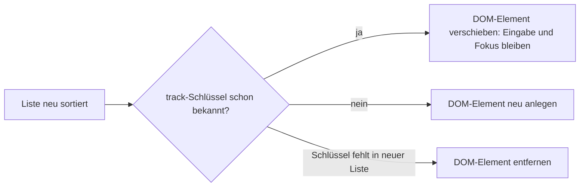

# Lab 3.1: Control Flow Syntax

**Leitfragen:**

<details>
<summary>Was passiert mit dem Fokus in einem Eingabefeld, wenn eine Liste neu sortiert wird?</summary>

Das hängt davon ab, ob Angular die DOM-Elemente verschiebt oder neu befüllt. Verschiebt es sie, bleiben Fokus und Eingabe beim richtigen Eintrag; befüllt es sie neu, steht der getippte Text plötzlich bei einer anderen Session.

</details>

<details>
<summary>Woran erkennt Angular, dass ein Listeneintrag derselbe ist wie vorher?</summary>

Am Tracking-Schlüssel: bei `@for` am Pflichtausdruck `track` (z. B. `track session.id`), bei `*ngFor` an der Objektidentität oder an einer `trackBy`-Funktion.

</details>

<details>
<summary>Was nervt an <code>*ngIf</code> mit <code>else</code>-Template?</summary>

Der `else`-Fall steht als `<ng-template #name>` weit weg vom `if`, braucht einen Namen und einen Import. `@if { } @else { }` steht zusammen wie in TypeScript.

</details>

- Seit Angular 17 gibt es Control Flow direkt in der Template-Syntax: `@if`, `@for`, `@switch`, seit v18.1 zusätzlich `@let`. Stabil seit v18 (`@let` seit v19).
- `*ngIf`, `*ngFor` und `ngSwitch` sind seit Angular 20 als veraltet markiert (`@deprecated 20.0` in `@angular/common` 22.2) und funktionieren noch.

## Begriffe

| Begriff | Bedeutung |
| --- | --- |
| Control Flow Block | Template-Anweisung mit `@`, z. B. `@if (…) { … }`; vom Compiler übersetzt, kein Import nötig |
| Strukturelle Direktive | alte Form mit `*`, z. B. `*ngIf`; eine Klasse aus `@angular/common`, die importiert werden muss |
| `track` | Ausdruck, der einen Listeneintrag eindeutig kennzeichnet, ähnlich einem Primärschlüssel in einer Tabelle |
| `@empty` | Zweig von `@for`, der erscheint, wenn die Liste leer ist |
| `@let` | lokale, schreibgeschützte Template-Variable, z. B. für ein Pipe-Ergebnis |

## Vorher und nachher

Beispiel: eine Speaker-Liste, die höchstens `limit` Einträge zeigt. Alter Stil:

```html
<ng-container *ngIf="speakers$ | async as speakers; else loading">
  <p class="muted">{{ speakers.slice(0, limit).length }} von {{ speakers.length }} Speakern</p>
  <div class="card" *ngFor="let speaker of speakers.slice(0, limit)">
    <strong>{{ speaker.name }}</strong>
    <ng-container [ngSwitch]="speaker.company">
      <span *ngSwitchCase="'Nordlicht Software'" class="badge badge-ok">Gastgeber</span>
      <span *ngSwitchDefault class="badge">{{ speaker.company }}</span>
    </ng-container>
  </div>
  <p *ngIf="speakers.length === 0" class="muted">Noch keine Speaker angekündigt.</p>
</ng-container>
<ng-template #loading><p class="loading">Lade Speaker …</p></ng-template>
```

Dasselbe mit Control Flow:

```html
@if (speakers$ | async; as speakers) {
  @let shown = speakers.slice(0, limit);                       <!-- einmal rechnen, benennen -->
  <p class="muted">{{ shown.length }} von {{ speakers.length }} Speakern</p>

  @for (speaker of shown; track speaker.id) {                   <!-- track ist Pflicht -->
    <div class="card">
      <strong>{{ speaker.name }}</strong>
      @switch (speaker.company) {
        @case ('Nordlicht Software') { <span class="badge badge-ok">Gastgeber</span> }
        @default { <span class="badge">{{ speaker.company }}</span> }
      }
    </div>
  } @empty {
    <p class="muted">Noch keine Speaker angekündigt.</p>
  }
} @else {
  <p class="loading">Lade Speaker …</p>
}
```

In `imports` der Komponente entfallen `NgIf`, `NgFor`, `NgSwitch`, `NgSwitchCase`, `NgSwitchDefault`; Pipes wie `AsyncPipe` bleiben.

## Syntax im Überblick

| Block | Beispiel | Hinweis |
| --- | --- | --- |
| `@if` / `@else if` / `@else` | `@if (a) { … } @else if (b) { … } @else { … }` | `as` speichert das Ergebnis: `@if (x$ \| async; as x)` |
| `@for` | `@for (s of list; track s.id) { … }` | `track` ist Pflicht, sonst Compilerfehler |
| `@empty` | `@for (…) { … } @empty { … }` | ersetzt das separate „Liste leer?“-`@if` |
| Kontextvariablen | `@for (s of list; track s.id; let i = $index, last = $last)` | außerdem `$count`, `$first`, `$even`, `$odd` |
| `@switch` / `@case` / `@default` | `@switch (s.level) { @case ('Experte') { … } }` | vergleicht mit `===`, kein Durchfallen |
| `@let` | `@let total = items.length;` | gilt im aktuellen Block und darunter, nur lesbar |

## Warum `track` zählt

Angular vergleicht nach jeder Änderung die alte und die neue Liste. Mit `track session.id` erkennt es dieselbe Session auch dann, wenn sie an anderer Stelle steht, und verschiebt ihr DOM-Element samt Eingabe und Fokus.



| `track`-Ausdruck | Wirkung beim Sortieren | Einsatz |
| --- | --- | --- |
| `track session.id` | Elemente wandern mit ihrer Session | Standard für Daten mit ID |
| `track session` | wie `id`, solange dieselben Objekte kommen; bei neu geladenen Objekten wird alles neu angelegt | Listen ohne ID, unveränderte Objekte |
| `track $index` | Element bleibt an seiner Position, nur die Bindungen ändern sich; die Notiz bleibt bei Platz 1 statt bei der Session | statische Listen ohne Umordnung |

## Migration mit dem Schematic

```bash
npx ng generate @angular/core:control-flow --path src/app/playground
```

Die Migration fragt nach dem Pfad und ob Templates neu formatiert werden sollen. Getestet mit Angular 22.2 am Starter dieses Labs (Stand: 28.10.2026):

- `NgIf`, `NgFor`, `NgSwitch…` werden aus `imports` entfernt, die Templates auf `@if`, `@for`, `@switch` umgestellt.
- Ohne `trackBy` erzeugt sie `track session` (Objektidentität); `track session.id` muss von Hand ergänzt werden.
- Ein `*ngIf … ; else empty` um die Liste bleibt ein `@if … @else`; `@empty` und `@let` setzt sie nicht ein.

Das Ergebnis immer prüfen und bauen (`npx ng build`), bevor es eingecheckt wird.

## Typische Fehler

| Symptom | Ursache | Lösung |
| --- | --- | --- |
| `@for loop must have a "track" expression` | `track` fehlt | `track item.id` ergänzen |
| Notiz steht nach dem Sortieren bei der falschen Session | `track $index` bei umsortierbarer Liste | `track session.id` |
| Konsole: Warnung NG0956 („track by identity caused re-creation …“) | `track` auf Objektidentität, Objekte werden bei jedem Laden neu erzeugt | auf eine stabile ID tracken |
| Konsole: Warnung NG0955 (doppelte Schlüssel) | zwei Einträge mit gleichem `track`-Wert | eindeutige ID wählen |
| `Cannot read properties of null` im `@if` | `async` liefert zuerst `null` | `@if (x$ \| async; as x)` statt direktem Zugriff |
| `@let` meldet „Cannot assign“ | `@let`-Variablen sind schreibgeschützt | Wert in der Klasse ändern |
| Schematic ändert nichts | falscher `--path` | Pfad relativ zum Projektordner angeben |

## Fazit

- `@if`, `@for`, `@switch` und `@let` brauchen keinen Import und stehen lesbar zusammen.
- `track` mit einer stabilen ID hält DOM, Eingaben und Fokus beim richtigen Eintrag.
- `@empty` ersetzt die extra Prüfung auf leere Listen; das Schematic erledigt den Großteil, `track` und `@empty` sind Handarbeit.

Die Übung stellt die Session-Liste des Starters auf Control Flow um und macht den Unterschied von `track` sichtbar.
