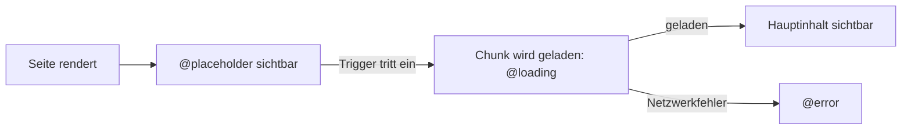

# Lab 3.2: Deferred Loading

**Leitfragen:**

<details>
<summary>Welche Teile einer Detailseite sieht jemand nie, der nicht scrollt?</summary>

Alles unterhalb des ersten Bildschirms: auf der Session-Seite Speaker-Profil und Kommentare. Viele Besucher lesen nur Titel, Zeit und Abstract.

</details>

<details>
<summary>Warum lädt eine App Code für Dinge, die gerade niemand braucht?</summary>

Weil jede Komponente, die im Template steht, statisch importiert und damit in denselben JavaScript-Chunk gebündelt wird. `@defer` löst genau diese Kopplung für einen Template-Bereich.

</details>

<details>
<summary>Was sieht die Person, während ein Bereich noch lädt?</summary>

Das, was das Template dafür vorsieht: vor dem Auslösen den `@placeholder`, während des Nachladens den `@loading`-Block, bei einem Netzwerkfehler den `@error`-Block. Ohne diese Blöcke bleibt die Stelle leer.

</details>

- `@defer` lädt einen Template-Bereich samt seinen Komponenten erst, wenn ein Trigger eintritt; der Code liegt in einem eigenen Lazy Chunk.
- Stabil seit Angular 18. Route-basiertes Lazy Loading (`loadComponent`) lädt ganze Seiten; `@defer` lädt Teile einer Seite (Routen vertieft in Modul 8).

## Begriffe

| Begriff | Bedeutung |
| --- | --- |
| Chunk | eine JavaScript-Datei der gebauten App; der Browser lädt sie bei Bedarf nach |
| Lazy Chunk | Chunk, der nicht beim Start, sondern erst später geladen wird |
| Trigger | Bedingung, die das Nachladen auslöst, z. B. „Bereich sichtbar“ |
| Prefetch | Code schon vorher im Hintergrund laden, aber erst beim Trigger anzeigen |

## Aufbau eines `@defer`-Blocks

Beispiel: Auf der Detailseite lädt die Liste ähnlicher Sessions erst, wenn sie ins Bild scrollt.

```html
@defer (on viewport) {
  <app-related-sessions [track]="session.track" />       <!-- wandert in einen eigenen Chunk -->
} @placeholder {
  <p class="muted">Ähnliche Sessions erscheinen beim Scrollen.</p>
} @loading (after 150ms; minimum 400ms) {
  <p class="loading">Suche ähnliche Sessions …</p>         <!-- erst nach 150 ms, dann mind. 400 ms -->
} @error {
  <p class="error">Ähnliche Sessions nicht verfügbar.</p>
}
```



| Block | Pflicht | Inhalt | Optionen |
| --- | --- | --- | --- |
| `@defer` | ja | Hauptinhalt, wird nachgeladen | Trigger, `prefetch` |
| `@placeholder` | nein (bei `on viewport`/`on interaction`/`on hover` nötig als Auslöser) | sichtbar bis zum Trigger | `minimum 500ms` |
| `@loading` | nein | sichtbar während des Ladens | `after 100ms; minimum 500ms` |
| `@error` | nein | sichtbar, wenn das Laden scheitert | – |

## Trigger

| Trigger | Lädt, wenn … | Typischer Einsatz |
| --- | --- | --- |
| `on idle` | der Browser nichts zu tun hat (Default ohne Angabe) | alles Nachrangige |
| `on viewport` | der Placeholder in den sichtbaren Bereich kommt | Inhalte unterhalb des ersten Bildschirms |
| `on interaction` | auf den Placeholder geklickt oder getippt wird | Kommentare, Chat, Editor |
| `on hover` | die Maus über den Placeholder fährt | Vorschauen |
| `on timer(2s)` | nach der angegebenen Zeit | Banner, Hinweise |
| `on immediate` | sofort nach dem Rendern, aber in eigenem Chunk | großer Code, der den Start nicht blockieren soll |
| `when showComments` | der Ausdruck `true` wird (einmalig) | eigene Bedingung, z. B. ein Feld nach Klick |

Prefetch kombiniert zwei Trigger: `@defer (on interaction; prefetch on hover)` lädt den Code bei Hover vor und zeigt ihn beim Klick sofort an.

Die Trigger `on viewport`, `on interaction` und `on hover` beobachten den `@placeholder`; er braucht dafür genau ein Wurzelelement.

## Was in den Chunk wandert

Der Compiler lagert eine Abhängigkeit nur aus, wenn alle drei Bedingungen gelten:

| Bedingung | Im Lab |
| --- | --- |
| Die Komponente, Direktive oder Pipe ist standalone. | `SpeakerBio`, `SessionComments` |
| Sie wird im Template nur innerhalb von `@defer` verwendet. | nicht zusätzlich außerhalb des Blocks |
| Sie steht in einer eigenen Datei und wird in derselben Datei nicht anders referenziert (z. B. `@ViewChild`). | `speaker-bio.ts`, `session-comments.ts` |

Der `import` am Dateianfang bleibt stehen; der Compiler ersetzt ihn durch ein dynamisches `import()`. Steht die Komponente in derselben Datei wie die Seite, entsteht kein eigener Chunk.

## Nachweis im Build und im Browser

```bash
npx ng build --verbose
```

Ausschnitt der Ausgabe (Angular 22.2, Stand: 28.10.2026), Hashes und Größen variieren:

```text
Lazy chunk files             | Names               |  Raw size | Estimated transfer size
chunk-6LqOH6yR.js            | session-comments    |   1.38 kB |               758 bytes
chunk-BuFjHlZz.js            | speaker-bio         | 742 bytes |               742 bytes
```

- Die Spalte `Names` nennt die Quelldatei; ohne `--verbose` kürzt die CLI lange Listen („…and 39 more lazy chunks files“).
- Im Browser: DevTools → Network, Filter `JS`, Seite neu laden. Beim Scrollen zum Speaker-Bereich erscheint ein weiterer `chunk-….js`. Mit Drosselung „Slow 4G“ wird der `@loading`-Block sichtbar.
- Der Dev-Server mit Hot Module Replacement (HMR, Default bei `ng serve`) bündelt `@defer`-Abhängigkeiten sofort mit, damit Änderungen ohne Neuladen greifen. Für den Nachweis im Network-Tab daher `npx ng serve --no-hmr` starten (geprüft im Compiler-Code von Angular 22.2, Stand: 28.10.2026).

## Typische Fehler

| Symptom | Ursache | Lösung |
| --- | --- | --- |
| Kein eigener Chunk im Build | Komponente auch außerhalb von `@defer` verwendet oder in derselben Datei definiert | nur im Block verwenden, eigene Datei |
| Fehlermeldung zum Trigger-Element, Inhalt erscheint nicht | `on viewport`/`on interaction` ohne `@placeholder` oder Placeholder mit mehreren Wurzelelementen | genau ein Element im `@placeholder` |
| Im Dev-Server kein Chunk im Network-Tab sichtbar | HMR aktiv (`npm start`) oder Chunk schon geladen (Prefetch, früheres Scrollen) | `npx ng serve --no-hmr`, Seite neu laden, Cache deaktivieren |
| Ladezustand flackert kurz auf | `@loading` ohne `after`/`minimum` | `@loading (after 100ms; minimum 500ms)` |
| `when`-Bedingung fällt wieder auf `false`, Inhalt bleibt | `when` löst nur einmal aus | gewollt; zum Verstecken ein `@if` um den Block |

## Fazit

- `@defer` verschiebt Code und Rendern eines Template-Bereichs auf einen Trigger; der Bereich bekommt einen eigenen Chunk.
- `@placeholder`, `@loading` und `@error` bestimmen, was bis dahin sichtbar ist.
- Nur standalone Bausteine aus eigener Datei, die ausschließlich im Block stehen, werden ausgelagert; `ng build --verbose` zeigt das Ergebnis.

Die Übung lädt Speaker-Profil und Kommentare der Session-Detailseite verzögert und weist beide Chunks im Build nach.
