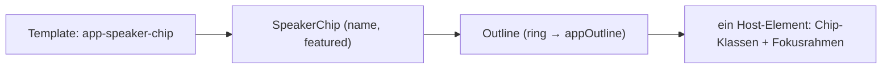

# Lab 3.3: Standalone Directives und Host Directives

**Leitfragen:**

<details>
<summary>Wie teilt man Verhalten (z. B. Tooltip) zwischen zehn Komponenten, ohne Code zu kopieren?</summary>

Man packt das Verhalten in eine Attribut-Direktive und hängt sie an die Elemente, die es brauchen. Soll eine Komponente das Verhalten immer haben, setzt sie die Direktive selbst über `hostDirectives` ein.

</details>

<details>
<summary>Warum ist Vererbung zwischen Komponenten oft eine schlechte Idee?</summary>

Eine Klasse kann nur von einer Basisklasse erben; Tooltip *und* Hover lassen sich so nicht frei kombinieren. Außerdem erbt die Kindklasse alle Felder und Abhängigkeiten der Basis, auch ungewollte. Komposition setzt nur die gewünschten Bausteine zusammen.

</details>

<details>
<summary>Wann braucht ein wiederverwendbarer Baustein ein eigenes Template?</summary>

Wenn er eigenes Markup erzeugt (Text, Buttons, Struktur): dann Komponente. Ändert er nur Verhalten oder Aussehen eines vorhandenen Elements (Farbe, Events, Attribute): dann Direktive.

</details>

- Eine Attribut-Direktive ist eine Klasse ohne Template, die an ein vorhandenes Element andockt und dessen Verhalten oder Aussehen ändert.
- Seit Angular 15 lassen sich standalone Direktiven per `hostDirectives` in Komponenten und andere Direktiven einbauen.

## Begriffe

| Begriff | Bedeutung |
| --- | --- |
| Host-Element | das Element, auf dem eine Direktive oder Komponente sitzt, z. B. `<app-session-badge>` |
| `host`-Metadaten | Objekt im Decorator, das Klassen, Styles, Attribute und Events des Host-Elements bindet |
| Host Directive | Direktive, die eine Komponente über `hostDirectives` fest auf ihr eigenes Host-Element setzt |
| `Renderer2` | Angular-Dienst für DOM-Änderungen (Element anlegen, Style setzen), statt direktem `document`-Zugriff |
| `ElementRef` | Verweis auf das DOM-Element des Hosts (`nativeElement`) |

Die Beispiele zeigen drei kleine Bausteine: einen Fokusrahmen `Outline`, einen Zeichenzähler `CharCount` und einen `SpeakerChip`, der `Outline` fest einbaut. Die Übung baut nach denselben Mustern Hover-Farbe, Tooltip und Session-Badge.

## Direktive mit `host`-Metadaten

```ts
@Directive({
  selector: '[appOutline]',                                     // passt auf das Attribut appOutline
  host: {
    '(focusin)': 'focused = true',                              // Event-Listener
    '(focusout)': 'focused = false',
    '[style.outline]': 'focused ? "2px solid " + (color || defaultColor) : null', // Property-Binding
  },
})
export class Outline {
  @Input('appOutline') color = '';     // <div appOutline="#2f6fed">; Eingabename = Selektor
  readonly defaultColor = '#7a5cff';
  focused = false;
}
```

Verwendung: Direktive in `imports` der Komponente aufnehmen, dann `<form appOutline>` oder `<fieldset appOutline="#2f6fed">`. Der Rahmen erscheint, solange ein Feld darin den Fokus hat.

Das Feld `focused` ändert sich nur durch Host-Events; Angular prüft die Ansicht danach neu, auch ohne Zone.js.

| Schlüssel in `host` | Bedeutung | Früher als Decorator |
| --- | --- | --- |
| `'(click)': 'onClick($event)'` | Event am Host abonnieren | `@HostListener('click', ['$event'])` |
| `'(document:keydown.escape)': 'close()'` | globales Event | `@HostListener('document:keydown.escape')` |
| `'[class.active]': 'active'` | Klasse umschalten | `@HostBinding('class.active')` |
| `'[style.backgroundColor]': 'color'` | Style setzen | `@HostBinding('style.backgroundColor')` |
| `'[attr.aria-label]': 'label'` | Attribut setzen | `@HostBinding('attr.aria-label')` |
| `class: 'badge'` | statische Klasse | – |

Die Angular-Dokumentation empfiehlt `host` statt `@HostBinding`/`@HostListener`; beide Decorators funktionieren weiter. Vorteil: alle Host-Bindungen stehen an einer Stelle.

## Direktive mit DOM-Arbeit: Zeichenzähler

Ein `<input [appCharCount]="80">` zeigt beim Tippen dahinter „12 / 80“; bei leerem Feld verschwindet die Anzeige.

```ts
@Directive({
  selector: 'input[appCharCount]',
  host: { '(input)': 'update()' },
})
export class CharCount {
  @Input('appCharCount') max = 100;
  private readonly host = inject<ElementRef<HTMLInputElement>>(ElementRef);
  private readonly renderer = inject(Renderer2);
  private counter: HTMLElement | null = null;

  update(): void {
    const length = this.host.nativeElement.value.length;
    if (length === 0) {
      this.remove();
      return;
    }
    if (!this.counter) {
      this.counter = this.renderer.createElement('small');
      this.renderer.appendChild(this.renderer.parentNode(this.host.nativeElement), this.counter);
    }
    this.renderer.setProperty(this.counter, 'textContent', `${length} / ${this.max}`);
  }

  private remove(): void {
    if (!this.counter) return;
    this.renderer.removeChild(this.renderer.parentNode(this.host.nativeElement), this.counter);
    this.counter = null;
  }
}
```

- `ElementRef.nativeElement` liefert das DOM-Element des Hosts; `Renderer2` legt Elemente an, hängt sie ein und entfernt sie wieder.
- Das Feld `counter` merkt sich das erzeugte Element, damit es nur einmal entsteht und später entfernt werden kann.

## Komposition mit `hostDirectives`

```ts
@Component({
  selector: 'app-speaker-chip',
  hostDirectives: [
    { directive: Outline, inputs: ['appOutline: ring'] },      // Eingabe appOutline heißt am Chip "ring"
  ],
  host: {
    class: 'badge',
    tabindex: '0',                                               // fokussierbar, damit focusin auslöst
    '[class.badge-ok]': 'featured',
  },
  template: `{{ name }}`,
})
export class SpeakerChip {
  @Input() name = '';
  @Input() featured = false;
}
```

```html
<app-speaker-chip [name]="speaker.name" [featured]="speaker.id === 1" ring="#2f6fed" />
```



`hostDirectives` nimmt beliebig viele Direktiven auf; jede bekommt einen eigenen Eintrag mit ihren freigegebenen Eingaben.

| Regel | Wirkung |
| --- | --- |
| Host Directives müssen standalone sein. | Direktiven aus einem NgModule sind nicht erlaubt. |
| Eingaben und Ausgaben sind standardmäßig nicht sichtbar. | `inputs: ['name']` bzw. `outputs: ['name']` gibt sie frei. |
| `'original: alias'` benennt um. | Der Originalname bezieht sich auf den öffentlichen Namen der Eingabe (hier `appOutline`). |
| Der Selektor der Host Directive spielt keine Rolle. | Sie wird immer angewendet, nicht nur bei passendem Attribut. |
| Die Komponente braucht die Direktiven nicht in `imports`. | `imports` gilt nur für das eigene Template. |

## Direktive oder Komponente?

| Frage | Direktive | Komponente |
| --- | --- | --- |
| Eigenes Markup nötig? | nein | ja |
| An beliebige Elemente hängbar (`<h1>`, `<div>`, `<button>`)? | ja | nein, eigenes Element |
| Beispiele | Fokusrahmen, Zeichenzähler, Hover, Tooltip, Berechtigungsprüfung | Badge, Chip, Karte, Dialog |
| Verhalten fest einbauen | – | `hostDirectives` |

## Typische Fehler

| Symptom | Ursache | Lösung |
| --- | --- | --- |
| Attribut wirkt nicht, keine Fehlermeldung | Direktive fehlt in `imports` | Direktive in `imports` der verwendenden Komponente |
| `Can't bind to 'tooltip' since it isn't a known property of 'app-session-badge'` | Eingabe der Host Directive nicht freigegeben | `inputs: ['appTooltip: tooltip']` |
| Badge nutzt Standardfarbe, kein Fehler | `color="…"` ohne Klammern ist ohne Freigabe nur ein HTML-Attribut | `inputs: ['appHighlight: color']` |
| `… does not have an input with a public name of "color"` | Klassenfeldname statt öffentlichem Eingabenamen angegeben | öffentlichen Namen nutzen (`appHighlight`, nicht `color`) |
| NG0309 `Directive Highlight matches multiple times on the same element` | Direktive zusätzlich als Attribut auf dem Badge | Attribut entfernen, `hostDirectives` reicht |
| Tooltip springt an falsche Stelle | Host ohne `position: relative` | `'[style.position]': '"relative"'` |

## Fazit

- Attribut-Direktiven kapseln Verhalten ohne Template; `host` bündelt Events, Klassen, Styles und Attribute.
- `hostDirectives` setzt Direktiven fest in eine Komponente ein; Eingaben werden gezielt freigegeben und umbenannt.
- Komposition ersetzt Vererbung: Hover und Tooltip lassen sich frei kombinieren und an jedem Element nutzen.

Die Übung baut `appHighlight` und `appTooltip` und setzt beide zur `SessionBadge` zusammen.
