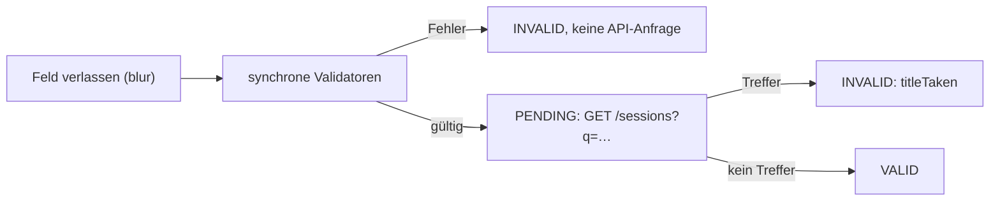

# Lab 4.2: Eigene Validatoren: synchron, asynchron, feldübergreifend

**Leitfragen:**

<details>
<summary>Welche Regeln kann nur der Server prüfen?</summary>

Alles, was Daten außerhalb des Formulars braucht: Ist die E-Mail schon angemeldet, ist der Benutzername frei, gibt es noch Plätze? Das Frontend fragt dafür die API; die endgültige Prüfung beim Speichern bleibt trotzdem Aufgabe des Servers.

</details>

<details>
<summary>Wann soll eine Fehlermeldung erscheinen: beim Tippen, beim Verlassen, beim Absenden?</summary>

Nicht vor der ersten Eingabe: Ein leeres Formular voller roter Meldungen schreckt ab. Üblich ist „nach dem Verlassen des Felds“ (`touched`) und spätestens beim Absenden für alle Felder (`markAllAsTouched()`).

</details>

<details>
<summary>Wo gehört eine Regel hin, die zwei Felder vergleicht?</summary>

Auf das gemeinsame Elternobjekt, also die `FormGroup`. Nur dort sieht der Validator beide Werte und läuft erneut, wenn sich eines der Felder ändert.

</details>

- Ein Validator ist eine Funktion: Sie bekommt ein Control und gibt `null` (gültig) oder ein Fehlerobjekt zurück.
- Drei Arten im Lab: synchron auf einem Feld, synchron auf der Gruppe, asynchron gegen die Mock-API.

## Begriffe

| Begriff | Bedeutung |
| --- | --- |
| `ValidatorFn` | `(control: AbstractControl) => ValidationErrors \| null` |
| `AsyncValidatorFn` | wie `ValidatorFn`, liefert das Ergebnis aber als Observable oder Promise |
| `ValidationErrors` | Objekt mit Fehlerschlüsseln, z. B. `{ forbiddenWord: { word: 'test' } }` |
| `AbstractControl` | gemeinsame Basisklasse von `FormControl`, `FormGroup`, `FormArray` |
| `touched` / `dirty` | Feld wurde verlassen / Wert wurde durch Eingabe geändert |
| `PENDING` | Status, solange ein asynchroner Validator läuft |

Die Beispiele zeigen ein Formular „Session vorschlagen“ (Titel, Format, Dauer). Die Übung wendet dieselben Muster auf das Anmeldeformular an.

## Synchroner Feld-Validator

```ts
export function noForbiddenWords(words: string[] = ['test', 'todo']): ValidatorFn {
  return (control: AbstractControl): ValidationErrors | null => {
    const value = String(control.value ?? '').trim().toLowerCase();
    if (!value) return null;                                    // leer: Sache von required
    const word = words.find((w) => value.split(/\s+/).includes(w));
    return word ? { forbiddenWord: { word } } : null;
  };
}
```

- Fabrikfunktion: `noForbiddenWords()` liefert den Validator; die Wortliste bleibt austauschbar.
- Ein Validator prüft genau eine Regel und lässt leere Werte durch; `Validators.required` kümmert sich um „leer“.
- Der Fehlerschlüssel (`forbiddenWord`) ist die Verbindung zur Fehlermeldung im Template; das Objekt dahinter (`{ word }`) liefert Details für den Text.

## Feldübergreifender Validator auf der Gruppe

```ts
export const workshopNeedsLongSlot: ValidatorFn = (group: AbstractControl): ValidationErrors | null => {
  const format = group.get('format')?.value as string | null;
  const durationMin = Number(group.get('durationMin')?.value ?? 0);
  if (format !== 'workshop' || !durationMin) return null;      // Regel betrifft nur Workshops
  return durationMin < 120 ? { slotTooShort: { min: 120, actual: durationMin } } : null;
};
```

```ts
readonly proposal = this.fb.group(
  { title: [...], format: ['talk'], durationMin: [45] },
  { validators: [workshopNeedsLongSlot] },               // zweites Argument: Optionen der Gruppe
);
```

- `group.get('format')` liefert ein `AbstractControl`; der Validator kennt den genauen Formulartyp nicht und castet deshalb den Wert.
- Der Fehler hängt an der Gruppe: `proposal.errors?.['slotTooShort']`, nicht an einem einzelnen Feld.
- Die Gruppe prüft erneut, sobald sich eines ihrer Felder ändert.

## Asynchroner Validator gegen die API

```ts
export function titleNotTaken(http: HttpClient): AsyncValidatorFn {
  return (control: AbstractControl) => {
    const title = String(control.value).trim().toLowerCase();
    return http
      .get<Session[]>(`${API_URL}/sessions`, { params: { q: title } })
      .pipe(map((found) => (found.some((s) => s.title.toLowerCase() === title) ? { titleTaken: true } : null)));
  };
}
```

```ts
title: this.fb.control('', {
  validators: [Validators.required, noForbiddenWords()],
  asyncValidators: [titleNotTaken(this.http)],
  updateOn: 'blur',           // Wert und Prüfung erst beim Verlassen: eine Anfrage statt einer pro Taste
}),
```



- Asynchrone Validatoren laufen nur, wenn alle synchronen Validatoren des Felds bestehen.
- Das Observable muss abschließen; `HttpClient` tut das nach der Antwort.
- `updateOn: 'blur'` ersetzt in diesem Lab die Entprellung (erst nach einer Tipp-Pause prüfen). Entprellung braucht RxJS-Operatoren wie `debounceTime` und `switchMap`; sie folgen in Lab 5.2.

| `updateOn` | Wert und Validierung aktualisieren bei | Einsatz |
| --- | --- | --- |
| `'change'` (Default) | jeder Eingabe | Sofort-Rückmeldung, günstige Regeln |
| `'blur'` | Verlassen des Felds | API-Prüfungen, teure Regeln |
| `'submit'` | Absenden des Formulars | sehr lange Formulare |

## Fehlermeldungen anzeigen

```html
@let title = proposal.controls.title;
@if (title.pending) {                                   <!-- Status PENDING: Async-Validator läuft -->
  <p class="loading">Prüfe, ob der Titel schon vergeben ist …</p>
}
@if (title.touched && title.errors; as errors) {
  @if (errors['required']) { <p class="error">Titel fehlt.</p> }
  @else if (errors['forbiddenWord']) { <p class="error">„{{ errors['forbiddenWord'].word }}“ ist als Titel nicht erlaubt.</p> }
  @else if (errors['titleTaken']) { <p class="error">Diesen Titel gibt es schon.</p> }
}
@if (proposal.errors?.['slotTooShort']; as slot) {
  <p class="error">Workshops brauchen mindestens {{ slot.min }} Minuten.</p>
}
```

- Die `@else if`-Kette zeigt immer nur die wichtigste Meldung eines Felds.
- `title.pending`, `title.status` und `title.hasError('titleTaken')` lassen sich direkt im Template lesen. Trifft das Ergebnis des asynchronen Validators ein, aktualisiert Angular die Ansicht ohne weiteren Klick (geprüft mit Angular 22.2).
- Alternative: `title.statusChanges` liefert jede Statusänderung als Observable, z. B. zum Protokollieren oder um im TypeScript-Code darauf zu reagieren. Für die Anzeige ist es nicht nötig.

| Bedingung | Meldung erscheint | Passt für |
| --- | --- | --- |
| `control.touched && control.errors` | nach dem ersten Verlassen | Standard |
| `control.dirty && control.errors` | sobald getippt wurde | Passwortregeln mit Live-Hinweis |
| `form.errors?.['…']` | sobald die Gruppenregel verletzt ist | Regeln über mehrere Felder |
| `markAllAsTouched()` in `submit()` | beim Absenden für alle Felder | immer ergänzen |

## Typische Fehler

| Symptom | Ursache | Lösung |
| --- | --- | --- |
| Gruppenfehler erscheint nie | Validator am Feld statt an der Gruppe oder `form.errors` nicht abgefragt | `{ validators: [...] }` als zweites Argument von `group()` |
| Status bleibt `PENDING` | Async-Validator-Observable schließt nicht ab (z. B. ein dauerhafter Stream) | Observable verwenden, das nach einem Wert abschließt, wie ein `HttpClient`-Aufruf |
| Bei jedem Tastendruck eine API-Anfrage | `updateOn` fehlt | `updateOn: 'blur'` |
| TS4111 `Property 'companyEmail' comes from an index signature` | Punktzugriff auf `errors` im TypeScript-Code (Projekt nutzt `noPropertyAccessFromIndexSignature`) | `errors['companyEmail']`, im Template einheitlich ebenso |
| Bekannte E-Mail gilt als frei | API-Prüfung läuft erst nach gültigen Sync-Regeln | gewollt; Firmen-E-Mail verwenden |

## Fazit

- Eigene Validatoren sind Funktionen, die `null` oder ein Fehlerobjekt liefern; Fabrikfunktionen machen sie konfigurierbar.
- Regeln über mehrere Felder sitzen auf der `FormGroup`, Server-Regeln als `AsyncValidatorFn` mit `updateOn: 'blur'`.
- Meldungen erscheinen nach `touched`; `pending` zeigt die laufende API-Prüfung, das Ergebnis erscheint ohne weiteren Klick.

Die Übung ergänzt das Anmeldeformular um die Regeln „Firmen-E-Mail“, „Workshops überschneiden sich nicht“ und als Erweiterung „E-Mail schon angemeldet“.
