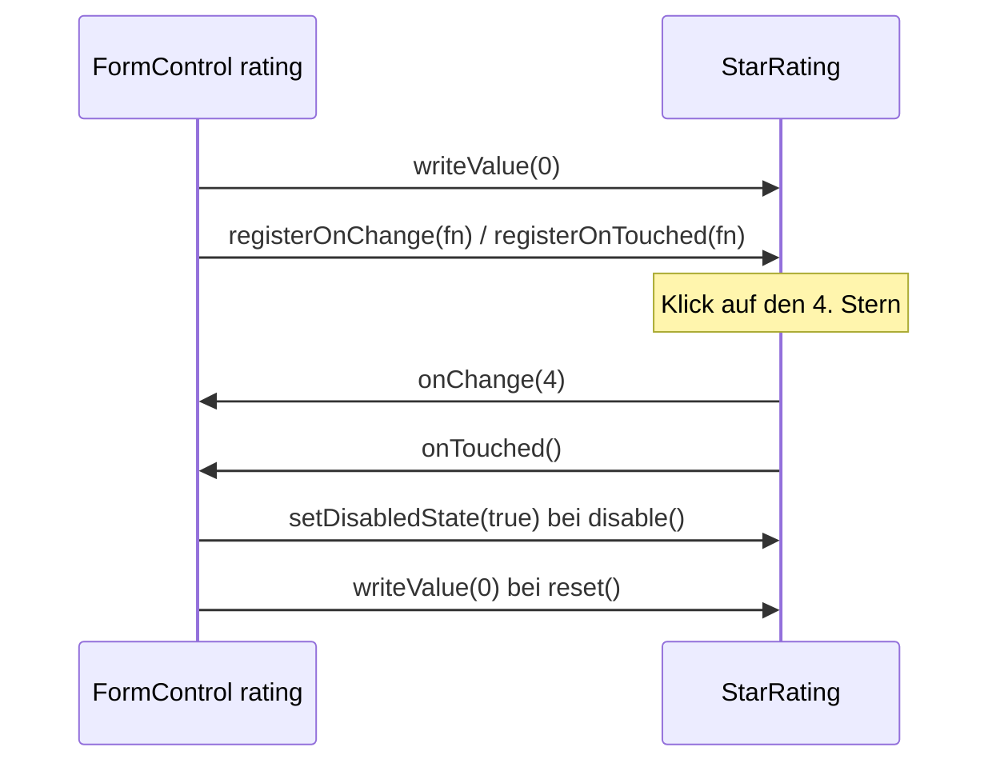

# Lab 4.3: Eigenes Formular-Control mit ControlValueAccessor

**Leitfragen:**

<details>
<summary>Was erwartet ein Formular von einem Eingabefeld, damit Validierung und Reset funktionieren?</summary>

Es muss einen Wert von außen annehmen (Startwert, `reset()`, `setValue()`), Änderungen nach außen melden, „berührt“ melden und sich sperren lassen. Ein `<input>` kann das von Haus aus; ein eigener Baustein muss es über eine feste Schnittstelle anbieten.

</details>

<details>
<summary>Wie würde man einen Zähler-Baustein ohne Formular-Anbindung bauen, und wo bricht das?</summary>

Mit `@Input() value` und `@Output() valueChange`. Das Elternformular müsste dann Wert, Reset, Sperren und Validierung von Hand weiterreichen; `formControlName="tickets"` funktioniert nicht.

</details>

<details>
<summary>Wer entscheidet, ob ein Feld „berührt“ wurde?</summary>

Das Feld selbst: Es ruft eine vom Formular übergebene Funktion auf, typischerweise beim Verlassen (`blur`). Bei einem eigenen Control legt die Komponente fest, wann das passiert, z. B. beim ersten Klick oder beim Verlassen.

</details>

- `ControlValueAccessor` (CVA) ist die Schnittstelle zwischen Formular-API und einem Eingabe-Baustein. Angular bringt CVAs für `<input>`, `<select>`, Checkboxen usw. mit.
- Eine eigene Komponente mit CVA funktioniert mit `formControlName`, `formControl` und `ngModel` wie ein natives Feld.

## Begriffe

| Begriff | Bedeutung |
| --- | --- |
| `ControlValueAccessor` | Interface mit vier Methoden, über die ein Formular mit einem Eingabe-Baustein spricht |
| `NG_VALUE_ACCESSOR` | Token, unter dem sich die Komponente als CVA anmeldet |
| `forwardRef` | Verweis auf eine Klasse, die an dieser Stelle im Code noch nicht definiert ist |
| `multi: true` | mehrere Provider unter demselben Token sammeln, statt zu ersetzen |
| `markForCheck()` | Methode von `ChangeDetectorRef`: Komponente für die nächste Prüfung der Ansicht vormerken |

## Die vier Methoden

Die Beispiele zeigen einen Bewertungs-Baustein `StarRating` (1–5 Sterne, z. B. für Session-Feedback). Die Übung baut nach demselben Muster den Ticket-Zähler.

| Methode | Richtung | Wird aufgerufen bei | Aufgabe im Baustein |
| --- | --- | --- | --- |
| `writeValue(value)` | Formular → Control | Startwert, `setValue()`, `reset()` | Wert übernehmen, Ansicht vormerken |
| `registerOnChange(fn)` | Formular → Control | einmal beim Verbinden | `fn` speichern, bei Änderung `fn(neuerWert)` |
| `registerOnTouched(fn)` | Formular → Control | einmal beim Verbinden | `fn` speichern, bei Klick und `focusout` aufrufen |
| `setDisabledState(bool)` | Formular → Control | `disable()`, `enable()` | Bedienung sperren |



## Beispiel: `StarRating`

```ts
@Component({
  selector: 'app-star-rating',
  providers: [{ provide: NG_VALUE_ACCESSOR, useExisting: forwardRef(() => StarRating), multi: true }],
  host: { '(focusout)': 'onTouched()' },               // Verlassen des Bausteins = berührt
  template: `
    <div class="row" role="group" aria-label="Bewertung">
      @for (star of stars; track star) {
        <button type="button" class="btn" (click)="select(star)" [disabled]="disabled"
                [attr.aria-pressed]="star <= rating">{{ star <= rating ? '★' : '☆' }}</button>
      }
    </div>
  `,
})
export class StarRating implements ControlValueAccessor {
  readonly stars = [1, 2, 3, 4, 5];
  rating = 0;                                            // 0 = noch nicht bewertet
  disabled = false;

  private readonly cdr = inject(ChangeDetectorRef);
  private onChange: (value: number) => void = () => {};
  onTouched: () => void = () => {};

  writeValue(value: number | null): void {
    this.rating = value ?? 0;
    this.cdr.markForCheck();
  }
  registerOnChange(fn: (value: number) => void): void { this.onChange = fn; }
  registerOnTouched(fn: () => void): void { this.onTouched = fn; }
  setDisabledState(isDisabled: boolean): void {
    this.disabled = isDisabled;
    this.cdr.markForCheck();
  }

  select(star: number): void {
    if (star === this.rating) return;
    this.rating = star;
    this.onChange(star);     // Formular erfährt den neuen Wert
    this.onTouched();        // Safari fokussiert Buttons beim Klick nicht, focusout allein reicht nicht
  }
}
```

Verwendung im Formular, ohne weitere Anpassung der Klasse:

```html
<app-star-rating formControlName="rating" />
```

- `type="button"` verhindert, dass ein Klick das umgebende Formular absendet.
- `useExisting` meldet dieselbe Instanz an; `useClass` würde eine zweite, unverbundene Instanz erzeugen.
- `forwardRef`: Der Provider steht im Decorator der Klasse, die er referenziert; `forwardRef` löst den Verweis erst später auf.
- `onTouched` ist öffentlich, weil die `host`-Bindung `(focusout)` es aufruft; `onChange` bleibt privat.

## Warum `markForCheck()`

Komponenten prüfen ihre Ansicht seit Angular 22 standardmäßig nur nach bestimmten Anlässen (`ChangeDetectionStrategy.OnPush` ist Default; vertieft in Lab 6.1):

| Anlass | Ansicht wird aktualisiert |
| --- | --- |
| Event im eigenen Template (Klick auf einen Stern, `focusout`) | ja |
| neuer Wert für ein `@Input` | ja |
| `async`-Pipe meldet einen Wert | ja |
| `writeValue()` / `setDisabledState()` vom Formular | nein → `markForCheck()` aufrufen |

Ohne `markForCheck()` zeigt der Baustein nach `reset()` oder `disable()` den alten Zustand, obwohl das Formular den neuen kennt. Das fällt nur auf, solange im Baustein selbst kein Event passiert: Verliert er beim Klick auf einen anderen Button den Fokus, löst `focusout` eine Prüfung aus und verdeckt den Fehler.

## Validierung im Control

Ein Control kann seine Regeln selbst mitbringen. Dazu implementiert es zusätzlich `Validator` und meldet sich unter `NG_VALIDATORS` an:

```ts
providers: [
  { provide: NG_VALUE_ACCESSOR, useExisting: forwardRef(() => StarRating), multi: true },
  { provide: NG_VALIDATORS, useExisting: forwardRef(() => StarRating), multi: true },
],
// …
validate(control: AbstractControl): ValidationErrors | null {
  const value = control.value as number | null;
  return !value ? { ratingMissing: true } : null;       // 0 oder null: noch kein Stern gewählt
}
```

Damit gilt die Regel überall, wo der Baustein eingesetzt wird; ein `Validators.min(1)` am Formular entfällt.

## Typische Fehler

| Symptom | Ursache | Lösung |
| --- | --- | --- |
| NG01203 `No value accessor for form control name: 'tickets'` | Provider `NG_VALUE_ACCESSOR` fehlt | Provider mit `useExisting` und `multi: true` |
| Fehler zu `multi: true` beim Start | `multi` vergessen | `multi: true` ergänzen |
| Baustein zeigt nach `reset()` alten Wert | `markForCheck()` fehlt in `writeValue` | `this.cdr.markForCheck()` |
| `touched` bleibt `false` | `onTouched` nie aufgerufen | bei Klick und `focusout` aufrufen |
| Absenden beim Klick auf einen Button im Baustein | Button ohne `type="button"` | `type="button"` |
| Konsolenwarnung „disabled attribute with a reactive form directive“ | `[disabled]` am Control im Template | `control.disable()` in der Klasse |

## Fazit

- `ControlValueAccessor` verbindet einen eigenen Baustein mit der Formular-API; vier Methoden decken Wert, Änderung, Berührt und Sperren ab.
- Anmeldung über `NG_VALUE_ACCESSOR` mit `forwardRef` und `multi: true`; danach funktioniert `formControlName`.
- Werte vom Formular kommen ohne Event an: `markForCheck()` hält die Ansicht aktuell.

Die Übung macht aus dem Ticket-Zähler ein Formular-Control und prüft Reset, Sperren und `touched` im Anmeldeformular.
