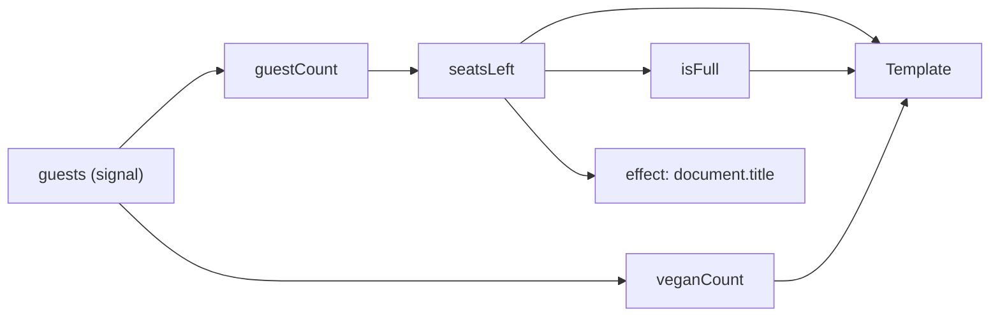

# Lab 6.1: Signals API

**Leitfragen:**

<details>
<summary>Woher weiß ein Framework, welche Stelle im Template neu gezeichnet werden muss?</summary>

Entweder prüft es nach jedem Ereignis alles (Zone.js-Ansatz) oder die Werte melden selbst, dass sie sich geändert haben und wer sie liest. Signals sind solche Werte: Das Template, das ein Signal liest, wird bei dessen Änderung gezielt aktualisiert.

</details>

<details>
<summary>Ist eine Gesamtsumme ein eigener Zustand oder ein berechneter Wert?</summary>

Ein berechneter Wert: Sie folgt immer aus den Positionen. Wer sie separat speichert, muss sie bei jeder Änderung von Hand nachziehen und vergisst es irgendwann. In Angular ist das ein `computed`.

</details>

<details>
<summary>Was kostet es, nach jedem Klick die ganze Seite zu prüfen?</summary>

Bei kleinen Seiten wenig, bei Listen mit hunderten Einträgen und teuren Template-Ausdrücken spürbar Zeit pro Klick, Tastendruck und Timer. Gezielte Aktualisierung prüft nur die betroffenen Komponenten.

</details>

- Ein Signal ist ein Wert mit Benachrichtigung: Lesen per Funktionsaufruf, Schreiben per `set`/`update`.
- `computed` leitet Werte ab, `effect` wirkt nach außen (Speicher, Log, DOM-APIs), `linkedSignal` ist beschreibbar und setzt sich bei Änderung einer Quelle zurück.
- Signals sind der Grund, warum Angular ohne Zone.js auskommt und Komponenten standardmäßig `OnPush` sind.

## Begriffe

| Begriff | Bedeutung |
| --- | --- |
| Signal | Behälter für einen Wert, der meldet, wenn er sich ändert; Lesen mit `zahl()` |
| `WritableSignal` | Signal mit `set(wert)` und `update(fn)`; erzeugt mit `signal(start)` |
| `computed` | Nur lesbares Signal, das aus anderen Signals berechnet wird; rechnet nur neu, wenn sich eine gelesene Quelle ändert |
| `effect` | Funktion, die bei jeder Änderung der gelesenen Signals erneut läuft; für Seiteneffekte nach außen |
| `linkedSignal` | Beschreibbares Signal, das bei Änderung seiner Quelle auf einen neu berechneten Wert zurückspringt |
| Abhängigkeit | Jedes Signal, das während einer Berechnung gelesen wird; Angular merkt sich diese Liste automatisch |
| Change Detection | Angulars Abgleich von Komponentendaten mit dem DOM |

## Lesen und schreiben

```ts
import { signal } from '@angular/core';

const anzahl = signal(1);       // WritableSignal<number>
anzahl();                       // 1 – lesen ist ein Funktionsaufruf
anzahl.set(3);                  // neuer Wert
anzahl.update((n) => n + 1);    // neuer Wert aus altem: 4

const items = signal<CartItem[]>([]);
items.update((liste) => [...liste, neu]); // neues Array, nicht push()
```

- Signals vergleichen mit `Object.is`. `liste.push(x)` ändert das Array, aber nicht die Referenz: Kein Leser erfährt davon. Immer ein neues Array oder Objekt erzeugen.
- Im Template: `{{ anzahl() }}`, `@for (item of items(); track item.workshopId)`.

## `computed`: abgeleitete Werte

Beispiel: Gästeliste für ein Speaker-Dinner mit begrenzten Plätzen.

```ts
readonly guests = signal<Guest[]>([]); // Guest = { name: string; vegan: boolean }

readonly guestCount = computed(() => this.guests().length);
readonly veganCount = computed(() => this.guests().filter((g) => g.vegan).length);
readonly seatsLeft = computed(() => Math.max(0, ROOM_CAPACITY - this.guestCount()));
readonly isFull = computed(() => this.seatsLeft() === 0);
```



- `computed` ist faul und gecacht: Es rechnet erst beim Lesen und nur, wenn sich eine Abhängigkeit geändert hat.
- Abhängigkeiten entstehen beim Lesen; ein `if` kann also bestimmen, welche Signals gerade zählen.

## `effect`: Wirkung nach außen

```ts
constructor() {
  effect(() => {
    document.title = `Speaker-Dinner: ${this.seatsLeft()} Plätze frei`;
  });
}
```

- Läuft einmal beim Start und danach bei jeder Änderung von `seatsLeft()`.
- Dasselbe Muster schreibt Zustand in den `localStorage`: `localStorage.setItem(schlüssel, JSON.stringify(wert))` im `effect`, beim Start mit `JSON.parse(localStorage.getItem(schlüssel) ?? '[]')` zurücklesen.
- Muss im Injection Context entstehen (Konstruktor oder Feld), damit Angular ihn mit der Komponente beendet.

| Aufgabe | Richtig | Falsch |
| --- | --- | --- |
| Summe aus Positionen | `computed` | `effect(() => this.total.set(…))` |
| Speichern in `localStorage` | `effect` | `computed` mit Seiteneffekt |
| Log, Analytics, Fokus setzen | `effect` | Code in jedem Klick-Handler wiederholen |

Ein `effect`, der ein anderes Signal setzt, ist fast immer ein verstecktes `computed` oder `linkedSignal`: Er rechnet doppelt, verzögert und erzeugt leicht Schleifen.

## `linkedSignal`: beschreibbar, aber gekoppelt

```ts
readonly filter = signal('');

// Seite ist frei änderbar (Weiter/Zurück), springt bei neuem Filter auf Seite 1 zurück
readonly page = linkedSignal(() => {
  this.filter(); // Quelle lesen = Abhängigkeit
  return 1;
});

this.page.set(4);          // 4
this.filter.set('ngrx');   // page() ist wieder 1
```

## Warum Signals zoneless ermöglichen

| | Zone.js (klassisch) | Signals, zoneless (Default seit v21) |
| --- | --- | --- |
| Auslöser | jedes asynchrone Ereignis (Klick, Timer, HTTP) | Signal-Änderung, Template-Ereignis, `async`-Pipe, `markForCheck()` |
| Was wird geprüft | alle Komponenten von oben | nur Komponenten, deren Template ein geändertes Signal liest (und ihre Vorfahren) |
| Wert per `setTimeout` in ein Feld schreiben | erscheint | erscheint nicht (Grund für die `async`-Pipe in m05) |

## `OnPush` als Default (Angular 22)

Geprüft in `@angular/core` 22.2.3 (Typdefinition von `ChangeDetectionStrategy`, Stand 28.10.2026):

- Ohne Angabe ist eine Komponente `OnPush` („OnPush is enabled by default“).
- Die frühere Strategie `Default` heißt jetzt `ChangeDetectionStrategy.Eager`; `Default` ist als veraltet markiert und ein Alias für `Eager`.
- `ng update` auf v22 enthält die Migration `change-detection-eager`, die `ChangeDetectionStrategy.Eager` in alle bestehenden Komponenten einträgt. Bestandscode verhält sich danach wie vorher.

| Strategie | Wann geprüft |
| --- | --- |
| `OnPush` (Default) | Input geändert, Ereignis im eigenen Template, gelesenes Signal geändert, `async`-Pipe, `markForCheck()` |
| `Eager` | bei jedem Change-Detection-Durchlauf, der sie erreicht |

Für Altcode heißt das: Komponenten, die Felder in Callbacks verändern, brauchen nach dem Update `Eager` (Übergang) oder werden auf Signals umgestellt (Ziel).

## Typische Fehler

| Symptom | Ursache | Lösung |
| --- | --- | --- |
| Template zeigt Funktionstext statt Wert, Compiler warnt | Signal ohne `()` gelesen | `{{ total() }}` |
| Nach Hinzufügen ändert sich nichts | `items().push(…)` statt neues Array | `items.update((l) => [...l, neu])` |
| `NG0203` bei `effect` | `effect` in einer Methode statt im Konstruktor | im Konstruktor oder als Feld anlegen |
| Summe hinkt hinterher oder Endlosschleife | Summe per `effect` gesetzt | `computed` |
| Fehler beim Start durch kaputten `localStorage`-Inhalt | `JSON.parse` ohne Absicherung | `try/catch`, Fallback `[]` |

## Fazit

- `signal` für Zustand, `computed` für alles Abgeleitete, `effect` nur für Wirkung nach außen, `linkedSignal` für zurücksetzbare Eingaben.
- Signals melden ihren Lesern Änderungen; deshalb reicht zoneless Change Detection mit `OnPush` als Default.
- `Eager` ist der neue Name der alten Default-Strategie und der Übergang für Altcode.

Die Übung baut einen Warenkorb für Workshop-Tickets mit live berechneter Summe und Speicherung im `localStorage`.
