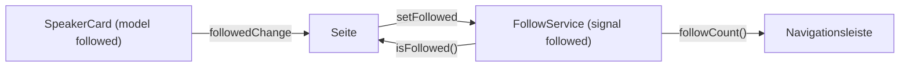

# Lab 6.3: Komponenten-Kommunikation mit Signals

**Leitfragen:**

<details>
<summary>Wie erfährt der Header, dass in einer Karte tief unten ein Favorit gesetzt wurde?</summary>

Über eine Event-Kette (Karte → Liste → Seite → Header) oder über einen gemeinsamen Service, den beide kennen. Mit einem Signal im Service liest der Header den Wert direkt und wird bei Änderung automatisch aktualisiert.

</details>

<details>
<summary>Wann ist Zwei-Wege-Bindung praktisch und wann gefährlich?</summary>

Praktisch für einfache Eingabe-Bausteine (Schalter, Zähler, Datumsauswahl), deren Wert die Eltern-Komponente ohnehin hält. Gefährlich, wenn mehrere Stellen denselben Wert schreiben: Dann ist unklar, wer die Wahrheit hat.

</details>

<details>
<summary>Welche Fehler aus <code>@Input</code> mit Settern kennt man aus Projekten?</summary>

Setter, die von der Reihenfolge der Inputs abhängen, abgeleitete Felder, die nicht nachgezogen werden, und `ngOnChanges` mit `SimpleChanges`-Abfragen. Ein Signal-Input macht abgeleitete Werte zu einem `computed`.

</details>

- `input()`, `output()` und `model()` ersetzen `@Input`, `@Output` und das Paar `@Input x` + `@Output xChange`.
- Inputs sind Signals: Abgeleitete Werte entstehen per `computed`, ohne Setter und `ngOnChanges`.
- Geteilter Zustand über mehrere Ebenen gehört in einen Service mit Signals, nicht in eine Kette von Outputs.

## Begriffe

| Begriff | Bedeutung |
| --- | --- |
| `input()` | Signal-Input; Wert lesen mit `speaker()`, nur lesbar in der Kind-Komponente |
| `input.required<T>()` | Pflicht-Input; fehlt die Bindung, meldet der Compiler einen Fehler |
| `transform` | Funktion, die den gebundenen Wert vor dem Speichern umwandelt, z. B. `booleanAttribute` |
| `output()` | Ereignis der Kind-Komponente; senden mit `.emit(wert)` |
| `model()` | Input, den die Kind-Komponente auch schreiben darf; jede Änderung sendet `<name>Change` |
| `viewChild()` / `viewChildren()` | Element oder Komponente aus dem eigenen Template als Signal |
| `contentChild()` | Element aus dem projizierten Inhalt (`<ng-content>`) als Signal |

## Klassisch und mit Signals

| Zweck | Klassisch (Lab 1.2) | Signal-API |
| --- | --- | --- |
| Eingabe | `@Input({ required: true }) speaker!: Speaker` | `speaker = input.required<Speaker>()` |
| Eingabe mit Standard | `@Input() showBio = false` | `showBio = input(false)` |
| Umwandlung | `@Input({ transform: booleanAttribute })` | `input(false, { transform: booleanAttribute })` |
| Ereignis | `@Output() contact = new EventEmitter<Speaker>()` | `contact = output<Speaker>()` |
| Zwei-Wege | `@Input() followed` + `@Output() followedChange` | `followed = model(false)` |
| Abgeleiteter Wert | Setter oder `ngOnChanges` | `computed(() => …)` |
| Element im Template | `@ViewChild('box') box!: ElementRef` | `box = viewChild.required<ElementRef>('box')` |

Im Template der Eltern-Komponente ändert sich nichts: `[speaker]="s"`, `(contact)="…"`, `[(followed)]="…"`.

## Eine Speaker-Karte mit Signal-APIs

```ts
export class SpeakerCard {
  readonly speaker = input.required<Speaker>();
  readonly showBio = input(false, { transform: booleanAttribute }); // <app-speaker-card showBio />
  readonly followed = model(false);
  readonly contact = output<Speaker>();

  protected readonly initials = computed(() =>
    this.speaker().name.split(' ').map((part) => part[0]).join(''),
  );

  protected toggleFollow(): void {
    this.followed.set(!this.followed()); // schreibt den Wert und sendet followedChange
  }
}
```

```html
<strong>{{ initials() }} · {{ speaker().name }}</strong>
@if (showBio()) { <p>{{ speaker().bio }}</p> }
<button (click)="toggleFollow()">{{ followed() ? '✓ Gefolgt' : '+ Folgen' }}</button>
<button (click)="contact.emit(speaker())">Kontakt</button>
```

- `input()` ist in der Kind-Komponente nur lesbar; nur die Eltern-Komponente setzt den Wert.
- `model()` darf die Kind-Komponente schreiben (`set` oder `update`); die Eltern-Komponente erfährt es über `followedChange`.

## Zwei-Wege-Bindung mit `model()`

```html
<!-- Kurzform: Eltern-Signal und Kind-model bleiben synchron -->
<app-speaker-card [speaker]="s" [(followed)]="folgeIch" />   <!-- folgeIch = signal(false) -->

<!-- Langform: Wert von außen, Änderung an einen Service melden -->
<app-speaker-card
  [speaker]="s"
  [followed]="follows.isFollowed(s.id)"
  (followedChange)="follows.setFollowed(s.id, $event)"
/>
```

Die Kurzform braucht ein beschreibbares Signal in der Eltern-Komponente. In einer `@for`-Liste mit einem gemeinsamen Service ist die Langform richtig: Der Service bleibt die einzige Quelle der Wahrheit.

## Geteilter Zustand: Service mit Signals

```ts
@Injectable({ providedIn: 'root' })
export class FollowService {
  private readonly followed = signal<ReadonlySet<number>>(new Set()); // schreiben nur im Service
  readonly followedIds = this.followed.asReadonly();                   // nach außen nur lesbar
  readonly followCount = computed(() => this.followed().size);

  isFollowed(id: number): boolean {
    return this.followed().has(id);
  }

  setFollowed(id: number, on: boolean): void {
    this.followed.update((current) => {
      const next = new Set(current); // neue Referenz, sonst merkt das Signal nichts
      if (on) next.add(id);
      else next.delete(id);
      return next;
    });
  }
}
```



Warum ein normales Feld im Service nicht reicht: Komponenten sind `OnPush` (Lab 6.1). Ein Klick in der Karte prüft die Karte und ihre Vorfahren, nicht aber eine Komponente daneben (hier die Navigationsleiste). Liest sie ein Signal, meldet das Signal ihr die Änderung direkt.

## Signal-Queries

```ts
// Template: <input #nameSearch /> und @for (s of speakers(); …) { <app-speaker-card … /> }
private readonly nameSearch = viewChild.required<ElementRef<HTMLInputElement>>('nameSearch');
private readonly speakerCards = viewChildren(SpeakerCard);
protected readonly speakerCount = computed(() => this.speakerCards().length);

protected clearSearch(): void {
  this.nameSearch().nativeElement.value = '';
  this.nameSearch().nativeElement.focus();
}
```

`viewChildren` aktualisiert sich, wenn `@for` Karten hinzufügt oder entfernt; `speakerCount` rechnet automatisch mit.

`contentChild()` sucht nicht im eigenen Template, sondern im projizierten Inhalt. Projizierter Inhalt ist das, was die Eltern-Komponente zwischen die Tags schreibt; `<ng-content />` markiert die Stelle, an der er erscheint:

```ts
@Component({
  selector: 'app-info-box',
  template: `<section class="card"><ng-content /></section>
    @if (!title()) { <p class="muted">Hinweis: Überschrift mit #title fehlt.</p> }`,
})
export class InfoBox {
  protected readonly title = contentChild<ElementRef<HTMLElement>>('title'); // undefined, wenn nichts passt
}
```

```html
<app-info-box><h2 #title>Anfahrt</h2><p>Halle 3, Eingang Nord</p></app-info-box>
```

## Migration per Schematic

```bash
ng generate @angular/core:signal-input-migration   # @Input → input()
ng generate @angular/core:output-migration         # @Output → output()
ng generate @angular/core:signal-queries-migration # @ViewChild & Co. → viewChild()
```

Die drei Schematics sind in `@angular/core` 22.2.3 enthalten (`schematics/collection.json`, Stand 28.10.2026). Inputs, die die Komponente selbst beschreibt, kann das Schematic nicht automatisch umstellen; sie werden zu `model()` oder bleiben vorerst klassisch.

## Typische Fehler

| Symptom | Ursache | Lösung |
| --- | --- | --- |
| `Property 'set' does not exist on type 'InputSignal<…>'` | `input()` in der Kind-Komponente beschrieben | `model()` verwenden oder Wert per `output()` melden |
| Compiler: `Property 'title' does not exist on type 'InputSignal<Session>'` | `session.title` statt `session().title` im Template | Signal mit `()` lesen |
| Header-Zähler bleibt stehen | Service-Feld ist kein Signal, Header ist `OnPush` | Zustand als `signal`, Zähler als `computed` |
| `NG0950: Input is required but no value is available yet` | `input.required()` im Konstruktor gelesen | erst im Template, in `computed` oder ab `ngOnInit` lesen |
| `<app-session-card compact />` meldet Typfehler | `input<boolean>()` ohne `transform` | `transform: booleanAttribute` |

## Fazit

- `input()`, `output()`, `model()` ersetzen die Decorators; Inputs sind Signals und machen Setter überflüssig.
- `model()` passt für eigene Eingabe-Bausteine; die Langform `[x]` + `(xChange)` hält einen Service als einzige Quelle der Wahrheit.
- Zustand, den entfernte Komponenten teilen, liegt als Signal in einem Service.

Die Übung stellt die Session-Karte auf Signal-APIs um und baut den Favoriten-Zähler im Header über einen Signal-Service.
