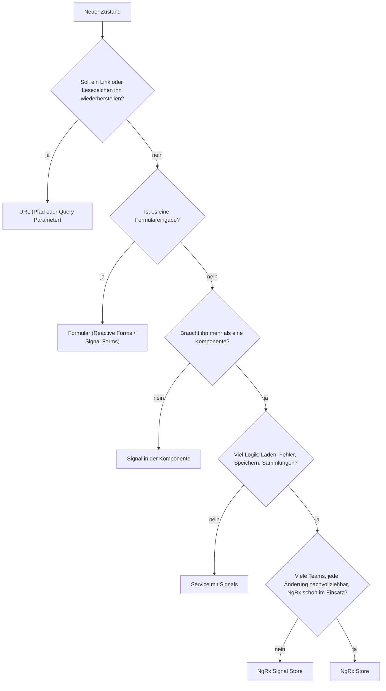

# Lab 7.1: Welcher State gehört wohin?

**Leitfragen:**

<details>
<summary>Welcher Zustand im eigenen Projekt macht am meisten Ärger?</summary>

Meist Zustand, der an mehreren Stellen gleichzeitig lebt (Kopie in Komponente und Service) oder dessen Änderung niemand nachvollziehen kann. Beides ist eine Frage des Orts, nicht der Bibliothek.

</details>

<details>
<summary>Gehört der Suchbegriff in die URL, in einen Service oder in die Komponente?</summary>

In die URL, sobald Link teilen, Lesezeichen oder Zurück-Button die Suche wiederherstellen sollen. Nur wenn das egal ist, reicht die Komponente.

</details>

<details>
<summary>Wann hat sich ein globaler Store im eigenen Projekt gelohnt, wann nicht?</summary>

Gelohnt bei vielen Teams, viel geteiltem Zustand und dem Bedarf, jede Änderung nachzuvollziehen. Nicht gelohnt, wenn er nur Formularwerte oder einen Ladezustand einer einzelnen Seite verwaltet.

</details>

- Zustand hat verschiedene Arten: UI, Formular, Server-Cache, globaler App-Zustand, URL. Jede Art hat einen natürlichen Ort.
- Der Ort folgt aus zwei Fragen: Wer liest den Zustand mit, und wie viel Logik hängt an ihm?

## Begriffe

| Begriff | Bedeutung |
| --- | --- |
| Zustand (State) | Daten, die sich zur Laufzeit ändern und die Anzeige bestimmen |
| UI-Zustand | betrifft nur die Darstellung einer Komponente, z. B. „Dropdown offen“ |
| Formular-Zustand | Eingaben, Validierung, `dirty`/`touched` eines Formulars (Modul 4, Lab 6.4) |
| Server-Cache | Kopie von Daten, die eigentlich dem Server gehören, z. B. die Session-Liste; braucht Laden, Fehler, Aktualisieren |
| Globaler App-Zustand | Daten, die viele Teile der App lesen, z. B. eingeloggte Person, Warenkorb |
| URL-Zustand | Zustand in Pfad oder Query-Parametern (`/sessions?q=angular`); überlebt Reload und lässt sich teilen |
| Store | zentrale Stelle, die Zustand hält und nur über definierte Wege ändern lässt |
| Boilerplate | Code, der für eine Struktur nötig ist, aber keine Fachlogik enthält |

## Fünf Arten von Zustand im EventHub

| Art | Beispiel im EventHub | Lebensdauer | Wer liest mit? |
| --- | --- | --- | --- |
| UI | Dropdown „Track-Filter“ offen, aktiver Tab | solange die Komponente lebt | nur die Komponente |
| Formular | Eingaben im Anmeldeformular | bis zum Absenden | das Formular |
| URL | Suchbegriff, Session-ID im Pfad | überlebt Reload, teilbar | Router, Komponente |
| Server-Cache | Session-Liste, Speaker | bis zum nächsten Laden | mehrere Seiten |
| Globaler App-Zustand | eingeloggte Person, Favoriten, Warenkorb | ganze Sitzung, evtl. gespeichert | viele Komponenten |

> **Merksatz:** Zustand wandert erst dann nach oben (Service, Store), wenn ihn mehr als eine Stelle braucht.

## Drei Werkzeuge für geteilten Zustand

Für UI, Formular und URL bringt Angular die Werkzeuge mit (Signal in der Komponente, Forms, Router). Für geteilten Zustand gibt es drei Stufen:

| Werkzeug | Bekannt aus | Wann einsetzen | Kosten |
| --- | --- | --- | --- |
| Service mit Signals | Lab 6.3 (Favoriten-Zähler) | Zustand eines Features, wenig Logik, ein kleines Team | kaum Boilerplate, Regeln nur per Konvention |
| NgRx Signal Store (`@ngrx/signals`) | Lab 7.4 | Feature-State mit Logik, Laden und Fehlern, Entities, Teamkonventionen | eine Datei pro Feature, eine Bibliothek mehr |
| NgRx Store (Actions, Reducer, Effects) | Lab 7.2–7.3 | große Apps mit vielen Teams, Nachvollziehbarkeit jeder Änderung, bestehender NgRx-Code | mehrere Dateien pro Feature, mehr Konzepte |

In einem Satz pro Werkzeug (Details folgen in den genannten Labs):

- **Service mit Signals:** eine Klasse mit Signals und Methoden, die den Zustand ändern; bereits aus Lab 6.3 bekannt.
- **NgRx Signal Store:** ein Store aus Bausteinen (State, abgeleitete Werte, Methoden), den nur die eigenen Methoden ändern dürfen; Thema in Lab 7.4.
- **NgRx Store:** ein globaler Store, der sich nur über benannte Ereignisse (Actions) ändert; eine reine Funktion (Reducer) berechnet daraus den neuen Zustand; Thema in Lab 7.2.

Der Service mit Signals aus Lab 6.3 sieht so aus und reicht für viele Fälle:

```ts
@Injectable({ providedIn: 'root' })
export class FavoritesService {
  private readonly ids = signal<number[]>([]);
  readonly count = computed(() => this.ids().length); // abgeleitet

  toggle(id: number): void {
    this.ids.update((ids) => (ids.includes(id) ? ids.filter((x) => x !== id) : [...ids, id]));
  }
}
```

Grenzen dieses Services: Jeder Service hat eigene Regeln für Laden, Fehler und Speichern; niemand sieht im Nachhinein, welcher Klick den Zustand geändert hat.

## Entscheidungsweg



„Reload überleben“ ist eine eigene Frage: Erst den Ort wie oben wählen, dann zusätzlich speichern (`localStorage` oder Server). Der Warenkorb soll einen Reload überleben, gehört aber nicht in die URL: Er landet im Store und wird dort gespeichert.

Der Weg ist eine Faustregel. Zwei begründete Antworten können beide richtig sein; die Begründung zählt.

## Boilerplate gegen Nachvollziehbarkeit

| Frage | Service mit Signals | Signal Store | NgRx Store |
| --- | --- | --- | --- |
| Dateien für ein Feature | 1 | 1 | 3–4 (Actions, Feature, Effects, ggf. Selectors) |
| Wer darf den Zustand ändern? | jeder mit Zugriff auf die Methoden | nur die Methoden des Stores | nur der Reducer, ausgelöst durch Actions |
| Verlauf jeder Änderung | nein | mit Zusatz-Plugin (Lab 7.5) | ja, die Browser-Erweiterung Redux DevTools listet jede Action (Lab 7.2) |
| Einarbeitung neuer Teammitglieder | gering | mittel | höher, dafür überall gleich |

## Typische Fehler

| Symptom | Ursache | Lösung |
| --- | --- | --- |
| Link auf eine Suche zeigt die leere Liste | Suchbegriff liegt nur in der Komponente | Suchbegriff in Query-Parameter legen |
| Zwei Komponenten zeigen unterschiedliche Favoriten | jede hält eine eigene Kopie | eine Quelle (Service oder Store), beide lesen daraus |
| Store enthält `isDropdownOpen` | UI-Zustand nach oben gezogen | zurück in die Komponente |
| Jeder Tastendruck im Formular erzeugt einen Store-Eintrag | Formular-Zustand im globalen Store | Formular hält die Eingaben, erst das Ergebnis geht weiter |

## Fazit

- Erst die Art des Zustands bestimmen, dann den Ort; die Bibliothek kommt zuletzt.
- Service mit Signals, Signal Store und NgRx Store sind Stufen; jede Stufe kauft Struktur mit Boilerplate.
- Die Begründung ist wichtiger als die eine richtige Antwort.

Die Übung ordnet acht EventHub-Zustände mit dieser Tabelle ein.
