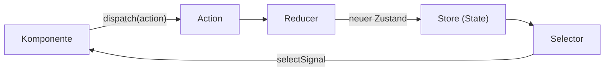

# Lab 7.2: NgRx Store: Actions, Reducer, Selectors

**Leitfragen:**

<details>
<summary>Wie findet man heraus, wer einen Wert im Zustand geändert hat?</summary>

In einem Service mit `set()`-Aufrufen an vielen Stellen nur mit Haltepunkten. Im NgRx Store ist jede Änderung eine benannte Action; die Redux DevTools listen sie in Reihenfolge mit Zustand davor und danach.

</details>

<details>
<summary>Warum sollte eine Komponente nicht selbst entscheiden, wie sich der Zustand ändert?</summary>

Dann steckt dieselbe Regel (z. B. „Favorit umschalten“) in jeder Komponente, die sie braucht, und weicht irgendwann ab. Im Store meldet die Komponente nur das Ereignis; die Regel steht einmal im Reducer.

</details>

<details>
<summary>Was ist der Unterschied zwischen „Benutzer hat geklickt“ und „Liste wurde sortiert“?</summary>

Das Erste ist ein Ereignis (was passiert ist), das Zweite ein Befehl bzw. eine Folge. Actions beschreiben Ereignisse; welche Folgen sie haben, entscheidet der Reducer.

</details>

- Der NgRx Store hält den Zustand an einer Stelle und ändert ihn nur über Actions und Reducer.
- Komponenten lesen per Selector (als Signal) und melden Ereignisse per `dispatch`.

## NgRx auf einen Blick

- **Problem:** Viele Komponenten lesen und ändern denselben Zustand; niemand sieht mehr, wer wann was geändert hat.
- **Bild:** Ein Kassenbuch. Niemand radiert im Kontostand; jede Buchung (Action) wird mit Namen eingetragen, der Stand (State) ergibt sich aus allen Buchungen der Reihe nach (Reducer).
- **Definition:** NgRx ist eine Sammlung von Bibliotheken für Zustand in Angular-Apps. Das Paket `@ngrx/store` beschreibt sich selbst als „RxJS powered Redux for Angular apps“ (`package.json` von `@ngrx/store` 22.0.1, Stand 30.10.2026).
- **Herkunft:** Redux ist ein Muster aus der React-Welt: ein zentraler Zustand, Änderungen nur über benannte Ereignisse, eine reine Funktion berechnet den neuen Zustand. NgRx überträgt es auf Angular und RxJS.
- **Heute:** NgRx 22 ist aktuell (ngrx.io, Versionsauswahl, abgerufen am 30.10.2026). Zum klassischen Store kam der Signal Store (`@ngrx/signals`, Lab 7.4) mit eigenem Events-Plugin (Lab 7.5).

| Paket | Zweck | Im Kurs |
| --- | --- | --- |
| `@ngrx/store` | Store, Actions, Reducer, Selectors | Lab 7.2 |
| `@ngrx/store-devtools` | Anbindung an die Browser-Erweiterung Redux DevTools | Lab 7.2 |
| `@ngrx/effects` | Seiteneffekte (HTTP, Speicher) außerhalb von Komponente und Reducer | Lab 7.3 |
| `@ngrx/signals` | Signal Store, Entities, Events-Plugin | Lab 7.4–7.5 |

Typische Einsätze: große Apps mit vielen Teams, Admin-Oberflächen mit nachvollziehbaren Änderungen, Bestandsprojekte, die seit Jahren NgRx nutzen.

## Begriffe

| Begriff | Bedeutung |
| --- | --- |
| Store | Objekt, das den gesamten Zustand hält; Lesen per Selector, Ändern nur per Action |
| Action | Objekt `{ type: '[Quelle] Ereignis', ...daten }`, beschreibt, was passiert ist |
| `dispatch` | Action an den Store schicken |
| Reducer | reine Funktion `(zustand, action) => neuer Zustand`; kein HTTP, kein Zufall, keine Änderung am alten Objekt |
| Selector | Funktion, die einen Teil des Zustands liest oder daraus etwas ableitet; Ergebnis wird zwischengespeichert |
| Feature | Teilbereich des Zustands mit eigenem Namen, z. B. `sessions` |
| Redux DevTools | Browser-Erweiterung, die jede Action und jeden Zustand anzeigt und zurückspulen kann |

## Einweg-Datenfluss

Daten fließen im Kreis, aber immer in dieselbe Richtung. Dieses Bild gilt auch für Lab 7.3–7.5.



## Actions mit `createActionGroup`

Eine Action-Gruppe bündelt Ereignisse einer Quelle. Aus dem Ereignisnamen wird automatisch ein Funktionsname.

Die Beispiele dieser Theorie zeigen ein Speaker-Feature: eine Speaker-Liste, in der Speaker zum Folgen markiert werden. Die Übung baut dasselbe Muster für Sessions und Favoriten.

```ts
// speakers.actions.ts
import { createActionGroup, emptyProps, props } from '@ngrx/store';
import { Speaker } from '../shared/models';

export const speakersPageActions = createActionGroup({
  source: 'Speakers Page',                              // Quelle: wer meldet
  events: {
    Entered: emptyProps(),                              // ohne Daten
    'Follow Toggled': props<{ speakerId: number }>(),   // mit Daten
  },
});

export const speakersApiActions = createActionGroup({
  source: 'Speakers API',
  events: {
    'Speakers Fetched': props<{ speakers: Speaker[] }>(),
    'Speakers Fetch Failed': props<{ message: string }>(),
  },
});
```

| Ereignis im Code | Funktion | `type` im Store und in den DevTools |
| --- | --- | --- |
| `Entered` | `speakersPageActions.entered()` | `[Speakers Page] Entered` |
| `'Follow Toggled'` | `speakersPageActions.followToggled({ speakerId: 3 })` | `[Speakers Page] Follow Toggled` |
| `'Speakers Fetched'` | `speakersApiActions.speakersFetched({ speakers })` | `[Speakers API] Speakers Fetched` |

Konvention: Actions heißen nach dem Ereignis in der Vergangenheit („Entered“, „Toggled“, „Fetched“), nicht nach dem gewünschten Ergebnis („Set Speakers“).

## Reducer mit `createReducer` und `on`

```ts
// speakers.feature.ts (Ausschnitt)
import { createFeature, createReducer, createSelector, on } from '@ngrx/store';
import { Speaker } from '../shared/models';
import { speakersApiActions, speakersPageActions } from './speakers.actions';

export interface SpeakersState {
  speakers: Speaker[];
  followedIds: number[];
  pending: boolean;
  message: string | null;
}

const initialState: SpeakersState = { speakers: [], followedIds: [], pending: false, message: null };

const reducer = createReducer(
  initialState,
  on(speakersPageActions.entered, (state) => ({ ...state, pending: true, message: null })),
  on(speakersApiActions.speakersFetched, (state, { speakers }) => ({ ...state, speakers, pending: false })),
  on(speakersApiActions.speakersFetchFailed, (state, { message }) => ({ ...state, message, pending: false })),
  on(speakersPageActions.followToggled, (state, { speakerId }) => ({
    ...state,
    followedIds: state.followedIds.includes(speakerId)
      ? state.followedIds.filter((id) => id !== speakerId) // entfernen
      : [...state.followedIds, speakerId],                 // hinzufügen, neues Array
  })),
);
```

- Jede `on`-Funktion gibt ein **neues** Objekt zurück (`...state`). `state.followedIds.push(id)` verändert den alten Zustand; Selectors und DevTools sehen die Änderung dann nicht.
- Actions ohne passendes `on` lassen den Zustand unverändert.

## `createFeature`: Selectors ohne Handarbeit

`createFeature` verbindet Name und Reducer und erzeugt für jedes Feld des Zustands einen Selector.

```ts
export const speakersFeature = createFeature({
  name: 'speakers',
  reducer,
  // eigene, abgeleitete Selectors
  extraSelectors: ({ selectSpeakers, selectFollowedIds }) => ({
    selectFollowedSpeakers: createSelector(selectSpeakers, selectFollowedIds, (speakers, followedIds) =>
      speakers.filter((speaker) => followedIds.includes(speaker.id)),
    ),
  }),
});
```

| Automatisch erzeugt | Liefert |
| --- | --- |
| `speakersFeature.selectSpeakersState` | den ganzen Feature-Zustand (`select` + Name + `State`) |
| `speakersFeature.selectSpeakers` | `speakers` |
| `speakersFeature.selectFollowedIds` | `followedIds` |
| `speakersFeature.selectPending`, `selectMessage` | `pending`, `message` |
| `speakersFeature.selectFollowedSpeakers` | Ergebnis von `extraSelectors` |

`createSelector` rechnet nur neu, wenn sich eines der Eingangsergebnisse ändert, wie `computed` aus Lab 6.1.

## Registrieren: `provideStore`, `provideState`, `provideStoreDevtools`

In einer normalen App steht der Store einmal in `app.config.ts`; Features kommen an ihre Route:

```ts
// app.config.ts (normale App)
providers: [
  provideStore(),                                    // leerer Root-Store
  provideStoreDevtools({ maxAge: 25, logOnly: !isDevMode() }), // Produktion: nur lesen, keine Zeitreise
],

// app.routes.ts (normale App): Feature wird mit der Route geladen
{ path: 'speakers', providers: [provideState(speakersFeature)], loadComponent: () => import('./speakers-page') }
```

In der Kurs-App bekommt jedes Beispiel und der Playground einen eigenen Store an seiner Route, damit sich die Labs nicht stören. `app.config.ts` bleibt ohne Store:

```ts
// src/app/examples/m07-ngrx/routes.ts (Ausschnitt)
{
  path: 'l02-store',
  providers: [
    provideStore(),
    provideState(sessionsFeature),
    provideStoreDevtools({ name: 'EventHub Lab 7.2', maxAge: 25 }), // nach provideStore()
  ],
  loadComponent: () => import('./l02-store/example').then((m) => m.StoreExample),
},
```

| Funktion | Paket | Wirkung |
| --- | --- | --- |
| `provideStore()` | `@ngrx/store` | legt den Store an; darf pro Injector-Zweig nur einmal vorkommen |
| `provideState(feature)` | `@ngrx/store` | hängt das Feature unter seinem Namen ein, z. B. `speakers` oder `sessions` |
| `provideStoreDevtools({ name, maxAge, logOnly })` | `@ngrx/store-devtools` | verbindet den Store mit der Browser-Erweiterung; `maxAge` = Anzahl gemerkter Actions |

## Lesen und Schreiben in der Komponente

```ts
export class SpeakersPage {
  private readonly store = inject(Store);                                           // aus @ngrx/store
  private readonly api = inject(SessionApi);                                        // liefert auch getSpeakers()

  readonly speakers = this.store.selectSignal(speakersFeature.selectSpeakers);       // Signal<Speaker[]>
  readonly followed = this.store.selectSignal(speakersFeature.selectFollowedSpeakers);

  constructor() {
    this.store.dispatch(speakersPageActions.entered());
  }

  toggleFollow(speakerId: number): void {
    this.store.dispatch(speakersPageActions.followToggled({ speakerId }));
  }
}
```

`store.selectSignal(selector)` liefert ein Signal; im Template steht `speakers()` wie in Modul 6. Die ältere Form `store.select(selector)` liefert ein Observable für die `async`-Pipe.

In diesem Lab lädt die Komponente die Daten noch selbst und meldet das Ergebnis als Action:

```ts
// im Konstruktor, nach dispatch(entered())
this.api.getSpeakers().subscribe({
  next: (speakers) => this.store.dispatch(speakersApiActions.speakersFetched({ speakers })),
  error: () => this.store.dispatch(speakersApiActions.speakersFetchFailed({ message: 'Speaker nicht erreichbar' })),
});
```

Lab 7.3 verschiebt diesen Aufruf aus der Komponente.

## Redux DevTools

Installation: siehe `00-setup-and-installation.md`. Danach in den Entwicklertools des Browsers den Tab **Redux** öffnen.

| Bereich | Zeigt |
| --- | --- |
| Instanz-Auswahl (oben) | jeden verbundenen Store, hier `EventHub Lab 7.2` oder `EventHub Playground` |
| Liste links | jede Action mit `type` in zeitlicher Reihenfolge |
| Tab **Action** | die Action mit ihren Daten |
| Tab **State** | den ganzen Zustand nach dieser Action |
| Tab **Diff** | nur die geänderten Felder |
| **Jump** an einer Action | springt zu diesem Zustand zurück; die Seite zeigt ihn an (Zeitreise) |
| Schieberegler (Slider) | spielt alle Actions nacheinander ab |

## Typische Fehler

| Symptom | Ursache | Lösung |
| --- | --- | --- |
| `NG0201: No provider found for Store` | `provideStore()` fehlt an der Route bzw. in `app.config.ts` | Provider an der Route ergänzen, Seite neu laden |
| `The root Store has been provided more than once` | `provideStore()` in `app.config.ts` **und** an einer Route | in der Kurs-App nur an Routen registrieren |
| Selector liefert `undefined` | `provideState(...)` für das Feature fehlt | Feature an derselben Route registrieren |
| Klick ändert nichts, DevTools zeigen die Action | `on` für diese Action fehlt oder verändert den alten Zustand | `on` ergänzen, neues Objekt zurückgeben |
| Tab „Redux“ zeigt „No store found“ | Erweiterung fehlt oder `provideStoreDevtools` fehlt | Erweiterung installieren, Provider ergänzen, Seite neu laden |
| Template zeigt Funktionscode statt Daten | Signal ohne Klammern gelesen (`speakers` statt `speakers()`) | Signal aufrufen |

## Fazit

- Actions melden Ereignisse, Reducer entscheiden über den neuen Zustand, Selectors lesen ihn.
- `createActionGroup` und `createFeature` sparen den größten Teil der früheren Boilerplate.
- Die Redux DevTools zeigen jede Änderung mit Zustand vorher und nachher.

Die Übung baut das Sessions-Feature mit Actions, Reducer und Selectors und prüft es in den DevTools.
