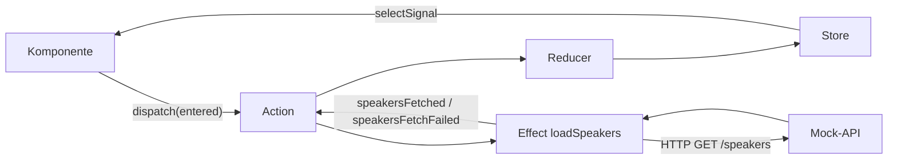

# Lab 7.3: Effects für Seiteneffekte

**Leitfragen:**

<details>
<summary>Wo würde man im bisherigen Store-Code den HTTP-Aufruf einbauen, und was spricht dagegen?</summary>

In Lab 7.2 steht er in der Komponente. Dann muss jede Komponente, die Sessions braucht, selbst laden und Fehler melden. Im Reducer geht es nicht: Reducer sind rein und synchron. Der Platz dafür ist ein Effect.

</details>

<details>
<summary>Welcher Operator aus Lab 5.2 passt zu „Speichern“?</summary>

`exhaustMap`: Solange gespeichert wird, werden weitere Klicks ignoriert, wie beim Doppelklick auf „Anmelden“. Soll jede Änderung der Reihe nach gespeichert werden, passt `concatMap`.

</details>

<details>
<summary>Was soll passieren, wenn das Laden fehlschlägt?</summary>

Die Seite zeigt eine verständliche Meldung und einen Weg zum erneuten Versuch. Der Store hält den Fehler als Zustand, ausgelöst durch eine eigene Fehler-Action.

</details>

- Ein Effect hört auf Actions, führt einen Seiteneffekt aus (HTTP, Speicher, Logging) und meldet das Ergebnis als neue Action.
- Komponente und Reducer bleiben frei von HTTP; die Operator-Wahl aus Lab 5.2 entscheidet über Abbrechen, Ignorieren oder Warten.

## Begriffe

| Begriff | Bedeutung |
| --- | --- |
| Seiteneffekt | alles, was über „Zustand rein, Zustand raus“ hinausgeht: HTTP, `localStorage`, Konsole, Navigation |
| Effect | Observable, das auf Actions reagiert und meist neue Actions liefert; NgRx schickt diese automatisch an den Store |
| `Actions` | Observable aller Actions, die an den Store gehen |
| `ofType(...)` | RxJS-Operator, der nur Actions der genannten Typen durchlässt |
| funktionaler Effect | Effect als Funktion mit `inject()` in den Parametern statt als Klasse |
| Fehler-Action | Action, die einen Fehlschlag meldet, z. B. `Speakers Fetch Failed` |

## Der Kreislauf mit Effect

Das Bild aus Lab 7.2 bekommt einen Seitenarm: Der Effect sieht jede Action **nach** dem Reducer. Die Beispiele führen das Speaker-Feature aus der Theorie von Lab 7.2 fort; die Übung baut dasselbe für Sessions.



Ablauf beim Öffnen der Seite:

| Schritt | Action | Reducer setzt |
| --- | --- | --- |
| 1 | `[Speakers Page] Entered` | `pending: true` |
| 2 | Effect ruft `GET /speakers` | – |
| 3 | `[Speakers API] Speakers Fetched` | `speakers`, `pending: false` |
| 3 (Fehler) | `[Speakers API] Speakers Fetch Failed` | `message`, `pending: false` |

## Funktionaler Effect: Laden mit `switchMap`

```ts
// speakers.effects.ts
import { HttpErrorResponse } from '@angular/common/http';
import { inject } from '@angular/core';
import { Actions, createEffect, ofType } from '@ngrx/effects';
import { catchError, map, of, switchMap } from 'rxjs';
import { SessionApi } from '../shared/api';
import { speakersApiActions, speakersPageActions } from './speakers.actions';

export const loadSpeakers = createEffect(
  // inject() in Parametern: läuft beim Registrieren im Injection Context
  (actions$ = inject(Actions), api = inject(SessionApi)) =>
    actions$.pipe(
      ofType(speakersPageActions.entered, speakersPageActions.refreshClicked),
      switchMap(() =>                       // neuer Auslöser bricht die laufende Anfrage ab
        api.getSpeakers().pipe(
          map((speakers) => speakersApiActions.speakersFetched({ speakers })),
          catchError((err: HttpErrorResponse) =>     // innen, nicht außen!
            of(speakersApiActions.speakersFetchFailed({ message: `Speaker nicht erreichbar (Status ${err.status})` })),
          ),
        ),
      ),
    ),
  { functional: true },                     // Pflicht für Effects ohne Klasse
);
```

`refreshClicked` ist eine weitere Action der Gruppe `speakersPageActions` (Button „Aktualisieren“).

- `catchError` steht **im** inneren Observable. Außen würde der Fehler den ganzen Effect-Strom beenden; danach reagiert er auf keine Action mehr.
- Der Effect liefert Actions. NgRx schickt sie an den Store; ein `dispatch` im Effect ist nicht nötig.

## Operator-Wahl im Effect

Die Marble-Tabelle aus Lab 5.2 gilt unverändert. Im Effect bedeutet sie:

| Operator | Bei neuem Auslöser während einer laufenden Anfrage | Passt zu |
| --- | --- | --- |
| `switchMap` | alte Anfrage abbrechen, neue starten | Laden, Suchen: nur das Neueste zählt |
| `exhaustMap` | neuen Auslöser ignorieren | Speichern per Button, Login: Doppelklick abfangen |
| `concatMap` | in die Warteschlange, nacheinander ausführen | jede Änderung soll in Reihenfolge ankommen |
| `mergeMap` | parallel ausführen | unabhängige Aufgaben, z. B. mehrere Dateien hochladen |

## Speichern mit `exhaustMap`

Im Beispiel steht `FollowStorage` für einen beliebigen Speicher-Service mit `save(ids): Observable<number[]>`; `saveFollowedClicked` (`{ speakerIds }`), `followedSaved` und `followedSaveFailed` sind weitere Actions der beiden Speaker-Gruppen:

```ts
export const saveFollowed = createEffect(
  (actions$ = inject(Actions), followStorage = inject(FollowStorage)) =>
    actions$.pipe(
      ofType(speakersPageActions.saveFollowedClicked),
      exhaustMap(({ speakerIds }) =>        // Klicks während des Speicherns werden verworfen
        followStorage.save(speakerIds).pipe(
          map((ids) => speakersApiActions.followedSaved({ speakerIds: ids })),
          catchError(() => of(speakersApiActions.followedSaveFailed({ message: 'Folgen nicht gespeichert' }))),
        ),
      ),
    ),
  { functional: true },
);
```

**Speichern in der Übung: nur lokal, ohne API.** Die Übung speichert Favoriten mit `FavoritesStorage` (`src/app/examples/m07-ngrx/shared/favorites-storage.ts`). Der Service schreibt in den `localStorage` des Browsers und ruft keine API auf: `PUT /favorites` der Mock-API verlangt ein Login, und das kommt erst in Modul 9. Damit sich das Speichern wie ein HTTP-Aufruf verhält, antwortet der Service nach 800 ms mit einem Observable; `exhaustMap` und `catchError` funktionieren deshalb genauso wie mit `HttpClient`.

## Effect ohne Dispatch

Manche Effects lösen nur etwas aus und melden nichts zurück, z. B. Logging oder Navigation. `dispatch: false` verhindert, dass NgRx das Ergebnis als Action behandelt.

```ts
export const reportSpeakerErrors = createEffect(
  (actions$ = inject(Actions)) =>
    actions$.pipe(
      ofType(speakersApiActions.speakersFetchFailed, speakersApiActions.followedSaveFailed),
      tap(({ message }) => console.warn('[Speakers]', message)),
    ),
  { functional: true, dispatch: false },
);
```

## Registrieren mit `provideEffects`

`provideEffects` nimmt Effect-Klassen oder ein Objekt mit funktionalen Effects. Ein Namespace-Import sammelt alle exportierten Effects einer Datei.

**Normale App:** Store, Effects-Laufzeit und DevTools stehen einmal in `app.config.ts`; jedes Feature bringt Zustand und Effects an seiner Route mit.

```ts
// app.config.ts (normale App)
providers: [
  provideStore(),
  provideEffects(),                 // Effects-Laufzeit im Root, hier noch ohne Effects
  provideStoreDevtools({ maxAge: 25, logOnly: !isDevMode() }),
],

// app.routes.ts (normale App)
import * as speakersEffects from './speakers/speakers.effects';

{
  path: 'speakers',
  providers: [provideState(speakersFeature), provideEffects(speakersEffects)],
  loadComponent: () => import('./speakers/speakers-page').then((m) => m.SpeakersPage),
},
```

**Kurs-App:** Jedes Lab hat seinen eigenen Store an der Route, `app.config.ts` bleibt ohne Store. NgRx registriert die Effects-Laufzeit (`Actions`, `EffectSources`, `EffectsRunner`) aber im Root-Injector und sucht dort einen Store; ohne Zusatz folgt `NG0201: No provider found for Store`. `provideEffectsRuntimeAtRoute()` aus `src/app/examples/m07-ngrx/shared/effects-at-route.ts` stellt diese drei Klassen zusätzlich an der Route bereit. Der Helfer gehört nur zur Kurs-App, nicht zu NgRx:

```ts
// src/app/examples/m07-ngrx/routes.ts (Ausschnitt, nur Kurs-App)
providers: [
  provideStore(),
  provideState(sessionsFeature),
  provideEffectsRuntimeAtRoute(),   // nur Kurs-App
  provideEffects(sessionsEffects),
  provideStoreDevtools({ name: 'EventHub Lab 7.3', maxAge: 25 }),
],
```

## Fehler sichtbar machen

Die Komponente zeigt die Fehlermeldung aus dem Store und bietet „Erneut versuchen“ an (löst wieder die Lade-Action aus). Zum Testen schaltet `<app-api-fail-switch />` die Mock-API per `POST /_control` auf HTTP 500 um. Der Schalter betrifft nur Anfragen an die Mock-API, in der Übung also das Laden; das Speichern im `localStorage` schlägt dadurch nicht fehl. Ohne UI geht dasselbe im Terminal:

```bash
curl -X POST http://localhost:3000/_control -H "Content-Type: application/json" -d '{"fail":500}'
curl -X POST http://localhost:3000/_control -H "Content-Type: application/json" -d '{"fail":0}'   # zurücksetzen
```

## Typische Fehler

| Symptom | Ursache | Lösung |
| --- | --- | --- |
| Nach dem ersten Fehler lädt „Neu laden“ nichts mehr | `catchError` außerhalb von `switchMap` beendet den Effect | `catchError` in das innere Observable |
| Endlosschleife, Browser hängt | Effect liefert dieselbe Action, auf die er hört | Ergebnis-Action mit anderem Typ, oder `dispatch: false` |
| `NG0201: No provider found for Store` (normale App) | `provideStore()` fehlt in `app.config.ts` | `provideStore()` in `app.config.ts` ergänzen |
| `NG0201: No provider found for Store` (Kurs-App) | Effects-Laufzeit sucht den Store im Root-Injector, der Store steht an der Route | `provideEffectsRuntimeAtRoute()` an der Route ergänzen |
| Effect läuft nie | `provideEffects(...)` fehlt oder Effect nicht exportiert | Effect exportieren und registrieren |
| `inject() must be called from an injection context` | `inject()` innerhalb eines Operators, z. B. in `switchMap` | `inject()` als Standardwert der Parameter |
| Doppelklick speichert zweimal | `mergeMap` oder `concatMap` statt `exhaustMap` | Operator nach Tabelle wählen |

## Fazit

- Effects halten Komponenten und Reducer frei von HTTP und anderen Seiteneffekten.
- Die Operator-Wahl ist eine fachliche Entscheidung: `switchMap` zum Laden, `exhaustMap` zum Speichern.
- Fehler werden zu Actions und damit zu Zustand, den die Seite anzeigen kann.

Die Übung verschiebt Laden und Speichern in Effects und macht den Fehlerfall sichtbar.
