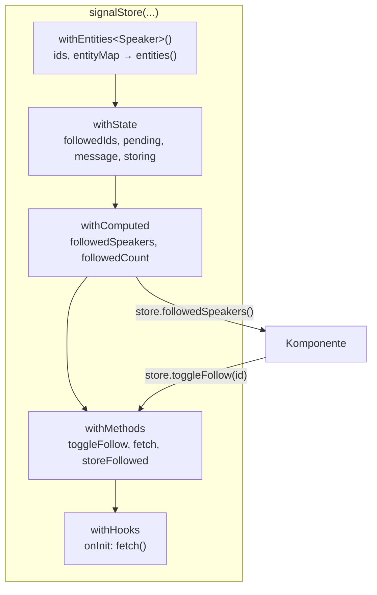

# Lab 7.4: NgRx Signal Store

**Leitfragen:**

<details>
<summary>Welche Dateien aus Lab 7.2–7.3 braucht man für ein kleines Feature wirklich?</summary>

Für Zustand, abgeleitete Werte, Laden und Speichern sind es fachlich vier Dinge. In Lab 7.3 verteilen sie sich auf Actions, Feature (Reducer und Selectors), Effects und Provider. Der Signal Store fasst sie in einer Datei zusammen.

</details>

<details>
<summary>Was ginge verloren, wenn es keine Actions mehr gäbe?</summary>

Die benannte Liste aller Ereignisse und damit der Verlauf in den Redux DevTools. Außerdem können andere Teile der App nicht mehr auf ein Ereignis reagieren, ohne die auslösende Stelle zu kennen (Thema von Lab 7.5).

</details>

<details>
<summary>Wie würde der Warenkorb aus Lab 6.1 als eigener Store aussehen?</summary>

Positionen als Zustand, Summe und Rabatt als `computed`, Hinzufügen und Entfernen als Methoden. Genau diese Aufteilung bildet der Signal Store mit `withState`, `withComputed` und `withMethods` ab.

</details>

- Ein Signal Store ist eine Klasse aus Bausteinen: Zustand, abgeleitete Werte, Methoden, Lebenszyklus.
- Jedes Feld des Zustands ist ein Signal; geändert wird nur innerhalb des Stores per `patchState`.

## Begriffe

| Begriff | Bedeutung |
| --- | --- |
| `signalStore(...)` | erzeugt eine injizierbare Store-Klasse aus Features (Bausteinen) |
| `withState` | Startzustand; jedes Feld wird ein Signal (`store.loading()`) |
| `withComputed` | abgeleitete Werte als `computed` (entspricht Selectors) |
| `withMethods` | Methoden, die den Zustand ändern oder Seiteneffekte starten |
| `withHooks` | Code beim Erzeugen (`onInit`) und Zerstören (`onDestroy`) des Stores |
| `patchState` | setzt Teile des Zustands; nur innerhalb des Stores erlaubt |
| `rxMethod` | Methode, die intern eine RxJS-Pipeline ist; nimmt einen Wert, ein Signal oder ein Observable |
| `withEntities` | Sammlung von Objekten mit `id`, gespeichert als `ids` und `entityMap`, lesbar als `entities()` |
| `EMPTY` | Observable aus RxJS, das sofort ohne Wert endet; in `catchError` zurückgegeben, schluckt es den Fehler |

Paket: `@ngrx/signals` (nicht `@ngrx/signal`), mit den Unterpfaden `@ngrx/signals/entities`, `@ngrx/signals/rxjs-interop` und `@ngrx/signals/events` (Lab 7.5).

## Aufbau eines Signal Stores



Die Reihenfolge zählt: Jedes Feature sieht nur, was davor definiert ist. `withComputed` kennt `entities` und `followedIds`, weil beide weiter oben stehen.

## Ein vollständiger Store

Das Beispiel führt das Speaker-Feature aus Lab 7.2–7.3 als Signal Store fort; die Übung baut dasselbe Muster für Sessions und Favoriten.

```ts
// speakers.store.ts
type SpeakersState = { followedIds: number[]; pending: boolean; message: string | null; storing: boolean };

export const SpeakersStore = signalStore(
  withEntities<Speaker>(),
  withState<SpeakersState>({ followedIds: [], pending: false, message: null, storing: false }),

  withComputed(({ entities, followedIds }) => ({
    followedSpeakers: computed(() => entities().filter((speaker) => followedIds().includes(speaker.id))),
    followedCount: computed(() => followedIds().length),
  })),

  withMethods((store, api = inject(SessionApi), followStorage = inject(FollowStorage)) => ({
    toggleFollow(speakerId: number): void {
      patchState(store, (state) => ({
        followedIds: state.followedIds.includes(speakerId)
          ? state.followedIds.filter((id) => id !== speakerId)
          : [...state.followedIds, speakerId],
      }));
    },

    fetch: rxMethod<void>(
      pipe(
        tap(() => patchState(store, { pending: true, message: null })),
        switchMap(() =>
          api.getSpeakers().pipe(
            tap((speakers) => patchState(store, setAllEntities(speakers), { pending: false })),
            catchError((err: HttpErrorResponse) => {
              patchState(store, { pending: false, message: `Speaker nicht erreichbar (Status ${err.status})` });
              return EMPTY; // Strom bleibt am Leben, nächster fetch() funktioniert
            }),
          ),
        ),
      ),
    ),

    storeFollowed: rxMethod<void>(
      pipe(
        exhaustMap(() => {
          patchState(store, { storing: true });
          return followStorage.save(store.followedIds()).pipe(
            tap(() => patchState(store, { storing: false })),
            catchError(() => {
              patchState(store, { storing: false, message: 'Folgen nicht gespeichert' });
              return EMPTY;
            }),
          );
        }),
      ),
    ),
  })),

  withHooks({
    onInit(store) {
      store.fetch();
    },
  }),
);
```

`FollowStorage` steht wie in Lab 7.3 für einen Speicher-Service mit `save(ids): Observable<number[]>`.

Imports: `signalStore`, `withState`, `withComputed`, `withMethods`, `withHooks`, `patchState` aus `@ngrx/signals`; `withEntities`, `setAllEntities` aus `@ngrx/signals/entities`; `rxMethod` aus `@ngrx/signals/rxjs-interop`; `pipe`, `tap`, `switchMap`, `exhaustMap`, `catchError`, `EMPTY` aus `rxjs`.

## `patchState`

| Aufruf | Wirkung |
| --- | --- |
| `patchState(store, { loading: true })` | Felder setzen, Rest bleibt |
| `patchState(store, (state) => ({ followedIds: [...state.followedIds, 3] }))` | neuer Wert aus dem aktuellen Zustand |
| `patchState(store, setAllEntities(speakers), { pending: false })` | mehrere Änderungen in einem Schritt |

Außerhalb des Stores meldet TypeScript einen Fehler, weil der Zustand standardmäßig geschützt ist. Komponenten ändern den Zustand nur über die Methoden.

## `rxMethod`: RxJS im Store

`rxMethod<T>(pipeline)` macht aus einer RxJS-Pipeline eine Methode. Jeder Aufruf schiebt einen Wert in die Pipeline; die Operator-Wahl aus Lab 5.2 und 7.3 gilt unverändert.

| Aufruf | Wirkung |
| --- | --- |
| `store.fetch()` | ein Durchlauf (Typ `void`) |
| `store.search('angular')` bei `rxMethod<string>` | ein Durchlauf mit diesem Wert |
| `store.search(this.term)` mit einem Signal | neuer Durchlauf bei jeder Änderung des Signals |

Die Pipeline endet automatisch, wenn der Store zerstört wird.

## `withEntities` für Sammlungen

`withEntities<Speaker>()` legt `ids: number[]` und `entityMap: Record<number, Speaker>` an und stellt `entities()` als abgeleitetes Signal bereit. Änderungen laufen über Hilfsfunktionen in `patchState`:

| Funktion | Wirkung |
| --- | --- |
| `setAllEntities(list)` | ersetzt die ganze Sammlung |
| `addEntity(item)` / `setEntity(item)` | fügt hinzu / fügt hinzu oder ersetzt |
| `updateEntity({ id, changes: { company: 'Kodschul' } })` | ändert Felder eines Eintrags |
| `removeEntity(id)` | entfernt einen Eintrag |

Vorteil gegenüber einem Array: Zugriff per ID ohne Suche (`entityMap()[5]`), keine doppelten Einträge.

## Bereitstellen und nutzen

```ts
@Component({
  providers: [SpeakersStore],   // eine Instanz pro Komponente, endet mit ihr
  template: `
    <p>Gefolgt: {{ store.followedCount() }}</p>
    @for (speaker of store.entities(); track speaker.id) {
      <button class="btn" (click)="store.toggleFollow(speaker.id)">{{ speaker.name }}</button>
    }
  `,
})
export class SpeakersPage {
  readonly store = inject(SpeakersStore);
}
```

Alternative: `signalStore({ providedIn: 'root' }, withState(...), ...)` macht den Store app-weit zu einem Singleton, wie einen Service. Weder `provideStore` noch Provider an der Route sind nötig.

## Codevergleich mit Lab 7.2–7.3

| Aspekt | NgRx Store (Lab 7.2–7.3) | Signal Store (Lab 7.4) |
| --- | --- | --- |
| Dateien für das Feature | Actions, Feature (Reducer, Selectors), Effects, dazu Provider an der Route | eine Store-Datei |
| Codemenge | höher: jede Änderung braucht Action, `on`-Fall und ggf. Effect | geringer: eine Methode pro Änderung |
| Zustand ändern | `dispatch(action)` → Reducer | `store.methode()` → `patchState` |
| Abgeleitete Werte | `createSelector`, `extraSelectors` | `withComputed` mit `computed` |
| HTTP | Effect mit `ofType` + Operator | `rxMethod` mit Operator |
| Lesen in der Komponente | `store.selectSignal(feature.selectX)` | `store.x()` |
| Registrierung | `provideStore`, `provideState`, `provideEffects` | `providers: [SpeakersStore]` oder `providedIn: 'root'` |
| Redux DevTools | eingebaut (`provideStoreDevtools`) | per Zusatz-Plugin (Lab 7.5) |
| Andere Stores reagieren lassen | jede Action ist für alle sichtbar | Events-Plugin (Lab 7.5) |

## Typische Fehler

| Symptom | Ursache | Lösung |
| --- | --- | --- |
| `NG0201: No provider found` beim Öffnen der Seite | Store weder in `providers` noch `providedIn: 'root'` | Store in `providers: [...]` der Komponente eintragen |
| TypeScript: Property `entities` does not exist | `withComputed` steht vor `withEntities` | Reihenfolge der Features ändern |
| Fehler bei `patchState` in der Komponente | Zustand ist geschützt | Methode im Store ergänzen |
| Nach einem Fehler lädt die `rxMethod` nicht mehr | `catchError` außerhalb von `switchMap` oder ohne `EMPTY` | `catchError` innen, `EMPTY` zurückgeben |
| Store lädt doppelt | Lade-Methode in `onInit` und im Konstruktor der Komponente | nur an einer Stelle auslösen |

## Vertiefung

- `tapResponse` aus `@ngrx/operators` fasst `tap` und `catchError` zusammen: `tapResponse({ next: ..., error: ... })`. Der Kurs zeigt die ausgeschriebene Form, damit die Operatoren aus Lab 5.2 sichtbar bleiben.
- Benannte Sammlungen: `withEntities({ entity: type<Speaker>(), collection: 'speaker' })` erzeugt `speakerEntities()`, `speakerIds` usw., wenn ein Store mehrere Sammlungen hält.

## Fazit

- Der Signal Store bündelt Zustand, abgeleitete Werte, Methoden und Seiteneffekte in einer Datei.
- `patchState` ersetzt Action und Reducer, `rxMethod` ersetzt den Effect; die Operator-Wahl bleibt dieselbe.
- Weniger Code kostet Actions als gemeinsame Sprache und den eingebauten DevTools-Verlauf.

Die Übung baut dasselbe Sessions-Feature als Signal Store mit unveränderter Oberfläche.
