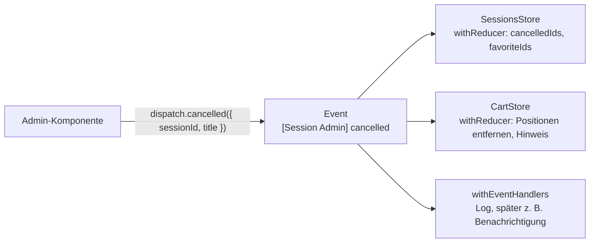

# Lab 7.5: Events-Plugin und Entscheidung im Team

**Leitfragen:**

<details>
<summary>Wie erfährt der Warenkorb, dass eine Session abgesagt wurde, ohne den Sessions-Store zu kennen?</summary>

Über ein Ereignis, das beide kennen: „Session abgesagt“. Wer absagt, meldet nur das Ereignis; jeder Store, der reagieren will, hört darauf. Kein Store ruft Methoden des anderen auf.

</details>

<details>
<summary>Welcher Ansatz passt zu einem Team mit drei Leuten, welcher zu einem mit dreißig?</summary>

Drei Leute: Signal Store, wenig Konvention nötig, kurze Wege. Dreißig Leute: feste Struktur mit Ereignissen und DevTools-Verlauf, also NgRx Store oder Signal Store mit Events. Die Teamgröße ist ein Kriterium unter mehreren.

</details>

<details>
<summary>Was würde man in einem bestehenden NgRx-Projekt nicht anfassen?</summary>

Funktionierende Features mit Actions, Reducern und Effects. Neue Features können als Signal Store entstehen; ein Umbau lohnt sich nur, wo ein Feature ohnehin neu geschrieben wird.

</details>

- Das Events-Plugin (`@ngrx/signals/events`) bringt Ereignisse wie im klassischen Store in den Signal Store, stabil seit NgRx 21.
- Mehrere Stores reagieren auf dasselbe Ereignis, ohne sich gegenseitig zu kennen.

## Begriffe

| Begriff | Bedeutung | Im klassischen Store |
| --- | --- | --- |
| Event | Objekt `{ type, payload }`, beschreibt, was passiert ist | Action |
| `eventGroup({ source, events })` | Gruppe von Events einer Quelle | `createActionGroup` |
| `withReducer(on(event, fn))` | Zustandsübergang bei einem Event im Signal Store | `createReducer` + `on` |
| `withEventHandlers(...)` | Seiteneffekte bei Events (bis NgRx 20: `withEffects`) | Effects |
| `Events` | Service, über den man Events als Observable abonniert (`events.on(...)`) | `Actions` + `ofType` |
| `injectDispatch(gruppe)` | liefert Funktionen, die Events sofort verschicken | `store.dispatch(...)` |

## Ohne Events: Stores rufen sich gegenseitig auf

```ts
// Kopplung: SessionsStore muss den CartStore kennen und aufrufen
cancel(sessionId: number) {
  patchState(store, ({ cancelledIds }) => ({ cancelledIds: [...cancelledIds, sessionId] }));
  cart.removeSession(sessionId);      // und morgen noch Favoriten, Kalender, Benachrichtigungen …
}
```

Jeder neue Interessent ändert den SessionsStore. Mit Events kehrt sich die Richtung um:



Die Übung setzt genau dieses Bild für „Session abgesagt“ um. Die Code-Beispiele unten zeigen dasselbe Muster an einem zweiten Fall: Ein Speaker zieht seine Teilnahme zurück. Darauf reagieren der `SpeakersStore` (aus Lab 7.4) und ein `WatchlistStore`, der gemerkte Speaker für eine Merkliste hält.

## Events definieren

```ts
// speaker.events.ts: kennt keinen Store
import { type } from '@ngrx/signals';
import { eventGroup } from '@ngrx/signals/events';

export const speakerAdminEvents = eventGroup({
  source: 'Speaker Admin',
  events: {
    withdrawn: type<{ speakerId: number; name: string }>(), // Typ: '[Speaker Admin] withdrawn'
  },
});
```

Einzelne Events ohne Gruppe: `const withdrawn = event('[Speaker Admin] withdrawn', type<{ speakerId: number }>());`.

## Zwei Stores reagieren

```ts
// speakers.store.ts (Ausschnitt)
withReducer(
  on(speakerAdminEvents.withdrawn, ({ payload }, state) => ({
    withdrawnIds: [...state.withdrawnIds, payload.speakerId],
    followedIds: state.followedIds.filter((id) => id !== payload.speakerId),
  })),
),

// watchlist.store.ts (Ausschnitt), Zustand { entries: { speakerId, name }[], hint: string | null }
withReducer(
  on(speakerAdminEvents.withdrawn, ({ payload }, state) => {
    if (!state.entries.some((entry) => entry.speakerId === payload.speakerId)) {
      return {};                                  // nicht betroffen: nichts ändern
    }
    return {
      entries: state.entries.filter((entry) => entry.speakerId !== payload.speakerId),
      hint: `${payload.name} hat die Teilnahme zurückgezogen und steht nicht mehr auf der Merkliste.`,
    };
  }),
),
```

- Die Funktion in `on` bekommt das Event und den aktuellen Zustand und liefert einen Teil-Zustand, wie `patchState`.
- `withReducer` und `withMethods` dürfen im selben Store stehen: Methoden für eigene Abläufe, Reducer für Ereignisse von außen.

## Events auslösen

```ts
export class SpeakerAdminPage {
  private readonly dispatch = injectDispatch(speakerAdminEvents); // aus @ngrx/signals/events

  withdraw(speaker: Speaker): void {
    this.dispatch.withdrawn({ speakerId: speaker.id, name: speaker.name });
  }
}
```

`injectDispatch` muss im Injection Context stehen (Feld oder Konstruktor). Alternative: `inject(Dispatcher).dispatch(speakerAdminEvents.withdrawn({ ... }))`.

## Seiteneffekte auf Events

```ts
// speakers.store.ts (Ausschnitt)
withEventHandlers((_store, events = inject(Events)) => ({
  announceWithdrawal$: events
    .on(speakerAdminEvents.withdrawn)
    .pipe(tap(({ payload }) => console.warn('[SpeakersStore] zurückgezogen:', payload.name))),
})),
```

Handler sind Observables wie Effects in Lab 7.3. Liefert ein Handler Events, werden sie automatisch verschickt; der Operator wird wie dort gewählt.

## Redux DevTools für den Signal Store

`withDevtools('name')` aus `@angular-architects/ngrx-toolkit` meldet den Zustand eines Signal Stores an die Redux DevTools:

```ts
import { withDevtools } from '@angular-architects/ngrx-toolkit';

export const WatchlistStore = signalStore(
  withDevtools('watchlist'),     // erscheint im Tab Redux unter „NgRx SignalStore“ als Zweig „watchlist“
  withState<WatchlistState>({ entries: [], hint: null }),
  // ...
);
```

- Jede Änderung erscheint standardmäßig als „Store Update“; Zustand und Diff sind sichtbar; Zeitreise (Jump) wie beim klassischen Store bietet das Plugin nicht.
- Ohne Browser-Erweiterung bleibt `withDevtools` wirkungslos; `withDevToolsStub` ersetzt es für Produktions-Builds.
- **Stand: 28.10.2026, prüfen:** Im Kurs-Repo ist `@angular-architects/ngrx-toolkit` 21.0.1 installiert. Es deklariert Angular 21 und `@ngrx/signals` 21 als Peer-Abhängigkeit, der Kurs nutzt Angular 22 und NgRx 22. Die App kompiliert damit und alle importierten NgRx-Funktionen existieren in Version 22; vor Kursbeginn eine zu NgRx 22 passende Version prüfen. Für die Übung ist das Plugin optional.

## Migrationspfad klassischer Store → Signal Store

| Schritt | Vorgehen |
| --- | --- |
| 1 | Bestehende Features mit Actions, Reducern und Effects unverändert lassen |
| 2 | Neue Features als Signal Store bauen; Daten aus dem klassischen Store per `store.selectSignal` lesen |
| 3 | Für Ereignisse über Feature-Grenzen das Events-Plugin nutzen; Namen wie Actions wählen (`[Quelle] ereignis`) |
| 4 | Ein klassisches Feature nur umbauen, wenn es ohnehin neu geschrieben wird; dann Action für Action in Events und Methoden übersetzen |
| 5 | Erst wenn kein Feature mehr `provideState` braucht, `provideStore` entfernen |

## Entscheidungshilfe für ein Team

| Kriterium | Signal Store | Signal Store + Events | NgRx Store |
| --- | --- | --- | --- |
| Teamgröße | 1–5 | 5–20 | 10+ oder viele Teams |
| Stores reagieren aufeinander | selten | regelmäßig | regelmäßig |
| Verlauf jeder Änderung nötig (Audit, Debugging) | nein | teilweise (Plugin) | ja, eingebaut |
| Bestehender NgRx-Store-Code | keiner | wenig | viel |
| Codemenge pro Feature | gering | mittel | höher |

Eine Entscheidungsnotiz fasst das für ein Projekt in wenigen Sätzen: Kontext, Entscheidung, Begründung, was bewusst nicht gemacht wird, wann neu entschieden wird.

## Typische Fehler

| Symptom | Ursache | Lösung |
| --- | --- | --- |
| „Absagen“ ändert nichts | `withReducer` fehlt oder hört auf ein anderes Event-Objekt | dasselbe `sessionAdminEvents.cancelled` importieren |
| Warenkorb-Hinweis erscheint bei jeder Absage | Reducer prüft nicht, ob der Warenkorb betroffen ist | bei nicht betroffenen Positionen `{}` zurückgeben |
| `NG0203: injectDispatch() can only be used within an injection context …` | Aufruf in einer Methode statt als Feld | als Feld der Komponente anlegen |
| TypeScript: `withEffects` wird nicht gefunden | Name aus NgRx 19/20 | `withEventHandlers` verwenden |
| Tab Redux zeigt den Signal Store nicht | `withDevtools` fehlt oder Erweiterung nicht installiert | Plugin ergänzen, Seite neu laden |

## Fazit

- Events entkoppeln Stores: Wer etwas meldet, muss nicht wissen, wer reagiert.
- Das Events-Plugin bringt Actions-Denken in den Signal Store, ohne Store, Reducer-Datei und Effects-Klasse.
- Die Wahl zwischen Signal Store, Signal Store mit Events und NgRx Store hängt an Team, Bestand und Nachvollziehbarkeit, nicht an der Mode.

Die Übung führt das Event „Session abgesagt“ ein und endet mit einer Entscheidungsnotiz für EventHub.
