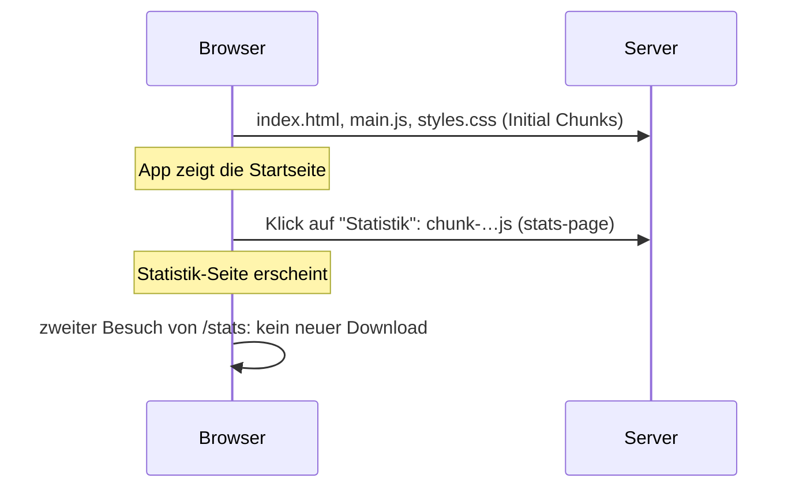

# Lab 8.1: Lazy Loading mit loadComponent und loadChildren

**Leitfragen:**

<details>
<summary>Wie viele Personen besuchen den Admin-Bereich, und wer bezahlt den Code dafür?</summary>

Wenige, aber ohne Lazy Loading lädt jede Person beim Start den kompletten Admin-Code mit. Mit Lazy Loading bezahlen nur die, die den Admin-Bereich öffnen.

</details>

<details>
<summary>Wo sieht man, wie groß der Code ist, der beim Start geladen wird?</summary>

In der Ausgabe von `ng build`: Die Tabelle „Initial chunk files“ listet alles, was der Browser beim Start lädt, mit Summe „Initial total“. Im Browser zeigt der Network-Tab dieselben Dateien.

</details>

<details>
<summary>Was ist der Unterschied zwischen „Seite später laden“ und „Teil einer Seite später laden“?</summary>

Lazy Loading per Route lädt eine ganze Seite erst bei der Navigation. `@defer` (Lab 3.2) lädt einen Bereich innerhalb einer bereits geladenen Seite nach, z. B. beim Scrollen.

</details>

- Jede Komponente, die eine Routen-Datei per `import { … }` einbindet, landet im Start-Bundle. `loadComponent` und `loadChildren` verschieben sie in eigene Dateien, die erst bei der Navigation laden.
- Provider an einer Route (`providers: [...]`) gelten nur für diese Route und ihre Kinder; so bleibt Feature-State im Feature.

## Begriffe

| Begriff | Bedeutung |
| --- | --- |
| Bundle | die JavaScript-Dateien, die der Build für den Browser erzeugt |
| Chunk | eine einzelne dieser Dateien, z. B. `main-4WKOFHEX.js` |
| Initial Chunk | Chunk, den der Browser beim Start lädt, bevor die App etwas anzeigt |
| Lazy Chunk | Chunk, den der Browser erst bei Bedarf nachlädt (Navigation, `@defer`) |
| `loadComponent` | Routen-Eigenschaft: Funktion, die eine Komponente per `import()` nachlädt |
| `loadChildren` | Routen-Eigenschaft: Funktion, die eine ganze Routen-Datei per `import()` nachlädt |
| `import()` | dynamischer Import; der Build legt für die Zieldatei einen eigenen Chunk an |
| Routen-Provider | Eintrag in `providers` einer Route; erzeugt einen eigenen Injector für diesen Teilbaum |

## Arbeitsumgebung: Workspace `eventhub-lab`

Die Kurs-App lädt jedes Modul bereits per `loadChildren` nach; ihre Root-Routen und `app.config.ts` gehören allen Beispielen. Für Labs, die Root-Routen oder Root-Konfiguration ändern (8.1, 8.2, 9.2, 9.3), gibt es deshalb eine kleine eigene App.

| Ort | Inhalt |
| --- | --- |
| `workspaces/eventhub-lab/` | Mini-EventHub mit Sessions, Speaker, Admin; Port 4201; nutzt `node_modules` der Kurs-App |
| `workspaces/eventhub-lab/src/app/app.config.ts` | Root-Konfiguration, ganz für die Übung |
| `workspaces/eventhub-lab/src/app/eventhub/` | Feature-Code; dieselbe Struktur wie in den Beispielen |
| `src/app/examples/m08-advanced-routing/l01-lazy-loading/` | Ergebnis dieses Labs, in der Kurs-App unter `/examples/m08-advanced-routing/l01-lazy-loading` |

```bash
cd workspaces/eventhub-lab
npx ng serve      # http://localhost:4201
npx ng build      # Build-Ausgabe mit Chunk-Größen
```

## Erst ohne: alles im Start-Bundle

Die Routen-Datei importiert jede Seite statisch. Der Build packt damit alle Seiten samt ihrer Abhängigkeiten in `main`.

```ts
// workspaces/eventhub-lab/src/app/eventhub/eventhub.routes.ts (Ausgangszustand)
import { AdminPage } from './admin/admin-page';           // Admin inkl. @angular/forms
import { SessionsPage } from './sessions/sessions-page';
import { Shell } from './shell';
import { SpeakerDetail } from './speakers/speaker-detail';
import { SpeakerList } from './speakers/speaker-list';

export const EVENTHUB_ROUTES: Routes = [
  {
    path: '',
    component: Shell,
    children: [
      { path: '', pathMatch: 'full', redirectTo: 'sessions' },
      { path: 'sessions', component: SessionsPage },
      { path: 'speakers', component: SpeakerList },
      { path: 'speakers/:id', component: SpeakerDetail },
      { path: 'admin', component: AdminPage },
    ],
  },
];
```

Ausgabe von `npx ng build` (gemessen am 28.10.2026, Angular 22.2):

```text
Initial chunk files | Names         |  Raw size | Estimated transfer size
main-4WKOFHEX.js    | main          | 327.38 kB |                88.18 kB
styles-YGSHSUSE.css | styles        |   1.75 kB |               644 bytes

                    | Initial total | 329.13 kB |                88.82 kB
```

| Spalte | Bedeutung |
| --- | --- |
| `Names` | Name des Chunks; bei Lazy Chunks abgeleitet vom Dateinamen (`stats-page`), `-` bei geteiltem Code |
| `Raw size` | Größe der Datei ohne Kompression |
| `Estimated transfer size` | geschätzte Größe nach Kompression, also das, was übers Netz geht |
| `Initial total` | Summe aller Initial Chunks: der Preis jedes Seitenaufrufs |

`ng serve` zeigt keine aussagekräftigen Größen (Entwicklungs-Build ohne Optimierung); gemessen wird mit `ng build`.

## Dann mit: loadComponent und loadChildren

Beispiel aus einer anderen Ausbaustufe von EventHub: eine Statistik-Seite und ein Räume-Feature (Liste und Detail) werden nachgeladen. Die Übung wendet dasselbe Muster auf Admin und Speaker an.

```ts
// app.routes.ts (Beispiel)
import { HomePage } from './home/home-page';            // Startseite bleibt statisch
// kein import von StatsPage, RoomList, RoomDetail!

export const routes: Routes = [
  { path: '', component: HomePage },
  {
    path: 'stats',
    loadComponent: () => import('./stats/stats-page').then((m) => m.StatsPage),
  },
  {
    path: 'rooms',
    loadChildren: () => import('./rooms/rooms.routes'), // Routen-Datei mit default export
  },
];
```

```ts
// rooms/rooms.routes.ts – die Routen des Features in einer eigenen Datei
import { Routes } from '@angular/router';
import { RoomDetail } from './room-detail';             // innerhalb des Features: statisch
import { RoomList } from './room-list';

export default [
  { path: '', component: RoomList },          // /rooms
  { path: ':roomId', component: RoomDetail }, // /rooms/4
] satisfies Routes;
```

| Eigenschaft | Lädt | Rückgabe der Funktion | Einsatz |
| --- | --- | --- | --- |
| `loadComponent` | eine Komponente | `import('…').then((m) => m.Klasse)` oder Datei mit `export default class` | einzelne Seite (Statistik) |
| `loadChildren` | ein Array von Routen | `import('…')` bei `export default [...]`, sonst `.then((m) => m.ROUTES)` | Feature mit mehreren Seiten (Räume-Liste + Detail) |

Innerhalb der Routen-Datei eines Features sind statische Imports richtig: Die ganze Datei ist bereits ein Lazy Chunk.

Nach dem Umbau ergänzt `ng build` eine zweite Tabelle (Aufbau, Größen je nach App):

```text
Initial chunk files | Names         |  Raw size | Estimated transfer size
main-….js           | main          |   kleiner |                 kleiner
styles-….css        | styles        |       …   |                     …

                    | Initial total |   kleiner |                 kleiner

Lazy chunk files    | Names         |  Raw size | Estimated transfer size
chunk-….js          | stats-page    |       …   |                     …
chunk-….js          | rooms-routes  |       …   |                     …
chunk-….js          | -             |       …   |                     …
```

Der Name in `Names` stammt aus dem Dateinamen der Zieldatei von `import()`. Wie viel das Start-Bundle im EventHub-Workspace verliert, misst die Übung; am meisten bringt das Auslagern von Seiten mit großen Abhängigkeiten (z. B. `@angular/forms` in einem Editor). Hash-Namen (`chunk-….js`) ändern sich bei jedem Build mit geändertem Inhalt.



## Provider pro Route: Feature-State bleibt im Feature

Ein Signal Store (Lab 7.4) mit `providedIn: 'root'` ist für die ganze App sichtbar. Ohne `providedIn` und mit `providers` an der Route existiert er nur in diesem Feature.

```ts
// rooms/rooms-store.ts (Beispiel)
export const RoomsStore = signalStore(
  // kein { providedIn: 'root' }
  withState({ rooms: [] as Room[], loading: false }),
  // ...
);

// rooms/rooms.routes.ts: Store für Liste und Detail gemeinsam
export default [
  {
    path: '',
    providers: [RoomsStore],                   // gilt für diese Route und ihre Kinder
    children: [
      { path: '', component: RoomList },
      { path: ':roomId', component: RoomDetail },
    ],
  },
] satisfies Routes;
```

| Registrierung | Sichtbar für | Instanz |
| --- | --- | --- |
| `@Injectable({ providedIn: 'root' })` / `signalStore({ providedIn: 'root' }, …)` | ganze App | eine für die App |
| `providers` an einer Route | diese Route und ihre Kinder | eine pro Route, entsteht beim ersten Aktivieren |
| `providers` im `@Component` | diese Komponente und ihre Kinder | eine pro Komponenten-Instanz |

Injiziert eine Komponente außerhalb des Features den Store, meldet Angular in der Konsole `` NG0201: No provider found for `SignalStore`. Source: Standalone[_StatsPage]. `` (`signalStore` heißt intern `SignalStore`, hinter `Source` steht die injizierende Komponente). Die Navigation bricht ab: Die URL bleibt, der Seiteninhalt unter der Navigation verschwindet. Der Routen-Injector bleibt nach dem Verlassen der Route erhalten; der Store behält seinen Zustand. Automatisches Aufräumen gibt es als Router-Feature `withAutoCleanupInjectors()` (seit Angular 22.2).

## Lazy Loading per Route und @defer

| | Route mit `loadComponent`/`loadChildren` | `@defer` (Lab 3.2) |
| --- | --- | --- |
| Einheit | ganze Seite oder Feature | Bereich in einem Template |
| Auslöser | Navigation | Trigger: `on viewport`, `on interaction`, `on idle`, `when …` |
| Konfiguration | Routen-Datei | Template |
| Vorladen | Preloading-Strategie (Lab 8.2) | `prefetch on …` |

Beides kombiniert sich: eine lazy geladene Admin-Seite kann einen Diagramm-Bereich zusätzlich per `@defer` nachladen.

## Typische Fehler

| Symptom | Ursache | Lösung |
| --- | --- | --- |
| Admin-Chunk erscheint nicht, `main` bleibt gleich groß | `import { AdminPage }` steht noch oben in einer Datei, die statisch geladen wird | alle statischen Imports der Seite entfernen; nur `import()` in der Route |
| `loadChildren` meldet „Invalid configuration … expected array“ | Routen-Datei hat keinen `export default`, Funktion liefert das Modul-Objekt | `export default [...]` oder `.then((m) => m.SPEAKER_ROUTES)` |
| Konsole: `` NG0201: No provider found for `SignalStore` ``, Seite bleibt leer | Store ohne `providedIn`, aber außerhalb der Route mit `providers` injiziert | Store nur im Feature nutzen oder Provider weiter oben eintragen |
| Link „Speaker“ führt ins Leere | absoluter Link `/speakers` statt relativ | im Shell relative Links (`routerLink="speakers"`) |
| Größen im Terminal fehlen | `ng serve` statt `ng build` | `npx ng build` im Workspace |

## Vertiefung

- `npx ng build --verbose` listet alle Lazy Chunks statt nur der größten.
- `npx ng build --stats-json` schreibt `dist/…/stats.json` für Bundle-Analyse-Werkzeuge (z. B. esbuild Bundle Analyzer, `prüfen`).
- In der Kurs-App (`npm run build`) zeigt die Ausgabe viele Lazy Chunks mit den Namen `example` und `routes`: Jedes Modul und jedes Beispiel ist dort schon ein eigener Chunk.

## Fazit

- Statischer `import` in den Routen = Start-Bundle; `import()` in `loadComponent`/`loadChildren` = eigener Lazy Chunk.
- `ng build` zeigt den Effekt: „Initial total“ sinkt, „Lazy chunk files“ kommen dazu.
- `providers` an einer Route begrenzen Feature-State auf das Feature.

Die Übung lagert Admin und Speaker im Workspace `eventhub-lab` aus und misst das Start-Bundle vorher und nachher.
