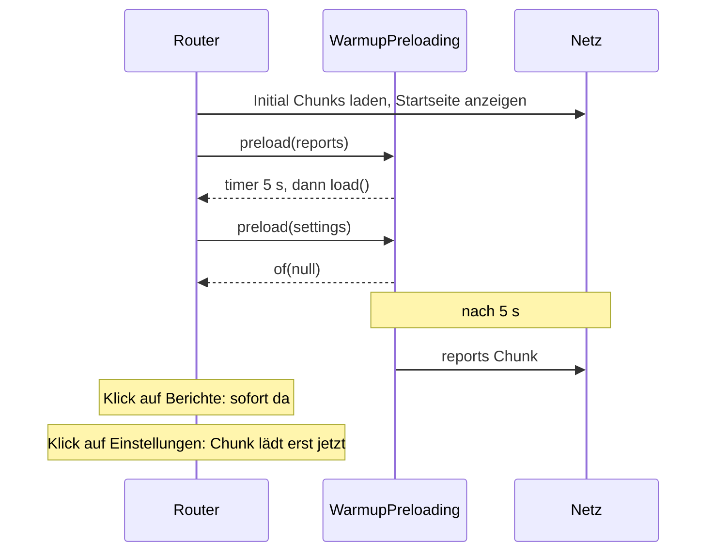

# Lab 8.2: Preloading-Strategien

**Leitfragen:**

<details>
<summary>Wann ist der beste Zeitpunkt, Code zu laden, den jemand gleich brauchen könnte?</summary>

Wenn die Startseite fertig ist und das Netz frei ist, aber bevor jemand klickt. Dann ist der Klick sofort da, ohne den Start zu bremsen.

</details>

<details>
<summary>Wer bezahlt das Vorladen auf einer mobilen Verbindung?</summary>

Die Person mit dem Handy: Datenvolumen und Akku für Code, den sie vielleicht nie öffnet. Vorladen lohnt sich nur für Bereiche, die viele wirklich besuchen.

</details>

<details>
<summary>Welche Bereiche der EventHub-App sollten nie vorgeladen werden?</summary>

Der Admin-Bereich: Nur wenige nutzen ihn, und sein Code verrät Endpunkte und Abläufe der Administration. Ebenso große, selten genutzte Features wie Berichte oder Exporte.

</details>

- Lazy Loading (Lab 8.1) spart beim Start, kostet aber eine Wartezeit beim ersten Klick. Preloading lädt Lazy Chunks im Hintergrund, nachdem die App gestartet ist.
- Die Strategie gilt für den ganzen Router und wird einmal in `provideRouter` gesetzt.

## Begriffe

| Begriff | Bedeutung |
| --- | --- |
| Preloading | Lazy Chunks nach dem Start im Hintergrund laden, bevor jemand navigiert |
| `PreloadingStrategy` | Klasse mit Methode `preload(route, load)`; entscheidet pro Lazy-Route, ob und wann geladen wird |
| `withPreloading(…)` | Router-Feature in `provideRouter`; aktiviert eine Strategie |
| `timer(ms)` | RxJS-Funktion: Observable, das nach `ms` Millisekunden einmal einen Wert sendet und endet |
| Routen-`data` | frei wählbares Objekt an einer Route, z. B. `{ preload: true }`; Strategien, Guards und Komponenten können es lesen |

## Die eingebauten Strategien

| Strategie | Verhalten | Passt für |
| --- | --- | --- |
| `NoPreloading` (Default ohne `withPreloading`) | lädt nur bei Navigation | große Apps, mobile Nutzung, viele selten genutzte Features |
| `PreloadAllModules` | lädt nach dem Start alle Lazy-Routen (`loadChildren` und `loadComponent`) | kleine Apps, interne Tools im schnellen Netz |
| eigene Strategie | entscheidet pro Route, z. B. über `data` | gemischte Apps: häufige Bereiche vorladen, seltene nicht |

```ts
// app.config.ts – Strategie wird beim Root-Router gesetzt
import { PreloadAllModules, provideRouter, withPreloading } from '@angular/router';

provideRouter(EVENTHUB_ROUTES, withComponentInputBinding(), withPreloading(PreloadAllModules));
```

`withPreloading` ist ein Feature von `provideRouter` in der Root-Konfiguration. In der Kurs-App ist `app.config.ts` für alle Beispiele fest; deshalb läuft diese Übung wie Lab 8.1 im Workspace `workspaces/eventhub-lab/` (Port 4201).

## Eigene Strategie: nur markierte Routen, verzögert

Beispiel aus einer anderen App (Berichte und Einstellungen): Routen mit `data: { warmup: true }` lädt die Strategie 5 Sekunden nach dem Start vor, alle anderen nie.

```ts
// app/warmup-preloading.ts
import { Injectable } from '@angular/core';
import { PreloadingStrategy, Route } from '@angular/router';
import { Observable, of, switchMap, timer } from 'rxjs';

@Injectable({ providedIn: 'root' })
export class WarmupPreloading implements PreloadingStrategy {
  preload(route: Route, load: () => Observable<unknown>): Observable<unknown> {
    if (!route.data?.['warmup']) {
      return of(null);                        // nicht vorladen
    }
    console.log(`[Warmup] ${route.path} in 5 s`);
    return timer(5000).pipe(                  // erst warten: Startseite hat Vorrang
      switchMap(() => load()),                // ruft loadChildren/loadComponent auf
    );
  }
}
```

| Teil | Bedeutung |
| --- | --- |
| `route` | die Routen-Konfiguration, für die der Router fragt (nur Lazy-Routen) |
| `load` | Funktion, die das Laden startet; liefert ein Observable |
| Rückgabe `of(null)` | „nicht vorladen“ |
| Rückgabe `load()` | „jetzt laden“ |
| `.pipe(switchMap(() => load()))` | wechselt nach dem Timer auf das Laden (`switchMap` aus Lab 5.2) |
| `route.data?.['warmup']` | Eckige Klammern, weil `data` ein Index-Typ ist (`noPropertyAccessFromIndexSignature`) |

Markierung in den Routen und Aktivierung:

```ts
// app.routes.ts
{ path: 'reports', data: { warmup: true }, loadChildren: () => import('./reports/reports.routes') },
{ path: 'settings', loadComponent: () => import('./settings/settings-page').then((m) => m.SettingsPage) },

// app.config.ts
provideRouter(routes, withPreloading(WarmupPreloading)),
```



## Nachweis im Network-Tab

| Beobachtung | Bedeutung |
| --- | --- |
| Chunk erscheint ohne Klick, nach der Verzögerung der Strategie (oben 5 s) | vorgeladen |
| Klick auf den Link erzeugt keinen neuen Request | Chunk war schon da |
| Chunk erscheint erst beim Klick | nicht vorgeladen |

Die DevTools-Drosselung (Network → „No throttling“ auf „Slow 4G“ stellen) macht Wartezeiten und Reihenfolge sichtbar.

## Abwägung: Bandbreite oder Wartezeit

| Bereich der EventHub-App | Nutzung | Vorladen? |
| --- | --- | --- |
| Sessions (Startseite) | alle | nicht lazy, im Start-Bundle |
| Speaker | viele | ja, verzögert |
| Admin | wenige Personen mit Rolle | nein |
| Anmeldung, Favoriten | viele nach dem Stöbern | ja, wenn lazy |

Ausblick: Strategien, die nur Routen vorladen, deren Links gerade sichtbar sind (z. B. die Bibliothek `ngx-quicklink`, Kompatibilität mit Angular 22 `prüfen`). Die Strategie aus diesem Lab lässt sich um weitere Bedingungen erweitern, z. B. kein Vorladen bei `navigator.connection.saveData`.

## Typische Fehler

| Symptom | Ursache | Lösung |
| --- | --- | --- |
| Nichts wird vorgeladen | `withPreloading` fehlt oder steht nicht in `provideRouter` der Root-Konfiguration | die eigene Strategie-Klasse (oben `WarmupPreloading`, in der Übung `DelayedPreloading`) als `withPreloading(…)`-Argument von `provideRouter` |
| Auch Admin wird vorgeladen | `PreloadAllModules` statt eigener Strategie aktiv | Strategie-Klasse in `withPreloading` prüfen |
| TS-Fehler „Property 'preload' comes from an index signature“ | Punkt-Schreibweise `route.data?.preload` | `route.data?.['preload']` |
| Konsole zeigt die Logs, Network-Tab nichts | Chunk war schon im Cache des Dev-Servers bzw. Filter falsch | Filter `JS`, „Disable cache“ aktivieren, neu laden |

## Fazit

- Preloading schließt die Lücke zwischen kleinem Start-Bundle und schnellem ersten Klick.
- Die Strategie ist eine Klasse mit `preload(route, load)`; `data` an der Route steuert sie pro Bereich.
- Häufig genutzte Bereiche vorladen, seltene und sensible (Admin) nicht.

Die Übung schreibt für EventHub eine eigene Strategie mit `data.preload` und Verzögerung und weist sie im Network-Tab nach.
