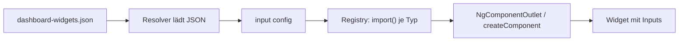

# Lab 8.3: Dynamische Komponenten

**Leitfragen:**

<details>
<summary>Wie baut man eine Seite, deren Aufbau erst zur Laufzeit feststeht?</summary>

Das Template kennt nur einen Platzhalter; welche Komponente dort erscheint, entscheidet Code anhand von Daten, z. B. einer Konfiguration vom Server. Angular bietet dafür `NgComponentOutlet` und `ViewContainerRef.createComponent`.

</details>

<details>
<summary>Was ist der Nachteil eines großen <code>@switch</code> über 20 Widget-Typen?</summary>

Jeder neue Typ ändert das Template, und alle 20 Komponenten stehen in `imports`, landen also im selben Chunk, auch wenn eine Seite nur drei zeigt.

</details>

<details>
<summary>Wer soll das Dashboard konfigurieren können?</summary>

Im Idealfall Fachleute oder die Nutzenden selbst, ohne neues Release. Dafür muss der Aufbau als Daten (JSON) vorliegen und nicht als Template-Code.

</details>

- Eine Registry ordnet jedem Widget-Typ eine Ladefunktion mit `import()` zu; jedes Widget wird zum eigenen Lazy Chunk wie die Routen in Lab 8.1.
- `NgComponentOutlet` rendert eine Komponentenklasse aus dem Template heraus, `ViewContainerRef.createComponent` aus dem Code; beide setzen Inputs.

## Begriffe

| Begriff | Bedeutung |
| --- | --- |
| dynamische Komponente | Komponente, deren Klasse erst zur Laufzeit feststeht und nicht im Template steht |
| `NgComponentOutlet` | Direktive `*ngComponentOutlet="Klasse; inputs: {...}"`: rendert die Klasse an dieser Stelle |
| `ViewContainerRef` | Stelle im Template, an der Code Komponenten einfügen, verschieben und entfernen kann |
| `ComponentRef` | Rückgabe von `createComponent`; Zugriff auf Instanz, Host-Element, `setInput`, `destroy` |
| Registry | Objekt `Typ → Ladefunktion`; einzige Stelle, die alle Widget-Typen kennt |
| Resolver | Funktion an einer Route, die Daten vor dem Aktivieren der Route lädt |

## Konfiguration als Daten

```jsonc
// public/dashboard-widgets.json
{
  "title": "Mein EventHub-Dashboard",
  "widgets": [
    { "type": "stats", "inputs": { "title": "Auslastung gesamt" } },
    { "type": "next-session", "inputs": { "track": "Frontend" } },
    { "type": "favorites", "inputs": { "sessionIds": [3, 6, 7] } }
  ]
}
```

| Feld | Bedeutung |
| --- | --- |
| `type` | Schlüssel in der Registry |
| `inputs` | Werte für die `input()`-Felder des Widgets; Namen müssen exakt passen |

Dateien in `public/` liefert der Dev-Server unter `/` aus (`/dashboard-widgets.json`); eine Änderung braucht keinen neuen Build.

## Registry mit import()

```ts
// examples/m08-advanced-routing/l03-dynamic-components/dashboard-config.ts
export const WIDGET_REGISTRY: Record<string, () => Promise<Type<unknown>>> = {
  stats: () => import('./widgets/stats-widget').then((m) => m.StatsWidget),
  'next-session': () => import('./widgets/next-session-widget').then((m) => m.NextSessionWidget),
  favorites: () => import('./widgets/favorites-widget').then((m) => m.FavoritesWidget),
};

export function loadWidget(type: string): Promise<Type<unknown>> {
  const loader = WIDGET_REGISTRY[type] ?? (() => import('./widgets/unknown-widget').then((m) => m.UnknownWidget));
  return loader();
}
```

`Type<unknown>` ist der Typ „irgendeine Komponentenklasse“. Ein Widget ist eine normale Komponente mit `input()` (Lab 6.3):

```ts
// widgets/favorites-widget.ts (Auszug)
export class FavoritesWidget {
  readonly sessionIds = input<number[]>([]);
  private readonly sessions = toSignal(inject(SessionApi).getSessions(), { initialValue: [] });
  protected readonly favorites = computed(() => this.sessions().filter((s) => this.sessionIds().includes(s.id)));
}
```

## Variante 1: NgComponentOutlet im Template

```ts
// examples/m08-advanced-routing/l03-dynamic-components/example.ts (Auszug)
@Component({
  imports: [NgComponentOutlet],
  template: `
    @for (w of widgets.value() ?? []; track $index) {
      <section class="card">
        <ng-container *ngComponentOutlet="w.component; inputs: w.inputs" />
      </section>
    }
  `,
})
export class DynamicDashboardExample {
  readonly config = input.required<DashboardConfig>();

  // resource() aus Lab 6.2: lädt alle Klassen, sobald config feststeht
  protected readonly widgets = resource({
    params: () => this.config().widgets,
    loader: ({ params }) =>
      Promise.all(params.map(async (w) => ({ component: await loadWidget(w.type), inputs: w.inputs ?? {} }))),
  });
}
```

## Variante 2: ViewContainerRef.createComponent im Code

```ts
// examples/m08-advanced-routing/l03-dynamic-components/example-vcr.ts (Auszug)
template: `<div class="grid"><ng-container #host /></div>`

private readonly host = viewChild.required('host', { read: ViewContainerRef });

ngAfterViewInit(): void {                     // erst jetzt existiert #host
  void this.render(this.config(), this.host());
}

private async render(config: DashboardConfig, vcr: ViewContainerRef): Promise<void> {
  vcr.clear();
  for (const widget of config.widgets) {
    const ref = vcr.createComponent(await loadWidget(widget.type));
    for (const [name, value] of Object.entries(widget.inputs ?? {})) {
      ref.setInput(name, value);       // wie [name]="value" im Template
    }
  }
}
```

| | `NgComponentOutlet` | `ViewContainerRef.createComponent` |
| --- | --- | --- |
| Steuerung | Template (`@for`, `@if`) | Code |
| Inputs | `inputs: {...}`, Änderungen werden übernommen | `ref.setInput(name, wert)` je Input |
| Outputs | nicht direkt | `ref.instance.<output>.subscribe(...)` |
| Entfernen, Verschieben | über die Liste im Template | `vcr.remove()`, `vcr.move()`, `ref.destroy()` |
| Passt für | Listen aus Konfiguration | Dialoge, Toasts, eigene Layout-Logik |

`*ngComponentOutlet` ist eine Strukturdirektive; Control Flow (`@if`, `@for`) ersetzt nur `*ngIf`/`*ngFor`, nicht diese Direktive.



## Router-Inputs und Resolver

Die Beispielroute lädt die Konfiguration per Resolver, bevor die Komponente erscheint. `withComponentInputBinding()` (Lab 2.2) übergibt das Ergebnis an das gleichnamige `input()`.

```ts
// dashboard-config.resolver.ts
export const dashboardConfigResolver: ResolveFn<DashboardConfig> = () =>
  inject(HttpClient).get<DashboardConfig>('/dashboard-widgets.json');

// examples/m08-advanced-routing/routes.ts
{
  path: 'l03-dynamic-components',
  resolve: { config: dashboardConfigResolver },   // Schlüssel "config" ...
  loadComponent: () => import('./l03-dynamic-components/example').then((m) => m.DynamicDashboardExample),
}
// ... landet in readonly config = input.required<DashboardConfig>();
```

| Quelle | Gelangt per `withComponentInputBinding` in `input()` |
| --- | --- |
| Pfad-Parameter `:id` | ja |
| Query-Parameter `?q=` | ja |
| `data` und `resolve` der Route | ja |

Ohne Route (z. B. im Playground) lädt die Komponente die Konfiguration selbst, etwa mit `httpResource` (Lab 6.2).

## Typische Fehler

| Symptom | Ursache | Lösung |
| --- | --- | --- |
| Konsole: `NG0303: Can't set value of the 'titel' input on the '_StatsWidget' component` (Klassenname mit vorangestelltem `_` aus dem Build) | Input-Name in der JSON passt nicht zum `input()` | Namen exakt wie in der Widget-Klasse |
| Widget bleibt leer, kein Fehler | Typ fehlt in der Registry | Platzhalter-Widget für unbekannte Typen anzeigen |
| Alle Widgets im selben Chunk | Widget-Klassen statisch importiert (`import { StatsWidget }`) | nur `import()` in der Registry |
| Änderung an der JSON wirkt nicht bzw. neue Datei liefert `404` | Browser-Cache bzw. neu angelegte Datei in `public/` noch nicht ausgeliefert | neu laden mit „Disable cache“; nach neuer Datei `npm start` neu starten |
| `*ngComponentOutlet` unbekannt | `NgComponentOutlet` fehlt in `imports` | Direktive importieren |

## Fazit

- Aufbau als Daten (JSON), Registry mit `import()`, Rendern mit `NgComponentOutlet` oder `createComponent`.
- Inputs kommen über `inputs: {...}` bzw. `setInput`; die Namen bilden den Vertrag zwischen JSON und Widget.
- Resolver plus `withComponentInputBinding` liefern Routendaten direkt als `input()`.

Die Übung baut das Dashboard im Playground und ändert seinen Aufbau nur über eine JSON-Datei.
