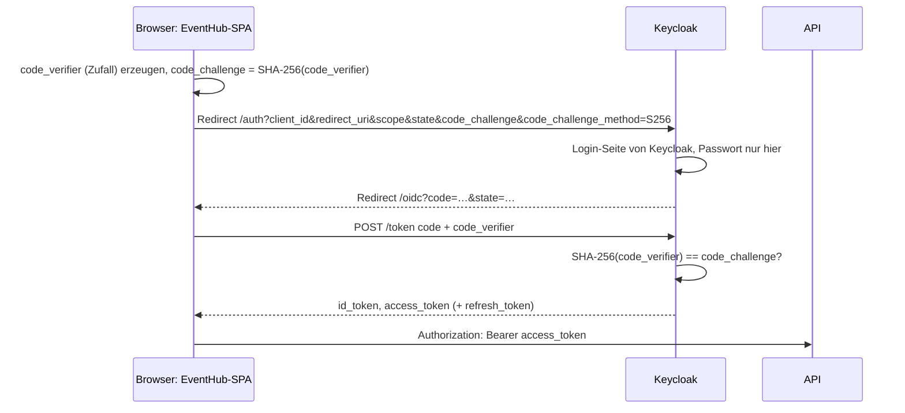

# Lab 9.3: OAuth 2.0 und OpenID Connect

**Leitfragen:**

<details>
<summary>Warum soll eine App das Passwort ihrer Nutzerinnen und Nutzer am besten nie sehen?</summary>

Jede App, die Passwörter annimmt, kann sie verlieren, protokollieren oder missbrauchen. Gibt die Person ihr Passwort nur bei einem zentralen Anmeldedienst ein, bekommt die App lediglich ein Token mit begrenzten Rechten.

</details>

<details>
<summary>Wie meldet man sich bei zehn Firmen-Apps an, ohne zehn Passwörter?</summary>

Alle Apps vertrauen demselben Anmeldedienst (Identity Provider). Wer dort schon angemeldet ist, wird ohne erneute Eingabe zurückgeschickt: Single Sign-on.

</details>

<details>
<summary>Was unterscheidet „wer bin ich“ von „was darf ich“?</summary>

„Wer bin ich“ ist Authentifizierung und steht im ID-Token für die App. „Was darf ich“ ist Autorisierung und steht im Access-Token, das die API prüft (Lab 9.1).

</details>

- OAuth 2.0 regelt, wie eine App Zugriff auf eine API bekommt; OpenID Connect (OIDC) ergänzt, wer sich angemeldet hat.
- Für Single Page Apps ist der Authorization Code Flow mit PKCE der heutige Standard; die Bibliothek `angular-auth-oidc-client` setzt ihn um.

## Begriffe

| Begriff | Bedeutung |
| --- | --- |
| Resource Owner | die Person, der die Daten gehören und die zustimmt |
| Client | die App, die Zugriff möchte (EventHub-SPA im Browser) |
| Authorization Server | stellt nach dem Login Tokens aus (hier Keycloak); bei OIDC auch Identity Provider (IdP) genannt |
| Resource Server | die API, die Access-Tokens prüft |
| Authorization Code | kurzlebiger Einmal-Code, den der Client gegen Tokens tauscht |
| PKCE („Pixie“) | Proof Key for Code Exchange: Zufallswert, der beweist, dass derselbe Client den Code einlöst |
| ID-Token | JWT für den Client: wer sich angemeldet hat (Claims wie `name`, `email`) |
| Scope | angefragter Umfang, z. B. `openid profile email` |
| Realm | abgeschlossener Bereich in Keycloak mit eigenen Clients, Benutzern und Rollen |
| Public Client | Client ohne Geheimnis (Secret), weil sein Code öffentlich im Browser liegt |

## Authorization Code Flow mit PKCE



| Flow | Status für SPAs |
| --- | --- |
| Authorization Code + PKCE | empfohlen |
| Implicit Flow (Token direkt in der Redirect-URL) | veraltet: Token landet in Browser-Verlauf und Logs; RFC 9700 (Januar 2025) rät ab |
| Resource Owner Password (App nimmt das Passwort an) | veraltet; widerspricht dem Ziel „App sieht kein Passwort“ |

PKCE ersetzt bei Public Clients das Secret: Wer nur den Code abfängt, kann ihn ohne den `code_verifier` nicht einlösen.

## ID-Token, Access-Token, Scopes

| | ID-Token | Access-Token |
| --- | --- | --- |
| Für wen | den Client | die API |
| Inhalt | Identität: `sub`, `name`, `email`, `preferred_username`, `aud` = Client-ID | Rechte: Scopes, Rollen, `aud` = API |
| Verwendung | Anzeige, Begrüßung | `Authorization: Bearer` an jede API-Anfrage |
| An die API schicken? | nein | ja |

| Scope | Liefert |
| --- | --- |
| `openid` | Pflicht für OIDC; ID-Token mit `sub` |
| `profile` | `name`, `given_name`, `family_name`, `preferred_username` |
| `email` | `email`, `email_verified` |
| `offline_access` | Refresh-Token, das auch nach Ende der Keycloak-Sitzung gilt |

## Keycloak für den Kurs

Der Realm kommt fertig als Datei mit und wird beim Start importiert. Klicks in der Admin-Konsole sind nicht nötig.

```yaml
# workspaces/keycloak/docker-compose.yml
services:
  keycloak:
    image: quay.io/keycloak/keycloak:26.8.1   # Stand 28.10.2026, prüfen
    command: ["start-dev", "--import-realm"]   # Dev-Modus, importiert /opt/keycloak/data/import/*.json
    environment:
      KC_BOOTSTRAP_ADMIN_USERNAME: admin
      KC_BOOTSTRAP_ADMIN_PASSWORD: admin
    ports:
      - "8080:8080"
    volumes:
      - ./realm:/opt/keycloak/data/import:ro
```

| Eintrag in `realm/eventhub-realm.json` | Wert | Bedeutung |
| --- | --- | --- |
| `realm` | `eventhub` | Issuer-URL `http://localhost:8080/realms/eventhub` |
| `clients[0].clientId` | `eventhub-spa` | Client-ID in der Angular-Konfiguration |
| `publicClient` | `true` | kein Secret |
| `attributes."pkce.code.challenge.method"` | `S256` | Keycloak verlangt PKCE mit SHA-256 |
| `redirectUris` | `http://localhost:4200/*`, `http://localhost:4201/*`, `http://localhost:4202/*` (Ausweich-Port aus Lab 8.1) | erlaubte Rücksprung-Adressen |
| `webOrigins` | dieselben Origins | CORS für Token-Anfragen aus dem Browser |
| `protocolMappers` | Realm-Rollen als Claim `roles` | Rollen in ID-Token, Access-Token und Userinfo |
| `users` | `alice` / `alice123` (admin, user), `bob` / `bob123` (user) | Kurs-Konten |

```bash
cd workspaces/keycloak
docker compose up            # erster Start lädt das Image, danach ca. 20–40 s
curl http://localhost:8080/realms/eventhub/.well-known/openid-configuration
docker compose down          # stoppen und Daten verwerfen
```

## Einbindung mit angular-auth-oidc-client

```ts
// oidc.config.ts
export const oidcConfig: OpenIdConfiguration = {
  authority: 'http://localhost:8080/realms/eventhub', // liest /.well-known/openid-configuration
  clientId: 'eventhub-spa',
  responseType: 'code',                               // Code Flow, PKCE automatisch
  scope: 'openid profile email',
  redirectUrl: `${window.location.origin}/oidc`,
  postLogoutRedirectUri: `${window.location.origin}/oidc`,
  silentRenew: false,
  logLevel: LogLevel.Warn,
};

// app.config.ts
provideAuth({ config: oidcConfig }),
```

| API (`OidcSecurityService`, v22) | Wirkung |
| --- | --- |
| `checkAuth()` | verarbeitet `?code=…` nach dem Rücksprung oder prüft gespeicherte Tokens; Observable mit `isAuthenticated` |
| `authorize()` | startet den Login: Redirect zu Keycloak |
| `authenticated()` | Signal `{ isAuthenticated, … }` |
| `userData()` | Signal `{ userData }` mit Claims aus Userinfo bzw. ID-Token |
| `getPayloadFromIdToken()` | Claims des ID-Tokens als Observable |
| `getAccessToken()` | Access-Token für API-Aufrufe |
| `logoff()` | Logout bei Keycloak und Rücksprung |

`provideAuth` gehört in die Root-Konfiguration: Die Dienste der Bibliothek sind `providedIn: 'root'` und finden ihre Konfiguration nur im Root-Injector. Als Routen-Provider (wie der Interceptor in der Kurs-App, Lab 9.2) funktioniert es nicht; die Übung läuft deshalb im Workspace `eventhub-lab`. Tokens speichert die Bibliothek standardmäßig im `sessionStorage`.

## Backend-for-Frontend (BFF)

| | Tokens im Browser (diese Übung) | Backend-for-Frontend |
| --- | --- | --- |
| Wer tauscht den Code | die SPA | ein eigener Server der App |
| Wo liegen Tokens | `sessionStorage` des Browsers | nur auf dem Server |
| Browser hält | Tokens | `HttpOnly`-Session-Cookie |
| Schutz gegen Token-Diebstahl per XSS | gering | hoch |
| Aufwand | Bibliothek im Frontend | zusätzlicher Server, CSRF-Schutz nötig |
| Passt für | interne Tools, geringe Schutzbedarfe | Banking, Gesundheit, Admin-Oberflächen |

## Typische Fehler

| Symptom | Ursache | Lösung |
| --- | --- | --- |
| Keycloak zeigt „Invalid parameter: redirect_uri“ | Port oder Pfad nicht in `redirectUris` | Workspace auf 4201 bzw. Kurs-App auf 4200 starten; Realm-Datei prüfen |
| Konsole: Fehler beim Laden von `.well-known/openid-configuration` | Keycloak läuft nicht oder `authority` falsch | `docker compose up`, URL im Browser öffnen |
| Login klappt, Seite zeigt weiter „nicht angemeldet“ | `checkAuth()` wird auf der Rücksprung-Seite nicht aufgerufen | `checkAuth()` im Konstruktor der Seite unter `redirectUrl` |
| `NG0201: No provider found for …StsConfigLoader` | `provideAuth` fehlt in `app.config.ts` oder steht an einer Route | in die Root-`providers` |
| Rolle fehlt in den Claims | Mapper für `roles` fehlt im Realm | Realm-Datei aus dem Kurs verwenden, Container neu erstellen (`down`, `up`) |

## Fazit

- OAuth 2.0 + OIDC trennen Login (Keycloak) von der App; die App sieht kein Passwort.
- SPAs nutzen den Authorization Code Flow mit PKCE; das ID-Token beschreibt die Person, das Access-Token geht an die API.
- `angular-auth-oidc-client` braucht `provideAuth` in der Root-Konfiguration und `checkAuth()` nach dem Rücksprung.

Die Übung verbindet den Workspace `eventhub-lab` mit dem Keycloak-Realm `eventhub` und zeigt Name und Rolle aus dem Token an.
