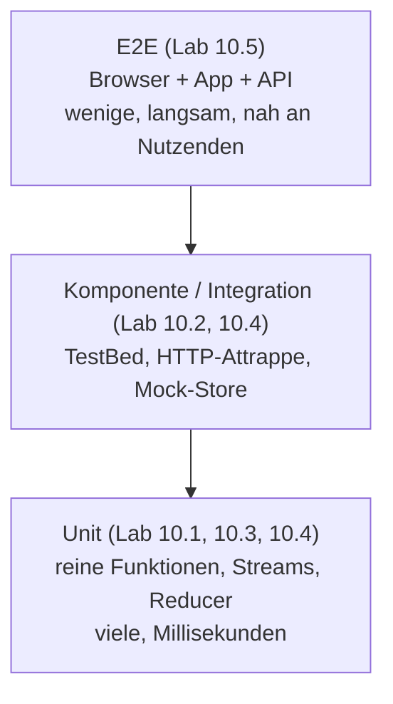

# Lab 10.1: Teststrategie und Vitest

**Leitfragen:**

<details>
<summary>Welche Tests laufen im eigenen Projekt, und wie lange?</summary>

Die Zusammenfassung eines Testlaufs nennt Anzahl der Testdateien, Tests und die Dauer; dazu kommt die Frage, welche Ebenen (Unit, Komponente, E2E) überhaupt vertreten sind. Die Laufzeit entscheidet, ob Tests bei jeder Änderung laufen oder nur im CI.

</details>

<details>
<summary>Welcher Fehler im eigenen Projekt wäre durch welchen Testtyp aufgefallen?</summary>

Falsche Berechnung → Unit-Test; Klick ändert nichts → Komponententest; falsche URL oder fehlender Header → Integrationstest mit HTTP-Attrappe; Login-Ablauf kaputt → E2E-Test.

</details>

<details>
<summary>Was spricht dagegen, alles per E2E zu testen?</summary>

E2E-Tests brauchen laufende App, Server und Browser. Sie sind langsam, anfällig für Timing und zeigen bei Fehlschlag nur „irgendwo kaputt“, nicht die Ursache.

</details>

- Angular 22 testet standardmäßig mit **Vitest** über den Builder `@angular/build:unit-test`; Karma ist Altbestand.
- Die Jasmine-Syntax `describe`/`it`/`expect` bleibt gleich. Unterschiede gibt es vor allem bei **Spies** und einigen Matchern.

## Begriffe

| Begriff | Bedeutung |
| --- | --- |
| Testpyramide | Faustregel für die Verteilung: viele schnelle Unit-Tests, weniger Komponenten- und Integrationstests, wenige E2E-Tests |
| Test-Runner | Programm, das Testdateien findet, ausführt und das Ergebnis meldet (Karma, Vitest) |
| Vitest | Test-Runner und Assertion-Bibliothek; läuft in Node.js mit jsdom (simuliertes DOM) statt in einem echten Browser |
| Spy / Mock-Funktion | Ersatzfunktion, die Aufrufe und Argumente mitschreibt und einen festgelegten Wert liefert |
| Watch-Modus | Runner bleibt aktiv und startet betroffene Tests bei jeder gespeicherten Änderung neu |
| Coverage | Anteil des Codes (Zeilen, Zweige, Funktionen), der beim Testlauf ausgeführt wurde |

## Testpyramide für Angular

Die Pyramide dient als roter Faden für Modul 10; jede Ebene bekommt ein eigenes Lab.



| Ebene | Prüft | Werkzeug im Kurs | Laufzeit pro Test |
| --- | --- | --- | --- |
| Unit | Funktion, Service, Reducer, Stream isoliert | Vitest, `vi.fn`, `TestScheduler` | ~1 ms |
| Komponente | Template + Klasse + Interaktion | `TestBed`, `ComponentFixture` | ~10–50 ms |
| Integration | Service + HTTP, Guard + Router, Store + Komponente | `HttpTestingController`, `provideMockStore` | ~10–50 ms |
| E2E | ganzer Ablauf im echten Browser | Cypress | Sekunden |

## Vitest statt Karma

| Merkmal | Karma + Jasmine (bis v20) | Vitest (Default seit v21) |
| --- | --- | --- |
| Builder in `angular.json` | `@angular-devkit/build-angular:karma` | `@angular/build:unit-test` |
| Umgebung | echter Browser (Chrome) | Node.js mit jsdom; Browser-Modus optional |
| Start | Browser öffnet sich | Ausgabe im Terminal |
| Globale Funktionen | `describe`, `it`, `expect`, `spyOn`, `jasmine.*` | `describe`, `it`, `expect`, `vi.*` (über `vitest/globals`) |
| Status Karma | Karma ist als Projekt eingestellt (deprecated) | – |

Konfiguration im Kurs-Repo (`angular.json`), keine eigene `vitest.config.ts` nötig:

```json
"test": {
  "builder": "@angular/build:unit-test"
}
```

`tsconfig.spec.json` macht die Vitest-Globals für den Editor bekannt und nimmt alle `*.spec.ts` auf:

```json
{
  "extends": "./tsconfig.json",
  "compilerOptions": { "types": ["vitest/globals"] },
  "include": ["src/**/*.d.ts", "src/**/*.spec.ts"]
}
```

## Testlauf steuern

| Befehl | Wirkung |
| --- | --- |
| `npm test` (`ng test`) | alle Tests, Watch-Modus im Terminal |
| `npm run test:run` (`ng test --watch=false`) | einmal laufen lassen, Exit-Code für CI |
| `npx ng test --include=src/app/examples/m10-testing/l01-strategy` | nur Tests eines Ordners (auch Dateipfad oder Glob) |
| `npx ng test --filter="WorkshopStats"` | nur Suites/Tests, deren Name zum regulären Ausdruck passt |
| `npx ng test --coverage --watch=false` | Coverage-Bericht; braucht das Paket `@vitest/coverage-v8` |

`it.todo('…')` markiert einen geplanten, noch leeren Test; die Zusammenfassung zählt ihn als `todo` (die Starter der folgenden Labs nutzen das).

Im Kurs-Projekt ist `@vitest/coverage-v8` installiert. In Projekten ohne das Paket meldet der Builder: `Code coverage requires either "@vitest/coverage-v8" or "@vitest/coverage-istanbul" to be installed.` Nach `npm i -D @vitest/coverage-v8` liegt der Bericht unter `coverage/project/` (Ordnername = Projektname aus `angular.json`).

## Jasmine-Spies und ihr Vitest-Gegenstück

| Jasmine | Vitest | Hinweis |
| --- | --- | --- |
| `jasmine.createSpy('notify')` | `vi.fn()` | freie Ersatzfunktion |
| `spyOn(obj, 'method')` | `vi.spyOn(obj, 'method')` | **Unterschied:** Jasmine ersetzt die Methode (liefert `undefined`), Vitest ruft das Original weiter auf |
| `spyOn(...).and.returnValue(x)` | `vi.spyOn(...).mockReturnValue(x)` | fester Rückgabewert |
| `.and.callFake(fn)` | `.mockImplementation(fn)` | eigene Implementierung |
| `.and.callThrough()` | Standardverhalten von `vi.spyOn` | – |
| `.and.throwError('x')` | `.mockImplementation(() => { throw new Error('x'); })` | – |
| `spy.calls.count()` | `spy.mock.calls.length` oder `toHaveBeenCalledTimes(n)` | – |
| `spy.calls.mostRecent().args` | `spy.mock.lastCall` | – |
| `toHaveBeenCalledOnceWith(a)` | `toHaveBeenCalledExactlyOnceWith(a)` | – |
| `toBeTrue()` / `toBeFalse()` | `toBe(true)` / `toBe(false)` | Jasmine-eigene Matcher |
| Spies werden nach jedem `it` automatisch entfernt | `vi.restoreAllMocks()` in `afterEach` | Vitest räumt ohne Konfiguration nicht auf |
| `jasmine.objectContaining({...})` | `expect.objectContaining({...})` | – |

Vorher (Jasmine) und nachher (Vitest) am selben Test. Beispiel: eine Funktion `reportInvalidEmails(emails)`, die für jede ungültige Adresse `console.error` aufruft und die Anzahl liefert:

```ts
// Jasmine
const error = spyOn(console, 'error');
expect(reportInvalidEmails(['ada@eventhub.test', 'kaputt'])).toBe(1);
expect(error).toHaveBeenCalledWith('Ungültige E-Mail: kaputt');

// Vitest
afterEach(() => vi.restoreAllMocks());           // Spy wieder entfernen
const error = vi.spyOn(console, 'error').mockImplementation(() => undefined); // Ausgabe unterdrücken
expect(reportInvalidEmails(['ada@eventhub.test', 'kaputt'])).toBe(1);
expect(error).toHaveBeenCalledWith('Ungültige E-Mail: kaputt');
```

Der dritte Jasmine-Test der Übung holt einen Service über `TestBed`, den Test-Injector von Angular (Details in Lab 10.2), und wandelt das Observable mit `firstValueFrom` aus RxJS in ein Promise um: `await firstValueFrom(obs$)` wartet auf den ersten Wert. Beides bleibt beim Umstieg auf Vitest unverändert.

## Bestehende Karma-Suites migrieren

| Schritt | Befehl (Angular 22) |
| --- | --- |
| Builder von Karma auf `unit-test` umstellen | optionale Migration `migrate-karma-to-vitest` beim `ng update` auf v22 |
| Jasmine-Aufrufe in Specs umschreiben | `ng g @schematics/angular:refactor-jasmine-vitest` (als **experimentell** markiert) |
| Danach | Karma-Pakete und `karma.conf.js` entfernen, Testlauf prüfen, Restfälle von Hand |

Stand: 28.10.2026, geprüft an `@schematics/angular` 22.2; Namen vor Kursbeginn auf angular.dev `prüfen`.

## Typische Fehler

| Symptom | Ursache | Lösung |
| --- | --- | --- |
| `ReferenceError: jasmine is not defined` / `spyOn is not defined` | Jasmine-Globals unter Vitest | `vi.fn()` / `vi.spyOn()` verwenden |
| Konsolenausgabe erscheint trotz Spy | `vi.spyOn` ruft das Original auf | `.mockImplementation(() => undefined)` anhängen |
| Spy aus Test A wirkt in Test B oder in anderer Datei | Vitest stellt nicht automatisch wieder her; Angular startet Vitest ohne Isolation | `afterEach(() => vi.restoreAllMocks())` |
| `toBeTrue is not a function` | Jasmine-Matcher | `toBe(true)` |
| `No tests found matching the following patterns` | `--include` passt auf keine Datei (z. B. `m10-*` statt Ordner) | Ordnerpfad oder `…/**/*.spec.ts` angeben |
| Coverage startet nicht | Paket fehlt | `npm i -D @vitest/coverage-v8` |

## Fazit

- Die Pyramide verteilt Tests nach Kosten: viele Unit-Tests, wenige E2E-Tests.
- Vitest läuft über `ng test` ohne eigene Konfiguration; `describe`/`it`/`expect` bleiben.
- Spies heißen `vi.fn`/`vi.spyOn`; `vi.spyOn` ruft das Original auf und wird nicht automatisch entfernt.

Die Übung schreibt drei Jasmine-Tests mit Spies auf Vitest um und nutzt Watch-Modus und (optional) Coverage.
