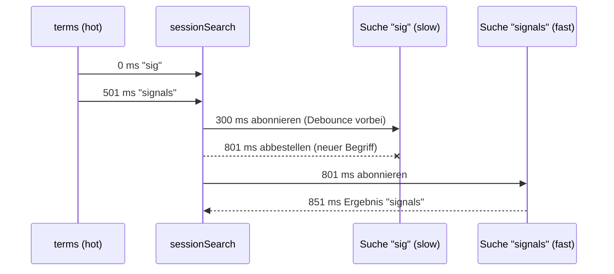

# Lab 10.3: Marble-Testing für RxJS-Streams

**Leitfragen:**

<details>
<summary>Wie testet man eine Suche mit 300 ms Verzögerung, ohne 300 ms zu warten?</summary>

Mit virtueller Zeit: Ein Test-Scheduler spielt Zeitpunkte nur rechnerisch durch. `debounceTime(300)` „wartet“ 300 virtuelle Millisekunden, der Test dauert trotzdem nur Millisekunden.

</details>

<details>
<summary>Wie würde man das Race-Condition-Problem aus Lab 5.2 als Test beschreiben?</summary>

„Die Antwort auf ‚ang‘ kommt nach der Antwort auf ‚angular‘ – trotzdem steht am Ende ‚angular‘ in der Liste, und die Anfrage für ‚ang‘ wurde abbestellt.“ Das lässt sich als Zeitdiagramm mit Abo-Zeitpunkten hinschreiben.

</details>

<details>
<summary>Welche Diagramme aus Lab 5.1 könnte man direkt als Erwartung verwenden?</summary>

Jedes Ausgabe-Diagramm (`--a--b--|`) lässt sich als Text-String an den Test geben. Aus der Skizze wird so die Erwartung.

</details>

- Marble-Diagramme aus Lab 5.1 sind gleichzeitig die Testsprache: Eingabe als Diagramm, erwartete Ausgabe als Diagramm.
- `TestScheduler` aus `rxjs/testing` ersetzt die echte Zeit. Zeitoperatoren wie `debounceTime` laufen innerhalb von `run()` automatisch virtuell.
- Code unter Test: die Suchkette aus Lab 5.2 als reine Funktion `sessionSearch(terms$, search)` in `session-search.ts`.

## Begriffe

| Begriff | Bedeutung |
| --- | --- |
| `TestScheduler` | RxJS-Scheduler für Tests: führt alle zeitbasierten Operatoren in virtueller Zeit aus |
| Frame | eine virtuelle Millisekunde; jedes Zeichen im Diagramm belegt einen Frame (im Playground von Lab 5.1 waren es zur Anschauung 100 echte ms, im `TestScheduler.run()` ist es immer 1 virtuelle ms) |
| `cold(…)` | erzeugt ein kaltes Test-Observable: startet bei jedem Abo von vorn (wie eine HTTP-Anfrage) |
| `hot(…)` | erzeugt ein heißes Test-Observable: läuft unabhängig vom Abo (wie Tastatureingaben, ein `Subject`) |
| `expectObservable(obs$).toBe(…)` | vergleicht die Ausgabe von `obs$` mit dem erwarteten Diagramm |
| `expectSubscriptions(…).toBe(…)` | prüft, wann ein Observable abonniert (`^`) und abbestellt (`!`) wurde |

## Code unter Test

Die Kette aus Lab 5.2, herausgelöst: Eingaben und Suche kommen als Parameter, deshalb braucht der Test weder Komponente noch `HttpClient`.

```ts
export function sessionSearch(terms$: Observable<string>, search: SearchFn, debounceMs = 300): Observable<SearchState> {
  return terms$.pipe(
    map((term) => term.trim()),
    debounceTime(debounceMs),
    distinctUntilChanged(),
    switchMap((term) =>
      search(term).pipe(
        map((sessions): SearchState => ({ term, sessions, error: null })),
        catchError(() => of<SearchState>({ term, sessions: [], error: 'Suche fehlgeschlagen' })),
      ),
    ),
  );
}
```

In der Komponente: `sessionSearch(this.terms, (q) => this.api.getSessions({ q }))`. Im Test: `sessionSearch(hot(…), (term) => cold(…))`.

## Marble-Syntax im Test

| Zeichen | Bedeutung |
| --- | --- |
| `-` | ein Frame (1 ms) ohne Ereignis |
| `a` (beliebiger Buchstabe) | Wert, aufgelöst über das Werte-Objekt `{ a: … }`; belegt einen Frame |
| `\|` | Abschluss (complete) |
| `#` | Fehler; Fehlerobjekt als dritter Parameter von `cold`/`hot` |
| `(ab)` | mehrere Ereignisse im selben Frame; die Klammergruppe belegt danach so viele Frames wie Zeichen inkl. Klammern |
| `300ms` | Zeitsprung um 300 Frames (Leerzeichen davor und danach) |
| `^` | in `hot`: Zeitpunkt des Abos; in Abo-Diagrammen: abonniert |
| `!` | abbestellt (unsubscribe) |
| Leerzeichen | wird ignoriert, nur zur Lesbarkeit |

Rechenbeispiel: `'a 100ms b'` → `a` bei 0, `b` bei 101 (1 Frame für `a`, dann 100 ms).

## Aufbau eines Marble-Tests

Die Beispiele nutzen eigene Begriffe und Testdaten (`signalsTalk`, `formsTalk`); die Übung rechnet dieselben Muster mit anderen Eingaben und Zeiten.

```ts
import { TestScheduler } from 'rxjs/testing';

const signalsTalk = { id: 2, title: 'Signals in der Praxis' } as Session;
const formsTalk = { id: 5, title: 'Signal Forms' } as Session;
let scheduler: TestScheduler;

beforeEach(() => {
  // Vergleichsfunktion: so meldet der Scheduler Abweichungen an Vitest
  scheduler = new TestScheduler((actual, expected) => expect(actual).toEqual(expected));
});

it('wartet 300 ms Ruhe ab und sucht nur den letzten Begriff', () => {
  scheduler.run(({ cold, expectObservable }) => {
    const terms = cold('a 200ms b 350ms c|', { a: 'si', b: 'sig', c: 'signals' });
    const search = (term: string) => cold('(r|)', { r: term === 'signals' ? [signalsTalk] : [] });

    // "si" verfällt, "sig" bei 201 + 300 = 501, "signals" beim Abschluss (553)
    expectObservable(sessionSearch(terms, search)).toBe('501ms x 51ms (y|)', {
      x: { term: 'sig', sessions: [], error: null },
      y: { term: 'signals', sessions: [signalsTalk], error: null },
    });
  });
});
```

`debounceTime` gibt beim Abschluss der Quelle den letzten Wert sofort aus; deshalb erscheint `y` bei 553 (`signals` bei 552, Abschluss bei 553) und nicht erst 300 ms später.

## Race Condition als Test: switchMap bestellt ab

```ts
scheduler.run(({ hot, cold, expectObservable, expectSubscriptions }) => {
  const terms = hot('a 500ms b', { a: 'sig', b: 'signals' });
  const slow = cold('600ms r|', { r: [formsTalk] }); // Antwort auf "sig" käme erst nach 600 ms
  const fast = cold('50ms s|', { s: [signalsTalk] });
  const search = (term: string) => (term === 'sig' ? slow : fast);

  expectObservable(sessionSearch(terms, search)).toBe('851ms y', {
    y: { term: 'signals', sessions: [signalsTalk], error: null },
  });
  expectSubscriptions(slow.subscriptions).toBe('300ms ^ 500ms !'); // abbestellt bei 801
});
```



Mit `mergeMap` statt `switchMap` käme bei 900 zusätzlich das veraltete Ergebnis für „sig“ an; der Test würde rot.

## Zeitpunkte zählen statt raten

| Frage | Lösung im Test |
| --- | --- |
| Wann kommt der Wert nach `debounceTime(300)`? | letzter Eingabe-Frame + 300 |
| Wann kommt die Antwort einer Suche `cold('100ms s')`? | Abo-Frame + 100 |
| Wie oft wurde gesucht? | `search` als `vi.fn((term) => cold(…))`, nach `scheduler.flush()` mit `toHaveBeenCalledTimes` prüfen |
| Läuft der Stream nach einem Fehler weiter? | zweiten Begriff nach dem Fehler senden und beide Ergebnisse erwarten |

## Typische Fehler

| Symptom | Ursache | Lösung |
| --- | --- | --- |
| Erwartung um 1 Frame daneben (`frame: 400` statt `401`) | Wert-Zeichen belegt selbst einen Frame | Zeichen mitzählen; `'a 100ms b'` → `b` bei 101 |
| Test wartet echt 300 ms oder läuft in Timeout | Observable außerhalb von `scheduler.run()` erzeugt oder abonniert | Alles innerhalb des `run`-Callbacks aufbauen |
| `expectSubscriptions` ohne Treffer | `search` liefert bei jedem Aufruf ein neues `cold(…)` | Cold-Observables vor `search` erzeugen und wiederverwenden |
| `hot` vs. `cold` verwechselt, Ergebnis verschoben | `cold` startet beim Abo, `hot` läuft ab Frame 0 | Eingaben von außen als `hot`, Antworten als `cold` |
| Typfehler bei `cold('#')` | ohne Werte kann TypeScript den Typ nicht ableiten | `cold<Session[]>('50ms #', undefined, new Error('500'))` |
| Vergleich schlägt mit langen Objekt-Diffs fehl | Werte-Objekt weicht in einem Feld ab | erwartete Werte vollständig angeben (`error: null`) |

## Fazit

- `TestScheduler.run()` macht aus Zeit eine Rechnung: Tests für `debounceTime`, `switchMap` und Fehler laufen in Millisekunden.
- Eingaben von außen sind `hot`, Antworten `cold`; `expectSubscriptions` beweist, dass `switchMap` alte Anfragen abbestellt.
- Eine Funktion mit Eingabe-Stream und Such-Funktion als Parametern ist der Schlüssel zur Testbarkeit.

Die Übung schreibt vier Marble-Tests für `sessionSearch`: Entprellung, gleiche Begriffe, Abbruch und Fehlerfall.
