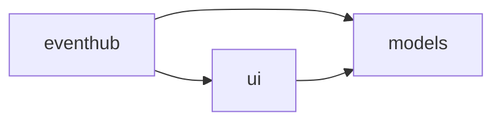

# Lab 11.1 – Lösung: Nx Workspace

Alle Befehle laufen im Ordner `project/workspaces/nx-eventhub/`. Die Kurs-App enthält für dieses Lab nur eine Infoseite: `/examples/m11-libraries/l01-nx` (Datei `src/app/examples/m11-libraries/l01-nx/example.ts`).

## Aufgabe 1: Projekte auflisten und App starten

```bash
npx nx show projects
# ["models","eventhub"]   (Reihenfolge kann abweichen)
npx nx serve eventhub      # http://localhost:4210
```

Die Seite „Programm“ zeigt zwölf Session-Karten aus der Mock-API.

## Aufgabe 2: Tags und Regel

| Projekt | Datei | Tags |
| --- | --- | --- |
| `eventhub` | `apps/eventhub/project.json` | `type:app`, `scope:eventhub` |
| `models` | `libs/shared/models/project.json` | `type:util`, `scope:shared` |

Regel für `type:ui` in `eslint.config.mjs`: darf nur `type:ui` und `type:util` importieren, `@angular/common/http` ist verboten (`bannedExternalImports`).

## Aufgabe 3: Library generieren

```bash
npx nx g @nx/angular:library libs/shared/ui --tags=type:ui,scope:shared --prefix=ui --dry-run
npx nx g @nx/angular:library libs/shared/ui --tags=type:ui,scope:shared --prefix=ui
```

Ergebnis (Auszug):

```text
CREATE libs/shared/ui/project.json
CREATE libs/shared/ui/src/index.ts
CREATE libs/shared/ui/src/test-setup.ts
CREATE libs/shared/ui/vite.config.mts
CREATE libs/shared/ui/src/lib/ui/ui.ts
UPDATE tsconfig.base.json
```

```json
// tsconfig.base.json
"paths": {
  "@nx-eventhub/models": ["./libs/shared/models/src/index.ts"],
  "@nx-eventhub/ui": ["./libs/shared/ui/src/index.ts"]
}
```

Der Name `ui` ergibt sich aus dem Ordner; `--name=ui` ist optional. Die Test-Pakete für Libraries (Vitest mit AnalogJS-Plugin) sind im Workspace bereits installiert, deshalb lädt der Generator nichts nach.

## Aufgabe 4: Platzhalter löschen

```bash
rm -r libs/shared/ui/src/lib/ui
```

## Aufgabe 5: Karte verschieben

```bash
mkdir -p libs/shared/ui/src/lib/session-card
mv apps/eventhub/src/app/sessions/session-card.ts libs/shared/ui/src/lib/session-card/
mv apps/eventhub/src/app/sessions/session-card.spec.ts libs/shared/ui/src/lib/session-card/
```

`libs/shared/ui/src/lib/session-card/session-card.ts`:

```ts
import { DatePipe } from '@angular/common';
import { Component, computed, input } from '@angular/core';
import { Session } from '@nx-eventhub/models';

/** Präsentationskomponente: zeigt eine Session, lädt selbst keine Daten. */
@Component({
  selector: 'ui-session-card',               // vorher app-session-card; Präfix der Library ist "ui"
  imports: [DatePipe],
  template: `
    <article class="card">
      <h3>{{ session().title }}</h3>
      <p class="muted">{{ session().speaker?.name }} · {{ session().room }} · {{ session().start | date: 'dd.MM. HH:mm' }}</p>
      <span class="badge" [class.badge-warn]="fewSeats()">{{ session().level }}</span>
    </article>
  `,
})
export class SessionCard {
  readonly session = input.required<Session>();
  protected readonly fewSeats = computed(() => this.session().capacity - this.session().booked < 5);
}
```

Die Spec-Datei bleibt unverändert; sie importiert `./session-card` relativ und läuft jetzt im Projekt `ui`.

## Aufgabe 6: Export und Import

`libs/shared/ui/src/index.ts`:

```ts
export * from './lib/session-card/session-card';
```

`apps/eventhub/src/app/sessions/session-list.ts`:

```ts
import { httpResource } from '@angular/common/http';
import { Component } from '@angular/core';
import { Session } from '@nx-eventhub/models';
import { SessionCard } from '@nx-eventhub/ui';            // neu: Alias statt './session-card'

@Component({
  selector: 'app-session-list',
  imports: [SessionCard],
  template: `
    <h1>Programm</h1>
    @if (sessions.isLoading()) {
      <p class="loading">Lade Sessions …</p>
    } @else if (sessions.error()) {
      <p class="muted">Mock-API nicht erreichbar. Läuft <code>npm run api</code> im Kursprojekt?</p>
    } @else {
      <div class="grid">
        @for (session of sessions.value(); track session.id) {
          <ui-session-card [session]="session" />
        }
      </div>
    }
  `,
})
export class SessionList {
  protected readonly sessions = httpResource<Session[]>(() => 'http://localhost:3000/sessions', { defaultValue: [] });
}
```

## Aufgabe 7: Build und Start

```bash
npx nx build eventhub
#  NX   Successfully ran target build for project eventhub
npx nx serve eventhub
```

Die Seite sieht aus wie vorher; der Code der Karte kommt jetzt aus `libs/shared/ui`.

## Aufgabe 8: Projektgraph

`npx nx graph --focus=eventhub` zeigt:



## Aufgabe 9: Betroffene Projekte

```bash
npx nx show projects --affected --files=libs/shared/ui/src/lib/session-card/session-card.ts
# ["ui","eventhub"]
npx nx show projects --affected --files=libs/shared/models/src/lib/models.ts
# ["models","ui","eventhub"]
```

`models` hat keine Abhängigkeiten, wird aber von beiden anderen importiert; eine Änderung dort betrifft deshalb alle drei. Ohne `--files` vergleicht Nx mit dem Git-Zweig `main` und zählt nicht committete Änderungen mit.

## Aufgabe 10: Cache

```bash
npx nx affected -t test --files=libs/shared/ui/src/lib/session-card/session-card.ts
#  NX   Successfully ran target test for 2 projects
npx nx affected -t test --files=libs/shared/ui/src/lib/session-card/session-card.ts
#  NX   Successfully ran target test for 2 projects
# Nx read the output from the cache instead of running the command for 2 out of 2 tasks.
```

Der zweite Lauf dauert unter einer Sekunde, weil sich keine Eingabe der Tests geändert hat.

## Aufgabe 11: Modulgrenze

```text
$ npx nx lint ui
libs/shared/ui/src/lib/session-card/session-card.ts
  2:1  error  A project tagged with "type:ui" is not allowed to import "@angular/common/http"  @nx/enforce-module-boundaries
✖ 1 problem (1 error, 0 warnings)
```

Ein relativer Import aus der App (`../../../../../../apps/eventhub/...`) scheitert ebenfalls: „Projects cannot be imported by a relative or absolute path, and must begin with a npm scope“.

## Erweiterung: data-access-Library

```bash
npx nx g @nx/angular:library libs/sessions/data-access --tags=type:data-access,scope:eventhub --prefix=eh
```

`libs/sessions/data-access/src/lib/session-store.ts`:

```ts
import { httpResource } from '@angular/common/http';
import { Injectable } from '@angular/core';
import { Session } from '@nx-eventhub/models';

@Injectable({ providedIn: 'root' })
export class SessionStore {
  readonly sessions = httpResource<Session[]>(() => 'http://localhost:3000/sessions', { defaultValue: [] });
}
```

Export in `libs/sessions/data-access/src/index.ts` (`export * from './lib/session-store';`), den generierten Platzhalter `src/lib/data-access/` löschen; in `session-list.ts` `import { SessionStore } from '@nx-eventhub/data-access';` und `protected readonly sessions = inject(SessionStore).sessions;`. `npx nx lint eventhub` bleibt grün; derselbe Import in der ui-Library meldet `A project tagged with "type:ui" can only depend on libs tagged with "type:ui", "type:util"`.
