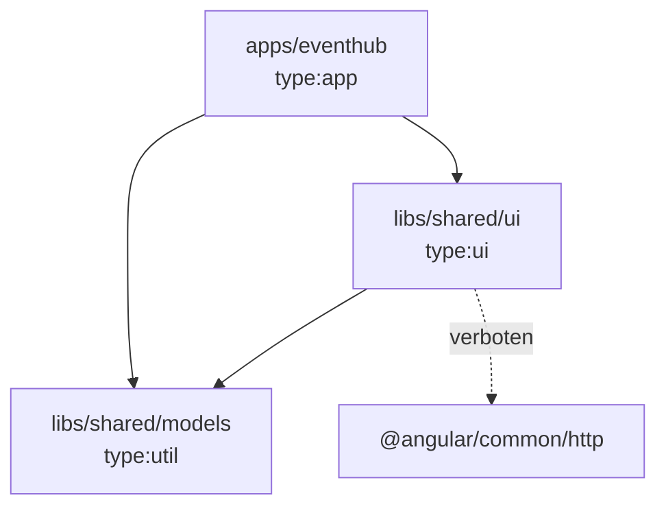

# Lab 11.1: Nx Workspace

**Leitfragen:**

<details>
<summary>Drei Apps brauchen dieselbe Komponente: kopieren, npm-Paket oder gemeinsames Repo?</summary>

Kopieren ist schnell, aber jeder Fehler muss dreimal behoben werden. Ein npm-Paket braucht Versionen, Veröffentlichung und Updates in jeder App (Lab 11.2). Ein gemeinsames Repo (Monorepo) teilt den Code direkt; jede Änderung wirkt sofort überall und wird überall getestet.

</details>

<details>
<summary>Warum testet man nach einer kleinen Änderung alles neu?</summary>

Weil ohne Wissen über Abhängigkeiten niemand sicher sagen kann, was betroffen ist. Nx kennt den Abhängigkeitsgraphen und testet nur die betroffenen Projekte (`affected`); unveränderte Ergebnisse kommen aus dem Cache.

</details>

<details>
<summary>Wer verhindert, dass ein UI-Baustein plötzlich Daten vom Server lädt?</summary>

Eine Lint-Regel: Projekte bekommen Tags wie `type:ui`, und `@nx/enforce-module-boundaries` legt fest, was ein Projekt mit welchem Tag importieren darf. Ein verbotener Import ist ein Lint-Fehler, kein Review-Kommentar.

</details>

- Ein Nx-Workspace ist ein Monorepo mit Apps und Libraries; Nx kennt die Abhängigkeiten zwischen ihnen.
- Generatoren legen Projekte an, der Projektgraph zeigt sie, `affected` und Cache sparen Zeit, Tags und Lint-Regeln halten die Architektur sauber.

## Begriffe

| Begriff | Bedeutung |
| --- | --- |
| Monorepo | ein Git-Repository mit mehreren Apps und Libraries, die gemeinsam versioniert werden |
| Nx | Build-System für Monorepos: Generatoren, Task-Ausführung, Cache, Projektgraph |
| Projekt | App (`apps/…`, startbar) oder Library (`libs/…`, wird von anderen Projekten importiert) |
| Generator | Befehl, der Dateien nach Vorlage anlegt und Konfiguration mitpflegt (wie `ng generate`) |
| Target | eine Aufgabe eines Projekts, z. B. `build`, `test`, `lint`, `serve` |
| Projektgraph | Netz aus Projekten und ihren Importen; Grundlage für `affected` |
| `affected` | nur die Projekte, die von geänderten Dateien betroffen sind |
| Tag | Etikett an einem Projekt (`type:ui`, `scope:shared`), Grundlage für Modulgrenzen |

## Kopieren, Paket oder Monorepo

| Weg | Vorteil | Nachteil | Passt, wenn … |
| --- | --- | --- | --- |
| Code kopieren | sofort, keine Werkzeuge | Abweichungen, Fehler mehrfach beheben | einmaliger Prototyp |
| npm-Paket (Lab 11.2) | klare Versionen, Apps entscheiden über Updates | Release-Aufwand, Versionen driften | Teams/Repos getrennt, externe Nutzer |
| Monorepo (Nx) | eine Version, Änderung sofort überall sichtbar und getestet | ein Repo für alle, Tooling nötig | Apps eines Produkts oder einer Abteilung |

## Aufbau des Workspace `nx-eventhub`

Der Workspace liegt unter `project/workspaces/nx-eventhub/` und wurde so erzeugt (Nx 24.0.2, Stand: 28.10.2026):

```bash
npx create-nx-workspace@latest nx-eventhub --preset=angular-monorepo --appName=eventhub \
  --bundler=esbuild --style=css --ssr=false --e2eTestRunner=none --linter=eslint \
  --formatter=prettier --nxCloud=skip --aiAgents=none --workspaces=false --skipGit --interactive=false
npx nx g @nx/js:library libs/shared/models --bundler=none --unitTestRunner=none --tags=type:util,scope:shared
```

```text
nx-eventhub/
├── apps/eventhub/                 # App: Session-Liste (Port 4210)
│   ├── project.json               # Targets build, serve, test + tags
│   └── src/app/sessions/
│       ├── session-list.ts        # Seite, lädt /sessions von der Mock-API
│       ├── session-card.ts        # Präsentationskomponente -> wandert in der Übung in libs/shared/ui
│       └── session-card.spec.ts
├── libs/shared/models/            # Library type:util: Interface Session
│   └── src/index.ts               # öffentliche Schnittstelle der Library
├── nx.json                        # Nx-Einstellungen: Plugins, Cache-Regeln, Generator-Defaults
├── tsconfig.base.json             # Pfad-Aliase: "@nx-eventhub/models" -> libs/shared/models/src/index.ts
└── eslint.config.mjs              # Modulgrenzen (siehe unten)
```

Libraries werden über einen Alias importiert, nicht über relative Pfade:

```ts
// apps/eventhub/src/app/sessions/session-list.ts
import { Session } from '@nx-eventhub/models';          // Alias aus tsconfig.base.json
```

```json
// tsconfig.base.json (Auszug); den Eintrag schreibt der Library-Generator
"paths": {
  "@nx-eventhub/models": ["./libs/shared/models/src/index.ts"]
}
```

## Generatoren und Targets

| Befehl | Wirkung |
| --- | --- |
| `npx nx g @nx/angular:library libs/speakers/feature-list --tags=type:feature,scope:speakers --prefix=sp` | Angular-Library mit Test-Setup, Tags und Präfix; Name und Alias (`@nx-eventhub/feature-list`) ergeben sich aus dem letzten Ordner |
| `npx nx g @nx/angular:component libs/speakers/feature-list/src/lib/speaker-list/speaker-list` | Komponente in einer Library |
| `npx nx serve eventhub` | Dev-Server der App |
| `npx nx build eventhub` | Produktions-Build nach `dist/apps/eventhub` |
| `npx nx test ui` | Tests eines Projekts |
| `npx nx run-many -t lint test` | Targets für alle Projekte |
| `npx nx show projects` | Projekte auflisten |
| `npx nx show project eventhub` | Targets und Konfiguration eines Projekts |

Generatoren haben einen Probelauf: `--dry-run` zeigt die Dateien, ohne sie zu schreiben.

## Library-Typen und Modulgrenzen

Nx empfiehlt vier Library-Typen. Sie beschreiben, was eine Library tun darf, nicht wo sie liegt.

| Typ (Tag) | Inhalt | Darf importieren |
| --- | --- | --- |
| `type:feature` | Seiten, Routen, Ablauf eines Fachbereichs | ui, data-access, util |
| `type:ui` | Präsentationskomponenten (Eingaben rein, Ereignisse raus) | ui, util |
| `type:data-access` | Services, HTTP, Store | data-access, util |
| `type:util` | Modelle, reine Funktionen | util |



Die Regel steht in `eslint.config.mjs` im Workspace-Root:

```js
'@nx/enforce-module-boundaries': ['error', {
  depConstraints: [
    { sourceTag: 'type:app', onlyDependOnLibsWithTags: ['type:feature', 'type:ui', 'type:data-access', 'type:util'] },
    { sourceTag: 'type:feature', onlyDependOnLibsWithTags: ['type:ui', 'type:data-access', 'type:util'] },
    {
      sourceTag: 'type:ui',
      onlyDependOnLibsWithTags: ['type:ui', 'type:util'],
      bannedExternalImports: ['@angular/common/http'],   // UI-Bausteine laden keine Daten
    },
    { sourceTag: 'type:data-access', onlyDependOnLibsWithTags: ['type:data-access', 'type:util'] },
    { sourceTag: 'type:util', onlyDependOnLibsWithTags: ['type:util'] },
  ],
}],
```

Tags stehen in der `project.json` des Projekts (`"tags": ["type:ui", "scope:shared"]`). Ein `HttpClient` in einer Komponente einer ui-Library meldet `npx nx lint ui` so:

```text
libs/shared/ui/src/lib/speaker-avatar/speaker-avatar.ts
  2:1  error  A project tagged with "type:ui" is not allowed to import "@angular/common/http"  @nx/enforce-module-boundaries
```

`scope:*`-Tags funktionieren genauso und trennen Fachbereiche (z. B. `scope:admin` darf nicht `scope:checkout` importieren).

## Projektgraph, `affected` und Cache

| Befehl | Wirkung |
| --- | --- |
| `npx nx graph` | Projektgraph im Browser (lokaler Server, Standard-Port 4211) |
| `npx nx graph --file=graph.html` | Graph als statische Datei (plus Ordner `static/`) |
| `npx nx show projects --affected` | betroffene Projekte gegenüber `main` (Git) inkl. nicht committeter Änderungen |
| `npx nx affected -t test` | Tests nur der betroffenen Projekte |
| `npx nx affected -t test --files=libs/shared/ui/src/index.ts` | betroffene Projekte für genannte Dateien, ohne Git-Vergleich |
| `npx nx affected -t test --base=origin/main --head=HEAD` | Vergleichsbasis festlegen (typisch in CI, Lab 14.1) |
| `npx nx reset` | Cache und Nx-Daemon zurücksetzen |

Eine Änderung in `libs/shared/ui` betrifft `ui` und `eventhub`, eine Änderung in `libs/shared/models` alle drei Projekte. Läuft ein Target ein zweites Mal mit unveränderten Eingaben, liefert Nx das Ergebnis aus dem Cache:

```text
 NX   Successfully ran target test for 2 projects

Nx read the output from the cache instead of running the command for 2 out of 2 tasks.
```

## Typische Fehler

| Symptom | Ursache | Lösung |
| --- | --- | --- |
| `Cannot find module '@nx-eventhub/ui'` | Alias fehlt oder Library anders benannt | Eintrag in `tsconfig.base.json` prüfen |
| Lint: `Projects cannot be imported by a relative or absolute path` | Import über `../../../libs/...` | über den Alias importieren |
| Lint: `A project tagged with "type:ui" is not allowed to import …` | Modulgrenze verletzt | Code in passende Library (z. B. data-access) verschieben |
| `'ui-session-card' is not a known element` | Selektor nach dem Verschieben nicht angepasst oder Komponente nicht in `imports` | Selektor und `imports` der nutzenden Komponente prüfen |
| `affected` listet alle Projekte | Änderung an `package.json`, `nx.json` oder `tsconfig.base.json` betrifft alle | erwartet; sonst `--files` zum Eingrenzen |
| `ng new` meldet „not available … inside a workspace“ | Befehl im Kursprojekt-Ordner ausgeführt | neue Workspaces außerhalb von `project/` anlegen |

## Vertiefung

- Remote Cache (Nx Cloud oder selbst betrieben) teilt Cache-Ergebnisse zwischen Laptops und CI.
- `npx nx migrate latest` aktualisiert Nx, Angular und die Konfiguration in einem Schritt.
- Bestehende Angular-CLI-Projekte lassen sich mit `npx nx init` auf Nx umstellen.

## Fazit

- Ein Nx-Workspace bündelt Apps und Libraries; Libraries werden über Aliase importiert.
- Der Projektgraph macht Abhängigkeiten sichtbar; `affected` und Cache testen nur, was sich geändert hat.
- Tags und `@nx/enforce-module-boundaries` setzen Architekturregeln als Lint-Fehler durch.

In der Übung wandert die Session-Karte in eine eigene ui-Library.
