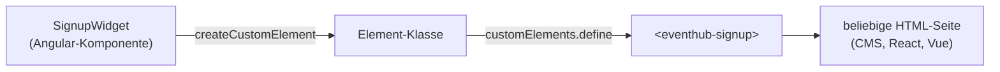

# Lab 11.3: Angular Elements

**Leitfragen:**

<details>
<summary>Wie bringt man eine Angular-Komponente auf eine Marketing-Seite, die mit einem CMS gebaut ist?</summary>

Das CMS kennt nur HTML und Script-Tags. Die Komponente muss sich deshalb wie ein HTML-Element verhalten: ein Tag wie `<eventhub-signup>` plus eine JavaScript-Datei, die es definiert. Genau das erzeugt Angular Elements.

</details>

<details>
<summary>Wie spricht eine Seite ohne Angular mit der Komponente?</summary>

Über die Mittel des Browsers: Attribute und Properties hinein, DOM-Events heraus. Ein Angular-`output()` kommt auf der Seite als `CustomEvent` an, die Daten stehen in `event.detail`.

</details>

<details>
<summary>Was kostet es, wenn jede Komponente ihr eigenes Framework mitbringt?</summary>

Jedes eigenständige Bundle enthält Angular erneut, hier rund 48 kB komprimiert. Drei Widgets aus drei Builds laden Angular dreimal. Elements lohnt sich für wenige, klar abgegrenzte Widgets, nicht für Dutzende kleine Bausteine.

</details>

- Angular Elements verpackt eine Angular-Komponente als Custom Element (Web-Standard), das in jeder HTML-Seite läuft.
- Inputs werden zu Attributen und Properties, Outputs zu DOM-Events; die Seite braucht kein Angular-Wissen.

## Begriffe

| Begriff | Bedeutung |
| --- | --- |
| Custom Element | eigenes HTML-Tag, das der Browser per `customElements.define()` kennt (Web-Components-Standard) |
| Web Components | Browser-Standards für eigene Elemente: Custom Elements, Shadow DOM, Templates |
| `createCustomElement()` | Funktion aus `@angular/elements`, die aus einer Komponente eine Custom-Element-Klasse macht |
| `createApplication()` | startet Angular ohne Wurzelkomponente; liefert nur den Injector für die Elemente |
| `CustomEvent` | DOM-Event mit eigenen Daten in `event.detail` |
| Shadow DOM | abgeschotteter DOM-Teilbaum: CSS der Seite wirkt nicht hinein, CSS der Komponente nicht hinaus |

## Vom Component zum Custom Element



Der Workspace `project/workspaces/eventhub-elements/` (erstellt mit `ng new … --minimal`, danach `npm install @angular/elements`) registriert das Element in `src/main.ts`:

```ts
import { provideBrowserGlobalErrorListeners } from '@angular/core';
import { createCustomElement } from '@angular/elements';
import { createApplication } from '@angular/platform-browser';
import { SignupWidget } from './app/signup-widget';

// Keine Angular-App mit <app-root>: nur ein Injector für die Custom Elements.
createApplication({ providers: [provideBrowserGlobalErrorListeners()] })
  .then((appRef) => {
    const SignupElement = createCustomElement(SignupWidget, { injector: appRef.injector });
    customElements.define('eventhub-signup', SignupElement);   // Bindestrich im Namen ist Pflicht
  })
  .catch((err) => console.error(err));
```

Die Komponente selbst ist eine normale Standalone-Komponente mit `input()` und `output()` (Lab 6.3):

```ts
@Component({
  selector: 'eventhub-signup-widget',            // wird nicht genutzt; der Tag-Name kommt aus define()
  imports: [ReactiveFormsModule],
  encapsulation: ViewEncapsulation.ShadowDom,    // CSS der Gastseite bleibt draußen
  template: `
    <form [formGroup]="form" (ngSubmit)="submit()">
      <h3>Anmeldung: {{ sessionTitle() }}</h3>
      <label>Name <input formControlName="name" /></label>
      <label>E-Mail <input type="email" formControlName="email" /></label>
      <label>Tickets <input type="number" min="1" [max]="maxTickets()" formControlName="tickets" /></label>
      <button type="submit" [disabled]="form.invalid">Anmelden</button>
    </form>
  `,
})
export class SignupWidget {
  readonly sessionTitle = input('EventHub Konferenz');
  readonly maxTickets = input(5, { transform: numberAttribute });   // Attribute sind immer Text
  readonly registered = output<SignupDetail>();
  // form, submit() siehe src/app/signup-widget.ts
}
```

## Inputs und Outputs aus Sicht der Seite

| Angular | Auf der HTML-Seite | Beispiel |
| --- | --- | --- |
| `sessionTitle = input(...)` | Attribut in kebab-case | `<eventhub-signup session-title="Signals in der Praxis">` |
| dasselbe Input | Property in camelCase | `widget.sessionTitle = 'RxJS'` |
| `maxTickets = input(5, { transform: numberAttribute })` | Attribut `max-tickets="3"` wird zur Zahl 3 | ohne `transform` käme der Text `"3"` an |
| `registered = output<SignupDetail>()` | DOM-Event `registered` | `widget.addEventListener('registered', e => e.detail)` |

Die statische Seite `public/demo.html` nutzt genau diese Schnittstelle:

```html
<eventhub-signup session-title="Signals in der Praxis" max-tickets="3"></eventhub-signup>
<div id="log">Noch keine Anmeldung.</div>

<script type="module" src="main.js"></script>   <!-- der Angular-Build -->
<script>
  const widget = document.querySelector('eventhub-signup');
  widget.addEventListener('registered', (event) => {
    document.getElementById('log').textContent = 'Anmeldung: ' + JSON.stringify(event.detail, null, 2);
  });
</script>
```

## Build-Ausgabe

`angular.json` setzt für dieses Projekt `"outputHashing": "none"`, damit die Datei stabil `main.js` heißt und in fremde Seiten eingebunden werden kann. `npx ng build` erzeugt:

```text
dist/eventhub-elements/browser/
├── main.js        # Angular + Widget, 172 kB roh, ca. 48 kB komprimiert (Stand: Angular 22.2)
├── demo.html      # aus public/ kopiert
├── index.html     # Hinweisseite des Projekts
└── favicon.ico
```

Ohne Zone.js (zoneless, Lab 2.2) entfällt `polyfills.js`; eine Datei genügt.

## Grenzen und Einsatz

| Passt | Passt nicht |
| --- | --- |
| ein bis drei Widgets in CMS-Seiten, Shops, Portalen | viele kleine Komponenten auf derselben Seite (jedes Bundle bringt Angular mit) |
| Integration in React-, Vue- oder Legacy-Seiten | Teile einer Angular-App (dort normale Komponenten nutzen) |
| klar abgegrenzte Schnittstelle (wenige Attribute, wenige Events) | komplexe Objekte über Attribute (nur Text; Objekte per Property setzen) |

- Mehrere Widgets aus **einem** Build (mehrere `customElements.define()` in derselben `main.ts`) teilen sich ein Angular.
- Ein Tag-Name darf pro Seite nur einmal definiert werden; ein zweites `define()` mit demselben Namen wirft einen Fehler.

## Typische Fehler

| Symptom | Ursache | Lösung |
| --- | --- | --- |
| Tag bleibt leer, keine Fehlermeldung | Script nicht geladen oder falscher Pfad (`main-ABC123.js` statt `main.js`) | `outputHashing: "none"` setzen, Pfad im Netzwerk-Tab prüfen |
| `Failed to execute 'define' … name is not a valid custom element name` | Tag-Name ohne Bindestrich | Namen mit Bindestrich wählen (`eventhub-signup`) |
| Zahl-Input verhält sich wie Text | Attribute sind immer Strings | `transform: numberAttribute` oder `booleanAttribute` |
| Button bleibt gesperrt, obwohl alles ausgefüllt ist | `[max]` an `input type="number"` aktiviert Angulars Max-Validator; zu hoher Wert | Wert prüfen; Validierung ist gewollt |
| `demo.html` per Doppelklick (`file://`) zeigt nichts | ES-Module brauchen einen Webserver | über `npm run serve:dist` öffnen |
| Styles der Seite verändern das Widget | Emulated Encapsulation | `ViewEncapsulation.ShadowDom` |

## Fazit

- `createApplication()` plus `createCustomElement()` und `customElements.define()` machen aus einer Komponente ein HTML-Tag.
- Attribute und Properties gehen hinein, `output()` kommt als `CustomEvent` mit `detail` heraus.
- Jedes Elements-Bundle bringt Angular mit; wenige, klar abgegrenzte Widgets pro Build sind der sinnvolle Einsatz.

In der Übung läuft das Anmelde-Widget auf einer statischen Seite und bekommt ein zweites Event.
