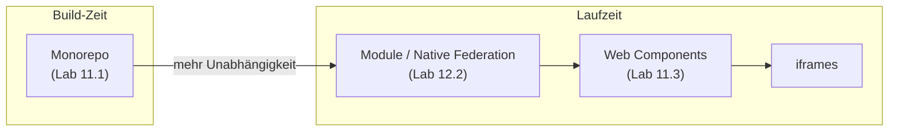

# Lab 12.1: Micro-Frontend-Architektur

**Leitfragen:**

Wann braucht ein Team eine eigene Release-Kadenz?

Wenn es fachlich unabhängig arbeitet und auf andere Teams warten müsste, z. B. der Admin-Bereich mit wöchentlichen Releases neben einem Shop, der nur quartalsweise freigegeben wird. Ein gemeinsamer Build zwingt alle in den langsamsten Takt.

Was passiert, wenn zwei Teams unterschiedliche Angular-Versionen nutzen wollen?

In einer App geht das nicht: Es gibt genau ein Angular zur Laufzeit. Getrennte Versionen erfordern getrennte Laufzeiten (Web Components mit eigenem Bundle oder iframes) und kosten Ladezeit. Mit geteilten Abhängigkeiten (Federation) müssen sich die Teams auf eine Version einigen.

Wäre der Nx-Workspace aus Lab 11.1 nicht schon genug?

Oft ja. Ein Monorepo trennt Code und Zuständigkeiten, liefert aber eine App mit einem Release aus. Erst wenn Teams getrennt deployen müssen, lohnen sich Micro-Frontends; vorher kosten sie nur.

- Micro-Frontends teilen eine Web-Oberfläche in Teile, die getrennt gebaut und ausgeliefert werden; der Host setzt sie zur Laufzeit zusammen.
- Der Gewinn ist organisatorisch (unabhängige Teams und Deployments), der Preis technisch (Versionen, geteilter Zustand, einheitliches Aussehen).

## Begriffe

| Begriff | Bedeutung |
| --- | --- |
| Micro-Frontend (MFE) | eigenständig gebauter und ausgelieferter Teil einer Oberfläche, meist ein Fachbereich |
| Host (Shell) | App, die Rahmen, Navigation und Login stellt und Micro-Frontends lädt |
| Remote | Micro-Frontend, das Code zum Nachladen bereitstellt |
| Module Federation | Laden von Code anderer Builds zur Laufzeit, mit geteilten Abhängigkeiten |
| Native Federation | Module Federation auf Basis von Browser-Standards (ES-Module, Import Maps), unabhängig vom Bundler |
| Import Map | JSON im Browser, das Paketnamen auf URLs abbildet (`"@angular/core": "/core.js"`) |

## Was Micro-Frontends bringen und kosten

| Nutzen | Kosten |
| --- | --- |
| Teams bauen, testen und deployen unabhängig | mehrere Builds, Pipelines, Server, Versionen |
| kleinere Codebasen pro Team | geteilte Abhängigkeiten müssen zusammenpassen (z. B. eine Angular-Version) |
| Fachbereich kann allein ausfallen oder getauscht werden | geteilter Zustand (Login, Warenkorb) braucht Absprachen |
| schrittweise Migration alter Anwendungen | UX-Konsistenz: gemeinsames Design-System nötig |
| | Fehlersuche über Grenzen hinweg, mehr Netzwerkanfragen |

> **Merksatz:** Micro-Frontends lösen ein Organisationsproblem, kein Technikproblem. Ohne getrennte Teams mit getrennten Release-Zyklen sind sie Overhead.

## Ansätze im Vergleich

| Kriterium | Monorepo (Nx) | Native Federation | Webpack Module Federation | Web Components | iframes |
| --- | --- | --- | --- | --- | --- |
| Getrennte Deployments | nein | ja | ja | ja | ja |
| Angular einmal geladen | ja | ja (geteilt) | ja (geteilt) | nein, je Bundle | nein, je Frame |
| Unterschiedliche Framework-Versionen | nein | nur mit Mehraufwand | nur mit Mehraufwand | ja | ja |
| Angular-Build-System | Standard | esbuild (Standard seit v17), Angular CLI | Webpack, nicht mehr Standard der CLI | Standard | beliebig |
| Routing, DI, Zustand teilen | direkt | über geteilte Pakete | über geteilte Pakete | nur über Attribute/Events | nur über `postMessage` |
| Isolation (CSS, Fehler) | gering | gering | gering | mittel (Shadow DOM) | hoch |
| Typischer Einsatz | eine Organisation, gemeinsamer Release | mehrere Angular-Teams | bestehende Webpack-Setups | Widgets in fremden Seiten, gemischte Frameworks | Altanwendungen, fremde Anbieter |

Stand: 28.10.2026, `@angular-architects/native-federation` 22.2 (Angular 22). Webpack Module Federation erfordert in Angular einen Webpack-basierten Builder; neue Angular-Projekte bauen mit esbuild. Vor Projektstart Kompatibilität `prüfen`.

## Entscheidungskriterien

| Frage | Spricht für |
| --- | --- |
| Wie viele Teams liefern unabhängig aus? | 1–2: Monorepo · 3+: Federation |
| Müssen Teams Framework-Versionen unabhängig wählen? | ja: Web Components oder iframes |
| Läuft der Teil auf Seiten außerhalb der eigenen App? | ja: Web Components |
| Wird fremder oder alter Code eingebettet, der stören könnte? | ja: iframes |
| Wie wichtig ist Ladezeit auf Mobilgeräten? | hoch: geteiltes Angular (Monorepo, Federation) |
| Gibt es ein gemeinsames Design-System und eine Plattform-Gruppe? | nein: zuerst schaffen, sonst driftet die UX |

Gemischte Lösungen sind üblich: ein Monorepo pro Team, Federation zwischen den Teams, Web Components für Widgets auf Marketing-Seiten.

## Grenzen

- Geteilter Zustand bleibt die schwierigste Stelle; ab Lab 12.2 gilt die Regel: so wenig wie möglich teilen, und wenn, dann über ein klar versioniertes Paket.
- Federation verlangt Einigkeit über geteilte Versionen; ein Team kann Angular nicht allein aktualisieren.

## Fazit

- Micro-Frontends lohnen sich, wenn mehrere Teams getrennt ausliefern müssen; vorher reicht ein Monorepo.
- Federation teilt Angular zur Laufzeit, Web Components und iframes isolieren stärker und kosten Ladezeit.
- Die Entscheidung folgt Kriterien: Anzahl Teams, Release-Takt, Versionen, Einsatzort, Isolation.

In der Übung entstehen zwei begründete Architektur-Entscheidungen.
