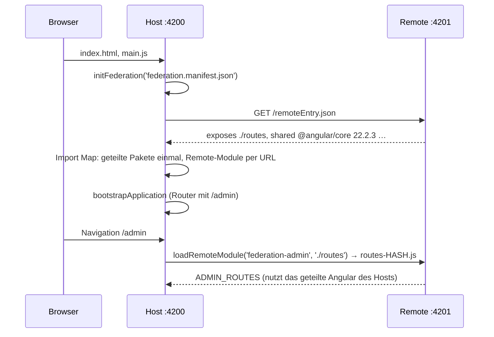

# Lab 12.2: Micro-Frontend mit Native Federation

**Leitfragen:**

<details>
<summary>Wie lädt eine App Code nach, der zur Build-Zeit noch nicht existierte?</summary>

Sie kennt zur Build-Zeit nur eine Adresse und einen Vertrag (welches Modul, welche Exporte). Zur Laufzeit liest sie ein Manifest, lädt von dort eine Beschreibung des Remotes (`remoteEntry.json`) und importiert dessen ES-Module per URL, wie beim Lazy Loading aus Lab 8.1, nur von einem anderen Server.

</details>

<details>
<summary>Was passiert, wenn Host und Remote je eine eigene Angular-Kopie laden?</summary>

Doppelte Ladezeit und zwei getrennte Welten: zwei Router, zwei Root-Injectors, Services existieren zweimal, Komponenten des einen passen nicht in den anderen. Native Federation teilt deshalb Angular, RxJS und Co. als Singletons; alle laden dieselbe Datei.

</details>

<details>
<summary>Wie erfährt der Remote, wer eingeloggt ist?</summary>

Der Remote läuft im Browserfenster und im Injector des Hosts. Ein Auth-Service aus einem geteilten Paket ist für beide dieselbe Instanz, und der `HttpClient` des Hosts hängt das Token (Lab 9.2) auch an Anfragen des Remotes. Der Remote sollte keinen eigenen Login-Zustand führen.

</details>

- Native Federation verbindet getrennt gebaute Angular-Apps zur Laufzeit über Browser-Standards: ES-Module und Import Maps.
- Der Host lädt Remotes über ein Manifest und `loadRemoteModule` in den Routen; geteilte Pakete wie Angular werden nur einmal geladen.

## Begriffe

| Begriff | Bedeutung |
| --- | --- |
| `federation.config.mjs` | Federation-Konfiguration eines Projekts: Name, freigegebene Module (`exposes`), geteilte Pakete (`shared`) |
| `remoteEntry.json` | vom Build erzeugte Beschreibung eines Remotes: freigegebene Module, geteilte Pakete mit Versionen |
| `federation.manifest.json` | Datei des Hosts: Remote-Name → URL der `remoteEntry.json`; austauschbar ohne Build |
| `initFederation()` | lädt Manifest und Remote-Beschreibungen, baut die Import Map, liefert `loadRemoteModule` |
| `loadRemoteModule()` | lädt ein freigegebenes Modul eines Remotes zur Laufzeit |
| Singleton (geteilt) | Paket existiert zur Laufzeit genau einmal für Host und alle Remotes |
| `es-module-shims` | Polyfill, der Import Maps nachträglich und dynamisch nutzbar macht |

## Einrichtung mit `ng add`

Beide Workspaces entstanden mit `ng new … --minimal` und danach (Stand: 28.10.2026, `@angular-architects/native-federation` 22.2.4):

```bash
# im Remote
npx ng add @angular-architects/native-federation --project federation-admin --port 4201 --type remote
# im Host
npx ng add @angular-architects/native-federation --project federation-host --port 4200 --type dynamic-host
```

| Änderung durch `ng add` | Wirkung |
| --- | --- |
| `angular.json`: Builder `@angular-architects/native-federation:build` | umhüllt den normalen esbuild-Builder (`esbuild`, `serve-original`) |
| `federation.config.mjs` | Name, `exposes`, `shared` |
| `src/main.ts` → `initFederation(...)`, danach `import('./bootstrap')` | Federation vor Angular starten |
| `src/bootstrap.ts` | bisheriger Inhalt von `main.ts` (`bootstrapApplication`) |
| `public/federation.manifest.json` (nur `dynamic-host`) | leeres Manifest `{}` |
| `package.json`: `es-module-shims`, Orchestrator-Paket | Laufzeit für Import Maps |

## Ablauf zur Laufzeit



## Remote: `federation-admin`

```js
// federation-admin/federation.config.mjs (Auszug)
export default withNativeFederation({
  name: 'federation-admin',
  exposes: {
    './routes': './src/app/admin.routes.ts',      // öffentlicher Vertrag des Remotes
  },
  shared: fromPackageJson({                       // alle dependencies aus package.json teilen
    singleton: true,                              // genau eine Instanz zur Laufzeit
    strictVersion: true,                          // Versionskonflikt = Fehler statt stiller Doppelkopie
    requiredVersion: 'auto',                      // Bereich aus package.json übernehmen
    build: 'package',
  })
    .patch(['@angular/*'], { includeSecondaries: { keepAll: true } })
    .get(),
});
```

```ts
// federation-admin/src/app/admin.routes.ts
export const ADMIN_ROUTES: Routes = [{ path: '', component: AdminDashboard, title: 'EventHub – Admin' }];
```

Ältere Projekte und viele Artikel nutzen `shareAll({ singleton: true, strictVersion: true, requiredVersion: 'auto' })`; die Funktion existiert weiter, neue Projekte bekommen `fromPackageJson`. Allein gestartet (`npx ng serve`, Port 4201) zeigt der Remote seine Routen über die eigene `app.routes.ts`.

## Host: `federation-host`

```json
// public/federation.manifest.json – pro Umgebung austauschbar, ohne den Host neu zu bauen
{
  "federation-admin": "http://localhost:4201/remoteEntry.json"
}
```

```ts
// src/main.ts
initFederation('federation.manifest.json', { hostRemoteEntry: { url: './remoteEntry.json' } })
  .then((nf) => import('./bootstrap').then((m) => m.bootstrap(nf)))   // nf enthält loadRemoteModule
  .catch((err) => console.error(err));
```

```ts
// src/app/app.routes.ts
export const routes = ({ loadRemoteModule }: NativeFederationResult): Routes => [
  { path: '', component: Home, title: 'EventHub' },
  {
    path: 'admin',
    loadChildren: () =>
      loadRemoteModule<typeof import('./admin-remote')>('federation-admin', './routes').then((m) => m.ADMIN_ROUTES),
  },
];
```

```ts
// src/app/admin-remote.d.ts – der Host kennt nur den Typ, nicht den Code
export declare const ADMIN_ROUTES: Routes;
```

`app.config.ts` ist eine Funktion `appConfig(nf)`, weil die Routen `loadRemoteModule` aus dem Ergebnis von `initFederation` brauchen. Das ebenfalls exportierte, globale `loadRemoteModule` aus `@angular-architects/native-federation` funktioniert noch, ist in Version 22 aber als veraltet markiert (`prüfen` bei Updates).

## Geteilter Zustand und Login

| Weg | Wie | Bewertung |
| --- | --- | --- |
| Host-Injector nutzen | Remote stellt keinen eigenen `HttpClient` bereit; der des Hosts mit Auth-Interceptor (Lab 9.2) gilt auch im Remote | einfachster Weg, im Workspace umgesetzt |
| geteiltes Auth-Paket | `@eventhub/auth` als npm-Paket oder Library (Lab 11.2), in beiden `shared` als Singleton; `AuthService` mit `providedIn: 'root'` | eine Instanz, klare Schnittstelle |
| Browser-Speicher | Token in `sessionStorage`, beide lesen | funktioniert (gleiche Seite), aber ohne Typen und Reaktivität |
| Custom Events | `window.dispatchEvent(new CustomEvent('login', …))` | lose gekoppelt, gut für Web Components (Lab 11.3) |

Regel: Login, Token-Erneuerung und Logout gehören in den Host; Remotes lesen nur.

## Build-Ausgabe

`npx ng build` im Remote erzeugt neben den normalen Dateien die geteilten Pakete einzeln und die Beschreibung:

```text
dist/federation-admin/browser/
├── remoteEntry.json              # exposes + shared mit Versionen
├── routes-<hash>.js            # das freigegebene Modul ./routes
├── _angular_core.AnS7MGp98i.js   # geteiltes Paket (wird nur einmal geladen)
├── _angular_router.qKFFg0ygq3.js
└── …
```

```json
// remoteEntry.json (Auszug)
{
  "name": "federation-admin",
  "shared": [{ "packageName": "@angular/core", "version": "22.2.3", "requiredVersion": "^22.2.0", "singleton": true, "strictVersion": true }],
  "exposes": [{ "key": "./routes", "outFileName": "routes-<hash>.js" }]
}
```

## Typische Fehler

| Symptom | Ursache | Lösung |
| --- | --- | --- |
| `Port 4200 is already in use` | Kurs-App läuft noch | Kurs-App beenden oder Host mit `--port 4300` starten |
| `Port 4201 is already in use` beim Start des Remotes | Dev-Server von `workspaces/eventhub-lab/` (Lab 8.1–9.3) nutzt ebenfalls Port 4201 | dort mit Strg+C beenden; sonst Remote mit `npx ng serve --port 4202` starten und die URL in `public/federation.manifest.json` des Hosts auf Port 4202 ändern |
| `/admin` bleibt leer, Konsole: `NFError: Failed to load module federation-admin/./routes` | Remote läuft nicht oder Manifest-URL falsch | Remote starten, `federation.manifest.json` prüfen; Ersatzroute per `.catch()` |
| Änderung am Remote nicht sichtbar | Browser-Cache oder Remote nicht neu gebaut | Remote-Terminal prüfen, Host-Seite neu laden |
| Fehler zu Versionskonflikt beim Start | `strictVersion` und unterschiedliche Versionen in Host und Remote | Versionen angleichen (z. B. beide `^22.2.0`) |
| Fehler `NG0201` (kein Provider für `HttpClient`) beim Öffnen von `/admin` | Remote verlässt sich auf `HttpClient`, Host stellt keinen bereit | `provideHttpClient()` in `app.config.ts` des Hosts |
| Typfehler beim Import aus dem Remote | Host hat keinen Typ für das Remote-Modul | `.d.ts` mit dem Vertrag anlegen (`admin-remote.d.ts`) |

## Vertiefung

- `loadRemoteModule({ remoteEntry: 'https://…/remoteEntry.json', exposedModule: './routes' })` lädt Remotes, die nicht im Manifest stehen.
- `exposes` kann auch einzelne Komponenten freigeben (`'./Dashboard': './src/app/admin-dashboard.ts'`) oder ganze Apps als Web Component (`ng add … --type remote --webcomponent`).
- Dokumentation: https://native-federation.com/docs/v4/angular-adapter/ (Stand: 28.10.2026).

## Fazit

- `ng add @angular-architects/native-federation` macht Projekte zu Host oder Remote; der Remote gibt Module per `exposes` frei.
- Der Host findet Remotes über `federation.manifest.json` und lädt sie mit `loadRemoteModule` in `loadChildren`, wie beim Lazy Loading.
- Geteilte Pakete laufen als Singletons; Login und `HttpClient` stellt der Host, Remotes nutzen sie mit.

In der Übung lädt der Host den Admin-Remote, und eine neue Remote-Version erscheint ohne Host-Build.
