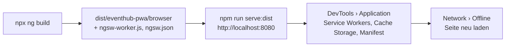

# Lab 12.3: Progressive Web App

**Leitfragen:**

<details>
<summary>Was soll jemand auf einer Konferenz ohne WLAN in der App noch sehen?</summary>

Mindestens das Programm: Sessions, Räume, Uhrzeiten, auch wenn es eine Stunde alt ist. Dafür muss die App selbst (HTML, JS, CSS) und die letzte Antwort der Programm-API im Browser gespeichert sein.

</details>

<details>
<summary>Welche Daten dürfen alt sein, welche nicht?</summary>

Das Programm darf alt sein, wenn das Netz fehlt, sollte aber frisch sein, wenn es da ist (`freshness`). Sprecher-Bios ändern sich selten und dürfen aus dem Cache kommen (`performance`). Anmeldungen, Restplätze und Zahlungen dürfen nie aus dem Cache kommen.

</details>

<details>
<summary>Wie erfährt jemand, dass eine neue App-Version bereitsteht?</summary>

Der Service Worker lädt neue Versionen im Hintergrund und meldet sie. Die App zeigt daraufhin einen Hinweis „Neue Version verfügbar – neu laden“; ohne Hinweis sähe man die neue Version erst beim nächsten Öffnen.

</details>

- Eine Progressive Web App (PWA) ist eine Web-App mit Manifest und Service Worker: installierbar, offline nutzbar, mit Update-Mechanismus.
- `ng add @angular/pwa` richtet alles ein; was gespeichert wird, steht in `ngsw-config.json`. Der Service Worker läuft nur im Produktions-Build.

## Begriffe

| Begriff | Bedeutung |
| --- | --- |
| Web App Manifest | JSON-Datei mit Name, Icons, Farben, Startadresse; macht die App installierbar |
| Service Worker | Script, das der Browser getrennt von der Seite ausführt; fängt Netzwerkanfragen ab und beantwortet sie aus dem Cache |
| Angular Service Worker (`ngsw`) | fertiger Service Worker von Angular, gesteuert über `ngsw-config.json` |
| Asset-Gruppe | Dateien der App selbst (JS, CSS, HTML, Icons) und wie sie gespeichert werden |
| Daten-Gruppe | API-Antworten und die Strategie, wann Cache, wann Netz |
| `freshness` / `performance` | erst Netz, Cache als Ersatz / erst Cache, Netz im Hintergrund |
| `SwUpdate` | Angular-Service, der neue Versionen meldet und aktiviert |

## Was `ng add @angular/pwa` ändert

Ausgangspunkt ist `project/workspaces/eventhub-pwa/`, das Ergebnis liegt in `eventhub-pwa-final/` (Angular 22.2, Stand: 28.10.2026).

```bash
npx ng add @angular/pwa
```

```text
CREATE ngsw-config.json
CREATE public/manifest.webmanifest
CREATE public/icons/icon-72x72.png … icon-512x512.png   (8 Größen)
UPDATE angular.json          # "serviceWorker": "ngsw-config.json" in der Produktions-Konfiguration
UPDATE package.json          # @angular/service-worker
UPDATE src/app/app.config.ts # provideServiceWorker(...)
UPDATE src/index.html        # <link rel="manifest" href="manifest.webmanifest" />
```

```ts
// src/app/app.config.ts (von ng add ergänzt)
provideServiceWorker('ngsw-worker.js', {
  enabled: !isDevMode(),                         // nicht in ng serve
  registrationStrategy: 'registerWhenStable:30000', // nach dem Start registrieren, spätestens nach 30 s
}),
```

```json
// public/manifest.webmanifest (angepasst)
{
  "name": "EventHub Programm",
  "short_name": "EventHub",
  "lang": "de",
  "theme_color": "#c3002f",
  "background_color": "#f6f7f9",
  "display": "standalone",
  "start_url": "./",
  "icons": [{ "src": "icons/icon-192x192.png", "sizes": "192x192", "type": "image/png", "purpose": "maskable any" }]
}
```

## `ngsw-config.json`

```json
{
  "$schema": "./node_modules/@angular/service-worker/config/schema.json",
  "index": "/index.html",
  "assetGroups": [
    {
      "name": "app",
      "installMode": "prefetch",
      "resources": { "files": ["/favicon.ico", "/index.html", "/manifest.webmanifest", "/*.css", "/*.js"] }
    },
    {
      "name": "assets",
      "installMode": "lazy",
      "updateMode": "prefetch",
      "resources": { "files": ["/**/*.(svg|cur|jpg|jpeg|png|apng|webp|avif|gif|otf|ttf|woff|woff2)"] }
    }
  ],
  "dataGroups": [
    {
      "name": "raumplan",
      "urls": ["https://cdn.eventhub.example/rooms.json"],
      "cacheConfig": { "strategy": "performance", "maxSize": 5, "maxAge": "12h" }
    }
  ]
}
```

Die Daten-Gruppe `raumplan` ist ein Beispiel: Der Raumplan ändert sich während einer Konferenz kaum und darf deshalb bis zu 12 Stunden aus dem Cache kommen. Für Daten, die möglichst frisch sein sollen, gilt `freshness` mit einem `timeout`, siehe Tabelle.

| Feld | Bedeutung |
| --- | --- |
| `installMode: prefetch` | alle Dateien sofort beim Installieren laden (App-Kern) |
| `installMode: lazy` | erst beim ersten Abruf speichern (Bilder, Schriften) |
| `urls` | Muster für API-Adressen; fremde Origins mit voller URL. Die Muster passen auf die ganze URL, `…/sessions?level=Experte` wäre ein eigenes Muster |
| `strategy: freshness` | Netz zuerst; antwortet das Netz nicht innerhalb `timeout`, kommt die gespeicherte Antwort |
| `strategy: performance` | Cache zuerst, solange jünger als `maxAge`; schnell, aber evtl. veraltet |
| `maxSize` / `maxAge` | höchstens so viele Antworten, höchstens so alt (`1d`, `12h`, `30m`) |
| `timeout` | nur bei `freshness`: so lange auf das Netz warten, dann Cache (`3s`, `500u` für Millisekunden) |

Nur `GET`-Anfragen landen im Cache; `POST /registrations` geht immer ans Netz.

## Neue Versionen mit `SwUpdate`

`SwUpdate` aus `@angular/service-worker` liefert mit `versionUpdates` ein Observable aller Update-Ereignisse. Das Beispiel zeigt eine Meldung, wenn eine neue Version nicht installiert werden konnte; der Hinweis auf eine fertig geladene Version funktioniert genauso mit einem anderen Ereignistyp.

```ts
// src/app/update-error.ts (Beispiel)
import { Component, inject, signal } from '@angular/core';
import { takeUntilDestroyed } from '@angular/core/rxjs-interop';
import { SwUpdate, VersionInstallationFailedEvent } from '@angular/service-worker';
import { filter } from 'rxjs';

@Component({
  selector: 'app-update-error',
  template: `
    @if (failure(); as message) {
      <p class="card muted">Die neue Version konnte nicht geladen werden: {{ message }}</p>
    }
  `,
})
export class UpdateError {
  private readonly swUpdate = inject(SwUpdate);
  protected readonly failure = signal<string | null>(null);

  constructor() {
    if (this.swUpdate.isEnabled) {                       // false in ng serve
      this.swUpdate.versionUpdates
        .pipe(
          // Typwächter: danach kennt TypeScript das Feld error
          filter((event): event is VersionInstallationFailedEvent => event.type === 'VERSION_INSTALLATION_FAILED'),
          takeUntilDestroyed(),                          // Abo endet mit der Komponente (Lab 5.3)
        )
        .subscribe((event) => this.failure.set(event.error));
    }
  }
}
```

| Ereignis (`event.type`) | Typ | Bedeutung |
| --- | --- | --- |
| `VERSION_DETECTED` | `VersionDetectedEvent` | neue Version gefunden, Download läuft |
| `VERSION_READY` | `VersionReadyEvent` | neue Version vollständig geladen; ein Neuladen der Seite (`document.location.reload()`) zeigt sie |
| `VERSION_INSTALLATION_FAILED` | `VersionInstallationFailedEvent` | Download fehlgeschlagen, Grund in `error` |
| `NO_NEW_VERSION_DETECTED` | `NoNewVersionDetectedEvent` | Prüfung ohne neue Version |

Der Service Worker prüft beim Laden der Seite auf Updates; `swUpdate.checkForUpdate()` prüft zusätzlich auf Wunsch, z. B. alle 30 Minuten.

## Testen: nur im Produktions-Build



| Schritt | Ort |
| --- | --- |
| Service Worker aktiv? | DevTools › Application › Service Workers: Status „activated and is running“ |
| Was liegt im Cache? | Application › Cache Storage: Einträge `ngsw:…:assets:app:cache` und je Daten-Gruppe `ngsw:…:data:<name>:cache` (Namen gekürzt) |
| Manifest gültig? | Application › Manifest: Name, Icons, Hinweise zur Installierbarkeit |
| Offline testen | Network › Throttling „Offline“ oder Mock-API stoppen, Seite neu laden |
| Installieren | Symbol in der Adressleiste von Chrome/Edge (nur `https://` oder `localhost`) |

`ng serve` registriert keinen Service Worker (`enabled: !isDevMode()`). Service Worker laufen nur über `https://` oder `http://localhost`.

Im Workspace `eventhub-pwa` startet `npx ng serve` auf Port 4240 (in `angular.json` gesetzt, damit die Kurs-App auf Port 4200 weiterlaufen kann); der Produktions-Build läuft mit `npm run serve:dist` auf Port 8080.

## Typische Fehler

| Symptom | Ursache | Lösung |
| --- | --- | --- |
| Kein Service Worker in DevTools | Test mit `ng serve` | `npx ng build` und `npm run serve:dist` |
| Offline lädt die App, aber das Programm fehlt | keine Daten-Gruppe oder URL-Muster passt nicht | `urls` mit voller URL inkl. Port; Muster gegen die Anfrage im Network-Tab prüfen |
| Nach neuem Build sieht der Browser die alte Version | Service Worker liefert die gespeicherte Version | Update-Hinweis abwarten und neu laden oder „Update on reload“ in DevTools aktivieren |
| Änderungen an `ngsw-config.json` wirken nicht | Konfiguration wird beim Build in `ngsw.json` übersetzt | neu bauen |
| Seite zeigt veraltete Restplätze | Daten-Gruppe mit `performance` für Daten, die frisch sein müssen | `freshness` oder aus der Daten-Gruppe nehmen |
| `http-server` liefert alte Dateien | HTTP-Cache des Servers | `-c-1` (in `serve:dist` gesetzt) |

## Vertiefung

- Lighthouse hat die eigene Kategorie „PWA“ entfernt; Installierbarkeit zeigt DevTools › Application › Manifest (Stand: 28.10.2026, `prüfen`).
- `SwPush` ergänzt Push-Benachrichtigungen; dafür braucht es einen Push-Server (VAPID-Schlüssel).
- `navigationUrls` in `ngsw-config.json` legt fest, welche Adressen offline auf `index.html` fallen (wichtig für Deep Links, vgl. Lab 13.3).

## Fazit

- Manifest plus Service Worker machen aus einer Angular-App eine installierbare, offline-fähige PWA; `ng add @angular/pwa` richtet beides ein.
- Asset-Gruppen speichern die App, Daten-Gruppen API-Antworten mit `freshness` oder `performance`.
- `SwUpdate.versionUpdates` meldet neue Versionen; getestet wird nur im Produktions-Build über `localhost` oder HTTPS.

In der Übung wird EventHub zur PWA und zeigt das Programm auch ohne Mock-API.
