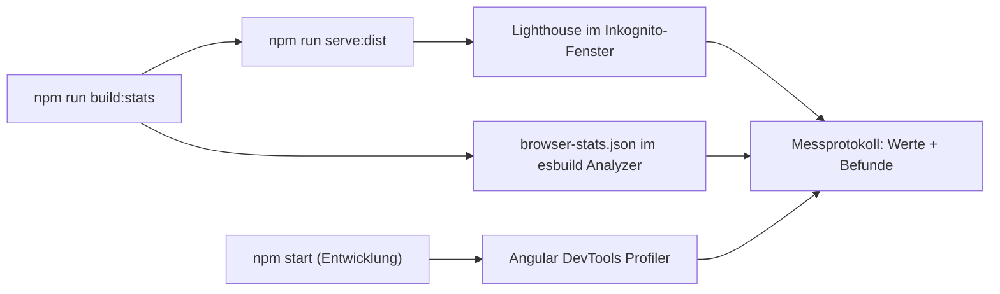

# Lab 13.1: Performance messen mit Lighthouse und DevTools

**Leitfragen:**

<details>
<summary>Woran merkt jemand ohne Messwerkzeug, dass eine App langsam ist?</summary>

Am langen leeren oder halbfertigen Bildschirm, an springenden Inhalten beim Laden und an Eingaben, die verzögert reagieren. Genau diese drei Eindrücke messen die Core Web Vitals: LCP, CLS und INP.

</details>

<details>
<summary>Warum misst man nicht im Entwicklungsmodus?</summary>

`ng serve` liefert unminifizierten Code mit Source Maps und zusätzlichen Prüfungen aus. Die Zahlen wären schlechter und anders verteilt als beim Publikum, das den Produktions-Build bekommt.

</details>

<details>
<summary>Welche der bisher gelernten Techniken könnten hier helfen?</summary>

`@defer` (Lab 3.2) und Lazy Loading (Lab 8.1) verkleinern den Start-Code, `track` (Lab 3.1) spart DOM-Arbeit, `computed()` (Lab 6.1) vermeidet wiederholte Berechnungen. Welche passt, zeigt erst die Messung.

</details>

- Erst messen, dann optimieren: Jede Maßnahme in Lab 13.2 braucht einen Befund aus diesem Lab.
- Zahlen kommen aus dem Produktions-Build; Details zur Change Detection aus dem Entwicklungsserver.

## Begriffe

| Begriff | Bedeutung |
| --- | --- |
| Core Web Vitals | Drei Kennzahlen von Google für das Nutzungserlebnis: Laden (LCP), Reaktion (INP), visuelle Stabilität (CLS). |
| LCP (Largest Contentful Paint) | Zeit, bis das größte sichtbare Element (Bild, Textblock) gezeichnet ist. |
| INP (Interaction to Next Paint) | Zeit von einer Eingabe (Klick, Taste) bis zur nächsten sichtbaren Reaktion; gemessen über den ganzen Besuch. |
| CLS (Cumulative Layout Shift) | Summe der unerwarteten Verschiebungen sichtbarer Elemente, z. B. wenn ein Bild nachlädt und Text nach unten schiebt. |
| TBT (Total Blocking Time) | Summe der Zeit, in der lange Aufgaben (> 50 ms) den Haupt-Thread blockieren; Labor-Ersatz für INP. |
| Long Task | JavaScript-Aufgabe, die länger als 50 ms läuft; in dieser Zeit reagiert die Seite nicht. |
| Lighthouse | In Chrome eingebautes Prüfwerkzeug, das eine Seite unter simulierter Drosselung lädt und bewertet. |
| Budget | Größengrenze in `angular.json`; der Build warnt oder bricht ab, wenn ein Bundle sie überschreitet. |

## Grenzwerte der Core Web Vitals

| Kennzahl | Gut | Verbesserungswürdig | Schlecht | Lighthouse misst |
| --- | --- | --- | --- | --- |
| LCP | ≤ 2,5 s | ≤ 4 s | > 4 s | ja |
| INP | ≤ 200 ms | ≤ 500 ms | > 500 ms | nein (braucht echte Eingaben), stattdessen TBT |
| CLS | ≤ 0,1 | ≤ 0,25 | > 0,25 | ja |

_Quelle: web.dev, „Web Vitals“ (https://web.dev/articles/vitals), abgerufen am 28.10.2026._

## Werkzeuge und was sie zeigen

| Werkzeug | Wo | Liefert | Build |
| --- | --- | --- | --- |
| Lighthouse | Chrome DevTools → Tab „Lighthouse“ | Score, LCP, TBT, CLS, konkrete Hinweise (z. B. Bild ohne `width`/`height`) | Produktion |
| Performance-Panel | Chrome DevTools → „Performance“ | Zeitleiste mit Long Tasks, Aufrufbaum („Bottom-Up“) | Produktion oder Entwicklung |
| Angular DevTools, Tab „Profiler“ | Chrome-Erweiterung | jeden Change-Detection-Durchlauf mit Dauer pro Komponente | nur Entwicklung |
| Build-Ausgabe | Terminal nach `ng build` | Größe von Initial- und Lazy-Chunks | Produktion |
| Bundle-Analyse | `ng build --stats-json` + esbuild Analyzer | welche Pakete wie viel Platz im Bundle belegen | Produktion |

Angular DevTools arbeitet nur mit Apps, die ohne Optimierung gebaut sind (`ng serve`); bei einem Produktions-Build meldet die Erweiterung, dass sie nur Entwicklungs-Builds unterstützt.

## Messablauf



- **Produktions-Build lokal ausliefern:** Ein statischer Server reicht. `serve -s` liefert für unbekannte Pfade `index.html` aus, damit Routen wie `/sessions/3` funktionieren.
- **Inkognito-Fenster:** Browser-Erweiterungen laufen dort nicht mit und verfälschen die Messung nicht.
- **Mehrfach messen:** Werte schwanken zwischen Läufen. Den Median aus drei Läufen notieren.

```bash
# im Ordner project/workspaces/eventhub-perf
npm install
npm run build:stats     # Hero-Bild erzeugen + ng build --stats-json
npm run serve:dist      # serve -s dist/eventhub-perf/browser -l 8081
```

Lighthouse-Einstellungen: Mode „Navigation“, Device „Mobile“, Category „Performance“, dann „Analyze page load“.

## Lighthouse-Bericht lesen

| Bereich im Bericht | Wofür |
| --- | --- |
| Metrics (FCP, LCP, TBT, CLS, Speed Index) | Ausgangswerte fürs Protokoll |
| „Largest Contentful Paint element“ / „LCP breakdown“ | welches Element das LCP ist und wo die Zeit hängt |
| „Image elements do not have explicit width and height“ | Ursache für CLS durch Bilder |
| „Improve image delivery“, „Avoid enormous network payloads“ | zu große Dateien |
| „Reduce unused JavaScript“, „Reduce JavaScript execution time“ | Code, der beim Start geladen, aber nicht gebraucht wird |

Die Titel der Hinweise wechseln zwischen Lighthouse-Versionen (Stand Lighthouse 13, 28.10.2026, `prüfen`).

## Change Detection im Profiler

Der Profiler zeichnet jeden Change-Detection-Durchlauf als Balken auf. Ein Klick auf einen Balken zeigt, welche Komponente wie lange gebraucht hat.

- Viele Balken in kurzer Zeit: Etwas löst ständig Change Detection aus (z. B. ein Timer, der ein Signal setzt).
- Ein hoher Balken bei einer Komponente: Ihr Template rechnet bei jedem Durchlauf viel, z. B. eine Methode, die in `{{ … }}` pro Listeneintrag aufgerufen wird.
- Methoden im Template laufen bei **jedem** Durchlauf der Komponente erneut; Angular kann ihr Ergebnis nicht zwischenspeichern.

Im Performance-Panel erscheinen dieselben Probleme als Long Tasks (rot markierte Ecke). Die Ansicht „Bottom-Up“ sortiert nach eigener Rechenzeit und nennt die teure Funktion beim Namen.

## Bundle-Analyse

`ng build --stats-json` schreibt neben den Build `dist/<app>/browser-stats.json` (esbuild-Metafile). Die Datei lässt sich unter [esbuild.github.io/analyze](https://esbuild.github.io/analyze/) über „Import your metafile…“ öffnen; die Treemap zeigt Pakete nach Größe pro Ausgabedatei.

Die Build-Ausgabe selbst zeigt schon die Aufteilung:

```text
Initial chunk files | Names         |  Raw size | Estimated transfer size
main-BRQTNP33.js    | main          | 471.96 kB |               133.87 kB
styles-Z3QJSWY5.css | styles        |   1.96 kB |               705 bytes
                    | Initial total | 473.92 kB |               134.57 kB
```

_Ausgabe der langsamen Variante, Angular CLI 22.2.5, Hashes und Größen ändern sich mit jedem Code-Stand._

Alternative ohne Website: `ng build --source-map` und danach `npx source-map-explorer "dist/eventhub-perf/browser/*.js"` (`prüfen` mit der installierten Version).

## Budgets in `angular.json`

```json
"configurations": {
  "production": {
    "budgets": [
      { "type": "initial", "maximumWarning": "2MB", "maximumError": "5MB" },
      { "type": "anyComponentStyle", "maximumWarning": "4kB", "maximumError": "8kB" }
    ]
  }
}
```

| `type` | prüft |
| --- | --- |
| `initial` | alles, was beim Start geladen wird |
| `anyScript` / `any` | jede einzelne Skript-Datei / jede Datei |
| `allScript` / `all` | alle Skripte / die ganze App zusammen |
| `anyComponentStyle` | das Stylesheet jeder Komponente |
| `bundle` | ein benanntes Bundle (`"name": "…"`) |

Die langsame Variante hat das Initial-Budget auf 2 MB / 5 MB angehoben, damit der Build nie warnt. So fällt kein Wachstum mehr auf.

## Typische Fehler

| Symptom | Ursache | Lösung |
| --- | --- | --- |
| Lighthouse-Score schwankt um 20 Punkte | Hintergrundlast, Erweiterungen | Inkognito, andere Tabs schließen, drei Läufe, Median |
| Angular DevTools zeigt keine Komponenten, nur einen Hinweis auf den Produktions-Build | Produktions-Build geöffnet | Profiler mit `npm start` (Port 4300) nutzen |
| Programm bleibt leer, Konsole: `ERR_CONNECTION_REFUSED` | Mock-API läuft nicht | im Ordner `project/` `npm run api` starten |
| `browser-stats.json` fehlt | `ng build` ohne `--stats-json` | `npm run build:stats` |
| `/sessions/3` gibt 404 | statischer Server ohne SPA-Fallback | `serve -s` verwenden (Option `-s`) |

## Fazit

- Lighthouse liefert LCP, CLS und TBT aus dem Produktions-Build, der Profiler die Change-Detection-Kosten aus dem Entwicklungsbuild.
- Die Bundle-Analyse zeigt, welches Paket den Start-Code aufbläht.
- Ein Befund nennt Messwert, Ort im Code und vermutete Ursache.

In der Übung entsteht das Messprotokoll der langsamen EventHub-Variante mit drei Befunden.
