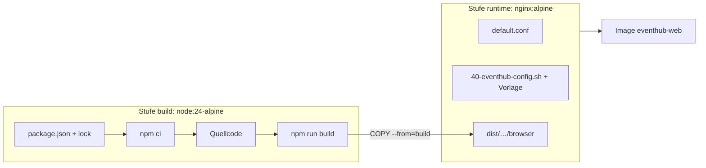

# Lab 13.3: Containerisierung mit Docker

**Leitfragen:**

<details>
<summary>Warum funktioniert <code>/sessions/3</code> lokal, aber auf manchem Webserver gibt es 404?</summary>

Der Pfad existiert nur im Angular-Router, nicht als Datei. `ng serve` liefert für unbekannte Pfade `index.html` aus; ein einfacher Webserver sucht eine Datei `sessions/3` und meldet 404. Abhilfe ist ein SPA-Fallback in der Server-Konfiguration.

</details>

<details>
<summary>Soll für Test und Produktion dasselbe Image laufen?</summary>

Ja. Nur ein Image, das getestet wurde, ist verlässlich. Was sich je Umgebung unterscheidet (z. B. die API-URL), kommt beim Start von außen hinein, statt pro Umgebung neu zu bauen.

</details>

<details>
<summary>Was hat Node.js im fertigen Image zu suchen?</summary>

Nichts. Node.js braucht nur der Build; ausgeliefert werden statische Dateien. Ein Multi-Stage-Build baut mit Node.js und kopiert nur das Ergebnis in ein kleines nginx-Image.

</details>

- Eine Angular-App ist nach `ng build` eine Sammlung statischer Dateien; jeder Webserver kann sie ausliefern, wenn er den SPA-Fallback kennt.
- Ein Image für alle Umgebungen, Konfiguration zur Laufzeit.

## Begriffe

| Begriff | Bedeutung |
| --- | --- |
| Image | Unveränderliches Paket aus Dateisystem und Startbefehl; Bauplan für Container. |
| Container | Laufende Instanz eines Images, isoliert vom Rechner; wie ein Prozess mit eigenem Dateisystem. |
| Layer | Jede Anweisung im Dockerfile erzeugt eine Schicht; unveränderte Schichten kommen aus dem Cache. |
| Multi-Stage-Build | Mehrere `FROM`-Stufen in einem Dockerfile; das Ergebnis enthält nur die letzte Stufe. |
| Build-Kontext | Ordner, den `docker build` an Docker übergibt; nur Dateien daraus kann `COPY` verwenden. |
| `.dockerignore` | Liste von Dateien, die nicht in den Build-Kontext gelangen (wie `.gitignore`). |
| nginx | Schlanker Webserver, liefert statische Dateien aus. |
| SPA-Fallback | Regel im Webserver: existiert keine Datei zum Pfad, wird `index.html` ausgeliefert. |

## Aufbau des Images



Dateien im Ordner `output/project/workspaces/`:

```text
workspaces/
├── eventhub-perf-fixed/              App aus Lab 13.2 (wird gebaut)
└── docker/
    ├── Dockerfile                    Multi-Stage-Build
    ├── Dockerfile.dockerignore       Ignore-Datei für genau dieses Dockerfile
    ├── Dockerfile.unprivileged       Variante ohne root
    ├── nginx/default.conf            SPA-Fallback und Caching
    ├── runtime/config.template.json  Vorlage mit ${API_URL}
    ├── runtime/40-eventhub-config.sh schreibt config.json beim Start
    └── starter/                      Starter für die Übung
```

## Dockerfile

```dockerfile
# syntax=docker/dockerfile:1
FROM node:24-alpine AS build
ARG APP_DIR=eventhub-perf-fixed
WORKDIR /app
# erst Paketdateien: Schicht bleibt im Cache, solange die Abhängigkeiten gleich sind
COPY ${APP_DIR}/package.json ${APP_DIR}/package-lock.json ./
RUN npm ci
COPY ${APP_DIR}/ ./
RUN npm run build                      # Produktions-Build inkl. Budgets

FROM nginx:alpine AS runtime
COPY docker/nginx/default.conf /etc/nginx/conf.d/default.conf
COPY docker/runtime/config.template.json /etc/eventhub/config.template.json
COPY --chmod=755 docker/runtime/40-eventhub-config.sh /docker-entrypoint.d/40-eventhub-config.sh
COPY --from=build /app/dist/eventhub-perf/browser /usr/share/nginx/html
ENV API_URL=http://localhost:3000
EXPOSE 8080
```

| Anweisung | Wirkung |
| --- | --- |
| `FROM … AS build` | Stufe mit Namen; spätere Stufen holen Dateien per `COPY --from=build` |
| `ARG APP_DIR` | Build-Parameter; `--build-arg APP_DIR=eventhub-perf` baut die langsame Variante |
| `COPY package*.json` vor `COPY .` | Abhängigkeiten nur neu installieren, wenn sich die Paketdateien ändern |
| `npm ci` | installiert exakt nach `package-lock.json` |
| `COPY --chmod=755` | setzt die Ausführungsrechte des Startskripts beim Kopieren |
| `EXPOSE 8080` | dokumentiert den Port; veröffentlicht wird er erst mit `docker run -p` |

Der Build-Kontext ist `workspaces/`, damit App und Docker-Dateien erreichbar sind. Docker (BuildKit) liest `Dockerfile.dockerignore` neben dem Dockerfile statt einer `.dockerignore` im Kontext.

```gitignore
*
!eventhub-perf/
!eventhub-perf-fixed/
!docker/
**/node_modules
**/dist
**/.angular
**/public/img/hero.png
```

## nginx: SPA-Fallback und Caching

```nginx
server {
    listen 8080;
    root /usr/share/nginx/html;
    index index.html;

    gzip on;
    gzip_types text/css application/javascript application/json image/svg+xml;

    location ~* "-[0-9a-z]{8}\.(js|css)$" {          # main-AB12CD34.js: Hash im Namen
        try_files $uri =404;
        add_header Cache-Control "public, max-age=31536000, immutable";
    }
    location ~* \.(png|jpg|jpeg|webp|avif|svg|ico|woff2?)$ {
        try_files $uri =404;
        add_header Cache-Control "public, max-age=86400";
    }
    location = /config.json { add_header Cache-Control "no-store"; }
    location = /index.html  { add_header Cache-Control "no-cache"; }

    location / {
        try_files $uri $uri/ /index.html;            # SPA-Fallback
    }
}
```

| Datei | Cache-Regel | Grund |
| --- | --- | --- |
| `main-….js`, `chunk-….js`, `styles-….css` | 1 Jahr, `immutable` | neuer Inhalt = neuer Dateiname (`outputHashing: "all"`) |
| Bilder aus `public/` | 1 Tag | Dateiname ohne Hash |
| `index.html` | `no-cache` (immer nachfragen) | verweist auf die aktuellen Bundles |
| `config.json` | `no-store` | wird beim Containerstart neu geschrieben |

`try_files $uri $uri/ /index.html` prüft zuerst eine Datei, dann einen Ordner, sonst liefert nginx `index.html` mit Status 200. Für Dateien mit Endung gilt `=404`, damit ein fehlendes Bundle nicht als HTML ankommt.

## Laufzeitkonfiguration statt Build pro Umgebung

Lab 2.2 lädt `config.json` mit `provideAppInitializer`, bevor die App startet. Im Container schreibt ein Startskript diese Datei aus einer Vorlage und Umgebungsvariablen.

```json
{ "apiUrl": "${API_URL}" }
```

```sh
#!/bin/sh
set -eu
: "${API_URL:=http://localhost:3000}"
export API_URL
envsubst '${API_URL}' < /etc/eventhub/config.template.json > /usr/share/nginx/html/config.json
echo "EventHub: config.json geschrieben (apiUrl=${API_URL})"
```

- Das nginx-Image führt beim Start alle ausführbaren `*.sh` in `/docker-entrypoint.d/` aus, danach startet nginx.
- `envsubst '${API_URL}'` ersetzt nur diese eine Variable; andere `$`-Zeichen bleiben stehen.
- Die URL muss aus Sicht des **Browsers** stimmen, nicht aus Sicht des Containers: Der Browser ruft die API auf.
- Alternative: `config.json` per Volume einhängen (`-v "$(pwd)/config.prod.json:/usr/share/nginx/html/config.json:ro"`); dann das Startskript weglassen.

## Befehle

```bash
cd output/project/workspaces
docker build -f docker/Dockerfile -t eventhub-web .
docker run --rm -p 8080:8080 -e API_URL=http://localhost:3000 eventhub-web
curl -i http://localhost:8080/sessions/3
docker image ls eventhub-web
```

| Befehl | Wirkung |
| --- | --- |
| `docker build -f <Datei> -t <name> <kontext>` | Image bauen |
| `docker run --rm -p 8080:8080 <name>` | Container starten, Port 8080 des Rechners auf 8080 im Container |
| `-e API_URL=…` | Umgebungsvariable setzen |
| `docker image ls <name>` | Image und Größe anzeigen |
| `docker logs <id>` / `docker exec -it <id> sh` | Ausgabe ansehen / Shell im Container |
| `docker history <name>` | Größe pro Schicht |

## Image-Größe und Sicherheit

| Maßnahme | Wirkung |
| --- | --- |
| Multi-Stage: nur `dist/…/browser` im Image | kein Node.js, kein Quellcode, keine `node_modules` |
| Alpine-Basis | `nginx:alpine` laut Docker Hub ca. 26 MB komprimiert, `node:24-alpine` ca. 62 MB (Stand 28.10.2026) |
| `Dockerfile.dockerignore` | kleiner Build-Kontext, keine lokalen `node_modules` oder Geheimnisse im Image |
| Nicht als root laufen | `nginxinc/nginx-unprivileged:alpine` startet als Benutzer 101 auf Port 8080 (`Dockerfile.unprivileged`) |
| Keine Geheimnisse im Image | API-Schlüssel nie in `config.json` des Frontends: Alles im Browser ist öffentlich |
| Versionen festschreiben | im Projekt `nginx:1.<x>-alpine` statt `nginx:alpine`, damit Builds reproduzierbar bleiben |

## Typische Fehler

| Symptom | Ursache | Lösung |
| --- | --- | --- |
| `/sessions/3` liefert 404 | `try_files` ohne `/index.html` | SPA-Fallback ergänzen |
| Bundle lädt als HTML, Konsole: „Failed to load module script … MIME type text/html“ | Fallback greift auch für fehlende `.js`-Dateien | für gehashte Dateien `try_files $uri =404` |
| `COPY failed: … not found` | falscher Build-Kontext oder Datei per Ignore-Datei ausgeschlossen | Build aus `workspaces/` starten, `Dockerfile.dockerignore` prüfen |
| Build dauert lange, „transferring context: 400MB“ | `node_modules` im Kontext | Ignore-Datei neben das Dockerfile legen |
| API-URL ändert sich nicht | Browser-Cache oder Skript nicht ausführbar (`Ignoring …, not executable` im Log) | `--chmod=755`, `Cache-Control: no-store` für `config.json` |
| `docker: Cannot connect to the Docker daemon` | Docker Desktop läuft nicht | Docker Desktop starten, `docker version` prüfen |

## Fazit

- Multi-Stage-Build: Node.js baut, nginx liefert aus; das Image enthält nur statische Dateien.
- `try_files … /index.html` macht Deep-Links möglich, Cache-Header trennen gehashte Bundles von `index.html` und `config.json`.
- Ein Image für alle Umgebungen; `API_URL` kommt beim Start hinein.

In der Übung entstehen Dockerfile und `nginx`-Konfiguration aus dem Starter, danach laufen Container, Deep-Link und API-Wechsel.
