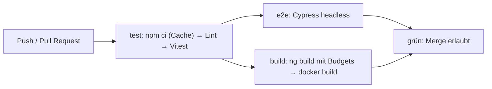

# Lab 14.1: CI-Pipeline für Angular

**Leitfragen:**

<details>
<summary>Was muss passieren, bevor Code in den Hauptzweig darf?</summary>

Er muss bauen, die Tests bestehen und die vereinbarten Regeln einhalten (Budgets, Lint). Eine Pipeline prüft das bei jedem Push und Pull Request automatisch; der Hauptzweig nimmt nur grüne Änderungen an.

</details>

<details>
<summary>Welche Prüfung im eigenen Projekt dauert am längsten und warum?</summary>

Meist die E2E-Tests: Sie starten App und Browser und warten auf echte Netzwerkantworten. Deshalb laufen sie in einem eigenen Job, parallel zum Build, und erst nach den schnellen Unit-Tests.

</details>

<details>
<summary>Was soll die Pipeline tun, wenn Budgets überschritten werden?</summary>

Bei `maximumWarning` weiterlaufen und die Warnung im Log zeigen, bei `maximumError` rot werden. Der Build aus Lab 13.2 endet dann mit Exit-Code 1, und genau das stoppt die Pipeline.

</details>

- Eine CI-Pipeline führt bei jeder Änderung dieselben Befehle aus, die lokal schon bekannt sind: `npm ci`, `ng test`, `cypress run`, `ng build`, `docker build`.
- Schnelle Prüfungen zuerst, teure parallel; ein roter Schritt stoppt den Lauf.

## Begriffe

| Begriff | Bedeutung |
| --- | --- |
| CI (Continuous Integration) | Jede Änderung wird automatisch gebaut und getestet, bevor sie in den Hauptzweig kommt. |
| Workflow | YAML-Datei in `.github/workflows/`; beschreibt, wann (`on`) welche Jobs laufen. |
| Job | Gruppe von Schritten auf einer frischen virtuellen Maschine (Runner); Jobs laufen parallel, außer `needs` legt eine Reihenfolge fest. |
| Step | einzelner Befehl (`run`) oder fertiger Baustein (`uses`) in einem Job. |
| Action | wiederverwendbarer Baustein, z. B. `actions/checkout@v7` holt den Code. |
| Artefakt | Datei, die ein Job zum Herunterladen ablegt, z. B. Screenshots fehlgeschlagener E2E-Tests. |
| Required Check | Einstellung im Repository: Ein Pull Request lässt sich erst zusammenführen, wenn bestimmte Jobs grün sind. |

## Pipeline-Stufen



| Stufe | Befehl | Bekannt aus | Bricht ab, wenn |
| --- | --- | --- | --- |
| Install mit Cache | `npm ci` + `actions/setup-node` mit `cache: npm` | Voraussetzung | Lock-Datei nicht zu `package.json` passt |
| Lint | `npx ng lint` | – (siehe unten) | Regelverstoß |
| Unit-Tests | `npx ng test --watch=false` | m10 | ein Test rot |
| E2E | `cypress run` über `cypress-io/github-action` | Lab 10.5 | ein E2E-Test rot |
| Build mit Budgets | `npm run build` | Lab 13.2 | `maximumError` überschritten, Compile-Fehler |
| Docker-Image | `docker build -f docker/Dockerfile …` | Lab 13.3 | Dockerfile-Fehler |

**Lint ehrlich betrachtet:** Angular 22 legt kein Lint-Target an. `ng lint` meldet „Cannot find "lint" target … ESLint: ng add angular-eslint“. Der Kurs-Workflow führt den Lint-Schritt deshalb nur aus, wenn `eslint.config.js` existiert (`if: hashFiles(…)`).

## Aufbau eines Workflows

Auszug aus der Vorlage `output/project/workspaces/ci/starter/ci.yml`:

```yaml
name: CI
on:
  push:
    branches: [main]
  pull_request:

concurrency:                       # neuer Push bricht den alten Lauf ab
  group: ci-${{ github.ref }}
  cancel-in-progress: true

jobs:
  test:
    runs-on: ubuntu-latest
    defaults:
      run:
        working-directory: project # alle run-Befehle im Ordner project/
    env:
      CYPRESS_INSTALL_BINARY: 0    # Unit-Tests brauchen kein Cypress-Binary
    steps:
      - uses: actions/checkout@v7
      - uses: actions/setup-node@v7
        with:
          node-version: 24
          cache: npm
          cache-dependency-path: project/package-lock.json
      - run: npm ci
      - name: Lint
        if: hashFiles('project/eslint.config.js') != ''
        run: npx ng lint
```

| Schlüssel | Wirkung |
| --- | --- |
| `on.push` / `on.pull_request` | Auslöser |
| `jobs.<id>.needs: test` | Job startet erst nach grünem `test` |
| `defaults.run.working-directory` | Arbeitsordner für `run`-Schritte (nicht für `uses`) |
| `cache: npm` + `cache-dependency-path` | npm-Cache zwischen Läufen; Schlüssel aus dem Hash der Lock-Datei |
| `if: failure()` | Schritt nur, wenn ein vorheriger Schritt scheiterte |
| `${{ github.sha }}` | Commit-Hash, z. B. als Image-Tag |

Versionen der Actions: `actions/checkout@v7`, `actions/setup-node@v7`, `cypress-io/github-action@v7`, `actions/upload-artifact@v7` (Stand 28.10.2026, `prüfen`).

## E2E mit Cypress in CI

```yaml
  e2e:
    needs: test
    runs-on: ubuntu-latest
    steps:
      - uses: actions/checkout@v7
      - uses: actions/setup-node@v7
        with:
          node-version: 24
      - uses: cypress-io/github-action@v7
        with:
          working-directory: project
          start: npm run api, npm start
          wait-on: 'http://localhost:3000/sessions, http://localhost:4200'
          wait-on-timeout: 180
```

- Die Action installiert die Abhängigkeiten selbst, cacht npm-Pakete und das Cypress-Binary (ca. mehrere hundert MB) und ruft `cypress run` headless auf.
- `start` startet Mock-API und App im Hintergrund, `wait-on` wartet, bis beide antworten.
- Ohne das Binary (`CYPRESS_INSTALL_BINARY=0`) startet `cypress run` nicht; deshalb setzt nur der Job `test` diese Variable.

## Monorepos: nur Betroffenes prüfen

In einem Nx-Workspace (Lab 11.1) prüft die Pipeline nur Projekte, die eine Änderung betrifft:

```yaml
      - uses: actions/checkout@v7
        with:
          fetch-depth: 0              # volle Historie für den Vergleich
      - uses: nrwl/nx-set-shas@v5    # setzt NX_BASE / NX_HEAD
      - run: npm ci
      - run: npx nx affected -t lint test build
```

Mit Remote-Cache (Nx Cloud oder selbst betrieben) übernimmt CI zusätzlich Ergebnisse, die schon einmal berechnet wurden.

## Übertragbarkeit

| | GitHub Actions | GitLab CI | Azure DevOps |
| --- | --- | --- | --- |
| Datei | `.github/workflows/*.yml` | `.gitlab-ci.yml` | `azure-pipelines.yml` |
| Einheit | `jobs` → `steps` | `stages` → `jobs` → `script` | `stages` → `jobs` → `steps` |
| Reihenfolge | `needs` | `stage`, `needs` | `dependsOn` |
| Cache | `actions/setup-node` `cache: npm` | `cache: key/paths` | `Cache@2`-Task |
| Docker bauen | `docker build` auf `ubuntu-latest` | Docker-in-Docker-Service oder Kaniko | `Docker@2`-Task |

Die Befehle (`npm ci`, `ng test`, `ng build`, `docker build`) bleiben überall gleich; nur die Hülle ändert sich.

## Lokal ausführen mit `act`

`act` (https://github.com/nektos/act) führt Workflows in Docker-Containern auf dem eigenen Rechner aus. Optional, braucht Docker.

```bash
act push -W .github/workflows/ci.yml -j test   # nur Job test
act -l -W .github/workflows/ci.yml             # Jobs auflisten
```

Grenzen (`prüfen`): Beim ersten Start fragt `act` nach der Größe des Runner-Images; Cache-Actions und Artefakt-Upload verhalten sich anders als auf GitHub; Cypress braucht ein großes Image.

## Typische Fehler

| Symptom | Ursache | Lösung |
| --- | --- | --- |
| `npm ci` scheitert: „lock file … not in sync“ | `package.json` geändert, `package-lock.json` nicht committed | lokal `npm install`, Lock-Datei committen |
| `ng test` hängt bis zum Timeout | Watch-Modus aktiv | `--watch=false` |
| Workflow startet nicht | Datei nicht unter `.github/workflows/` der Repo-Wurzel | Pfad prüfen; Ordner `project/workspaces/ci/` ist nur die Vorlage |
| `cypress run`: „Cypress binary is missing“ | Binary per `CYPRESS_INSTALL_BINARY=0` übersprungen | E2E mit `cypress-io/github-action` ohne diese Variable |
| E2E-Job: Timeout bei `wait-on` | App oder API startet nicht, falscher Port | `start`-Befehle lokal testen, Ports 3000/4200 |
| `docker build`: „failed to compute cache key … not found“ | falscher Arbeitsordner / Build-Kontext | `working-directory: project/workspaces`, Kontext `.` |

## Fazit

- Die Pipeline führt bekannte Befehle aus: Install mit Cache, Lint, Vitest, Cypress, Build mit Budgets, Docker-Image.
- `needs` ordnet die Jobs; ein roter Schritt stoppt den Lauf und blockiert über Required Checks den Merge.
- Monorepos prüfen mit `nx affected` nur Betroffenes.

In der Übung wird die Vorlage um Unit-Tests und Docker-Build ergänzt und einmal rot und einmal grün ausgeführt.
