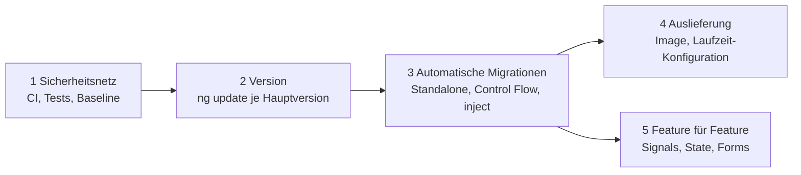

# Lab 14.2: Architektur-Review: Bestands-App modernisieren

**Leitfragen:**

Was würde man im eigenen Projekt am Montag als Erstes ändern?

Meist nichts am Code, sondern das Sicherheitsnetz: eine Pipeline, die baut und testet, und eine Messung des Ist-Zustands. Erst danach lässt sich jede weitere Änderung absichern und ihr Nutzen belegen.

Welche Änderung bringt viel und riskiert wenig?

Automatische Migrationen mit Angular-Schematics (Standalone, Control Flow, `inject()`), Lazy Loading und Budgets: Sie sind mechanisch, klein schneidbar und durch Tests prüfbar.

Wie überzeugt man ein Team, das „nie wieder migrieren“ will?

Mit kleinen Schritten statt eines großen Umbaus, mit Zahlen aus der eigenen App (Build-Zeit, Bundle-Größe, Lighthouse, Fehler pro Release) und mit dem Risiko des Stillstands: Alte Versionen bekommen keine Sicherheitsupdates mehr.

- Modernisierung ist eine Folge kleiner, einzeln auslieferbarer Schritte mit Messkriterium, kein Großprojekt.
- Die Checkliste fasst die Kursentscheidungen zusammen; jede Zeile verweist auf das Lab mit dem Werkzeug.

## Checkliste: Altbestand → Angular 22

| Bereich | Altbestand erkennen an | Heute | Werkzeug | Lab |
| --- | --- | --- | --- | --- |
| Version | `ng version` < 22, Node.js < 22 | Angular 22, Node.js 22 oder 24 LTS | `ng update`, eine Hauptversion pro Schritt | 1.1, 2.3 |
| Bündelung | `@NgModule`, `SharedModule` | Standalone-Komponenten, `app.config.ts` | `ng generate @angular/core:standalone` | 2.1–2.3 |
| Templates | `*ngIf`, `*ngFor`, `[ngSwitch]` | `@if`, `@for` mit `track`, `@switch`, `@defer` | `ng generate @angular/core:control-flow` | 3.1, 3.2 |
| Abhängigkeiten | Konstruktor-Injection | `inject()` | `ng generate @angular/core:inject` | 1.2 |
| Komponenten-API | `@Input`, `@Output` + `EventEmitter` | `input()`, `output()`, `model()` | `ng generate @angular/core:signal-input-migration`, `…:output-migration` | 6.3 |
| Reaktivität | `subscribe` in `ngOnInit`, `Subject` in Services, Zone.js | Signals, `computed`, `httpResource`, zoneless | manuell, Feature für Feature | 5.3, 6.1–6.2 |
| State | Service mit `BehaviorSubject`, NgRx ohne Regeln | Service mit Signals, NgRx Signal Store, NgRx Store | Entscheidungstabelle | 7.1–7.5 |
| Formulare | `FormGroup` ohne Typen (`UntypedFormGroup`) | Typed Reactive Forms, Signal Forms | manuell, Formular für Formular | 4.1–4.3, 6.4 |
| Routing | Feature-Module mit `loadChildren: () => …Module` | `loadComponent`, Routen-Dateien, Preloading | `ng generate @angular/core:route-lazy-loading` | 8.1–8.2 |
| Sicherheit | Klassen-Guards, Klassen-Interceptor, Token im `localStorage` | funktionale Guards und Interceptors, OIDC | manuell | 9.1–9.3 |
| Unit-Tests | Karma + Jasmine | Vitest über `ng test` | `ng generate @schematics/angular:refactor-jasmine-vitest` (experimentell) | 10.1–10.4 |
| E2E | Protractor (eingestellt) oder keine | Cypress oder Playwright | neu schreiben, kritische Abläufe zuerst | 10.5 |
| Wiederverwendung | kopierte Komponenten | Library, Nx-Workspace, Web Component | `ng generate library`, Nx | 11.1–11.3 |
| Performance | kein Messwert, Budgets hochgesetzt | Lighthouse-Baseline, Budgets, `NgOptimizedImage` | DevTools, `angular.json` | 13.1–13.2 |
| Auslieferung | manuelles Kopieren, `environment.prod.ts` je Umgebung | Docker-Image, `config.json` zur Laufzeit, CI | Dockerfile, Workflow | 13.3, 14.1 |

Namen der Schematics geprüft gegen `@angular/core` 22.2 (`node_modules/@angular/core/schematics/collection.json`, 28.10.2026).

## Reihenfolge finden

| Regel | Grund |
| --- | --- |
| Sicherheitsnetz vor Umbau | ohne grüne Pipeline und Baseline lässt sich kein Schritt bewerten |
| `ng update` nur eine Hauptversion pro Schritt | jede Version bringt eigene automatische Migrationen mit; Sprünge überspringen sie |
| Mechanisch vor manuell | Schematics sind schnell, reproduzierbar und klein reviewbar |
| Feature für Feature statt Schicht für Schicht | jedes Feature ist danach fertig und auslieferbar; Mischbetrieb ist in Angular erlaubt |
| Messkriterium je Maßnahme | „fertig“ ist überprüfbar, Fortschritt wird sichtbar |

## Maßnahmen bewerten

| Kriterium | Frage | Skala |
| --- | --- | --- |
| Aufwand | Wie viele Personentage, inklusive Review und Test? | S (≤ 2 PT), M (≤ 10 PT), L (> 10 PT) |
| Risiko | Was kann für Nutzende kaputtgehen, und merkt es jemand vor dem Release? | niedrig / mittel / hoch, mit Begründung |
| Nutzen | Was wird messbar besser: Sicherheit, Geschwindigkeit, Entwicklungszeit? | Zahl oder Beobachtung |
| Messkriterium | Woran erkennt das Team, dass die Maßnahme abgeschlossen ist? | konkret und prüfbar, z. B. „`grep -r '\*ngIf' src` liefert 0 Treffer“ |

## Argumente für Teams, die nicht migrieren wollen

| Einwand | Antwort mit Beleg |
| --- | --- |
| „Läuft doch.“ | Supportstatus der eigenen Version auf angular.dev/reference/releases prüfen; ohne Sicherheitsupdates wächst das Risiko mit jedem Monat |
| „Kostet zu viel Zeit.“ | kleine Schritte neben Features; Schematics erledigen den mechanischen Teil |
| „Danach ist alles kaputt.“ | Pipeline und E2E-Tests der wichtigsten Abläufe zuerst; jeder Schritt einzeln rückgängig machbar |
| „Bringt den Kunden nichts.“ | Baseline vorher/nachher: Lighthouse, Bundle-Größe, Build-Dauer, Zeit pro Release |

## Typische Fehler

Häufige Schwächen in Modernisierungsplänen:

| Symptom | Ursache | Lösung |
| --- | --- | --- |
| Maßnahme gilt nie als „fertig“ | Messkriterium wie „Code ist modern“ ist nicht prüfbar | Befehl, Zahl oder Ja/Nein, z. B. „`grep -r 'NgModule' src` liefert 0 Treffer“ |
| Erste Maßnahme ist ein großer Umbau (z. B. alles auf Signals) | Sicherheitsnetz fehlt; Pipeline und Baseline kommen erst später | CI, Tests der wichtigsten Abläufe und Lighthouse-Baseline an Position 1 |
| `ng update` von 14 direkt auf 22 geplant | Versionssprung überspringt die automatischen Migrationen der Zwischenversionen | eine Hauptversion pro Schritt, jeweils mit grüner Pipeline |
| Plan hat zehn Maßnahmen, keine ist begonnen | zu viel auf einmal, kein Nutzen-Risiko-Abgleich | fünf Maßnahmen, nach Nutzen und Risiko sortiert; Rest unter „Bewusst nicht im Plan“ |
| Maßnahme passt nicht zum Ist-Zustand | Checkliste nicht gegen die App geprüft | Checkliste Zeile für Zeile mit „betroffen / nicht betroffen“ markieren |
| Aufwand „S“ für eine Maßnahme, die alle Formulare betrifft | Review- und Testaufwand nicht mitgeschätzt | Personentage inklusive Review und Test schätzen |

## Fazit

- Erst Sicherheitsnetz und Messung, dann Version, dann automatische Migrationen, danach Feature für Feature.
- Jede Maßnahme braucht Aufwand, Risiko und ein prüfbares Messkriterium.
- Die Kurs-Labs liefern zu jedem Bereich das Werkzeug.

In der Übung entsteht ein Modernisierungsplan mit fünf Maßnahmen für eine beschriebene Bestands-App oder das eigene Projekt.
