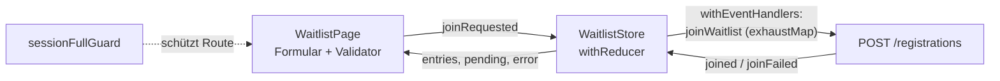

# Transferprojekt „EventHub Release“ – Lösung

Referenz für den Kern des Features: `output/project/src/app/examples/m14-ci-transfer/transfer/` (Ereignisse, `joinWaitlist`, Store, Validator, Guard, Seite, Marble- und Store-Test). Im Browser: `/examples/m14-ci-transfer/transfer/waitlist/6`. In der Übung liegt derselbe Code unter `src/app/features/waitlist/` und die Route unter `/waitlist/:sessionId`.



## Block 1: Planung

| Aufgabe | Lab | Wer (Beispiel) |
| --- | --- | --- |
| Ereignisse, `joinWaitlist`, Store, Marble- und Store-Test | 5.2, 7.4, 7.5, 10.3, 10.4 | Person A |
| Guard, Route, Formular, Validator, Seite | 4.1, 4.2, 8.1, 9.2 | Person B |
| Library-Badge, Offline, E2E, Pipeline | 6.2, 10.5, 11.2, 12.3, 14.1 | Person C (bei 2 Personen: A und B je zur Hälfte) |

Branches `feature/waitlist-store`, `feature/waitlist-page`, `feature/waitlist-e2e`; Pull Requests gegen `main`, Required Checks `Lint und Unit-Tests`, `E2E-Tests (Cypress)`.

## Block 2: State und Datenfluss

### Aufgabe 3: Ereignisse

```ts
import { type } from '@ngrx/signals';
import { eventGroup } from '@ngrx/signals/events';
import { WaitlistEntry, WaitlistRequest } from './waitlist.model';

export const waitlistPageEvents = eventGroup({
  source: 'Waitlist Page',
  events: { joinRequested: type<WaitlistRequest>() },
});

export const waitlistApiEvents = eventGroup({
  source: 'Waitlist API',
  events: { joined: type<WaitlistEntry>(), joinFailed: type<string>() },
});
```

`waitlist.model.ts`: `WaitlistEntry extends Registration` mit `waitlistSessionId: number`; `WaitlistRequest` mit `sessionId`, `name`, `email`.

### Aufgabe 4: `joinWaitlist`

```ts
export function joinWaitlist(
  requests$: Observable<WaitlistRequest>,
  post: (request: WaitlistRequest) => Observable<WaitlistEntry>,
) {
  return requests$.pipe(
    exhaustMap((request) =>
      post(request).pipe(
        map((entry) => waitlistApiEvents.joined(entry)),
        catchError((error: HttpErrorResponse) =>
          of(waitlistApiEvents.joinFailed(`Eintrag fehlgeschlagen (HTTP ${error.status})`)),
        ),
      ),
    ),
  );
}
```

`exhaustMap` statt `switchMap`: Eine laufende Anfrage wird nicht abgebrochen, weitere Klicks werden ignoriert (Akzeptanzkriterium 3). `catchError` innerhalb von `exhaustMap`, damit der äußere Strom nach einem Fehler weiterläuft (Akzeptanzkriterium 4).

### Aufgabe 5: Store

```ts
export const WaitlistStore = signalStore(
  withState<WaitlistState>({ entries: [], pending: false, error: null }),
  withComputed(({ entries }) => ({ count: computed(() => entries().length) })),
  withReducer(
    on(waitlistPageEvents.joinRequested, () => ({ pending: true, error: null })),
    on(waitlistApiEvents.joined, ({ payload }, state) => ({ pending: false, entries: [...state.entries, payload] })),
    on(waitlistApiEvents.joinFailed, ({ payload }) => ({ pending: false, error: payload })),
  ),
  withEventHandlers((_store, events = inject(Events), http = inject(HttpClient)) => ({
    join$: joinWaitlist(
      events.on(waitlistPageEvents.joinRequested).pipe(map(({ payload }) => payload)),
      (request) =>
        http.post<WaitlistEntry>(`${API_URL}/registrations`, {
          name: request.name,
          email: request.email,
          tickets: 0,
          workshopIds: [],
          waitlistSessionId: request.sessionId,
        }),
    ),
  })),
);
```

Ereignisse, die ein Handler in `withEventHandlers` zurückgibt, dispatcht der Store selbst (geprüft in `@ngrx/signals` 22.0: Implementierung von `withEventHandlers`). Kein `providedIn: 'root'`: Der Store wird an der Route bereitgestellt und lebt nur, solange die Seite offen ist.

### Aufgabe 6: Marble-Test

```ts
it('ignoriert einen Doppelklick, solange die erste Anfrage läuft', () => {
  scheduler.run(({ cold, hot, expectObservable }) => {
    const requests = hot('-a-a-----a-|', { a: request });
    const post = vi.fn(() => cold('---e|', { e: entry }));

    expectObservable(joinWaitlist(requests, post)).toBe('----j-------j|', { j: waitlistApiEvents.joined(entry) });
    scheduler.flush();
    expect(post).toHaveBeenCalledTimes(2);
  });
});

it('macht aus einem HTTP-Fehler ein joinFailed-Ereignis', () => {
  scheduler.run(({ cold, expectObservable }) => {
    const requests = cold('a|', { a: request });
    const post = () => cold<WaitlistEntry>('--#', undefined, { status: 500 });

    expectObservable(joinWaitlist(requests, post)).toBe('--(f|)', {
      f: waitlistApiEvents.joinFailed('Eintrag fehlgeschlagen (HTTP 500)'),
    });
  });
});
```

Frame 1: erste Anfrage, Antwort bei Frame 4. Die zweite Anfrage bei Frame 3 fällt weg. Die dritte bei Frame 9 antwortet bei Frame 12. Der äußere Strom endet bei Frame 11, das Ergebnis aber erst bei Frame 13: `exhaustMap` wartet, bis die laufende innere Anfrage abgeschlossen ist.

### Aufgabe 7: Store-Test

```ts
it('trägt nach erfolgreicher API-Antwort ein', () => {
  const { store, dispatcher, http } = setup(); // TestBed mit WaitlistStore, provideHttpClient(), provideHttpClientTesting()

  dispatcher.dispatch(waitlistPageEvents.joinRequested({ sessionId: 6, name: 'Uli', email: 'u@eventhub.test' }));
  expect(store.pending()).toBe(true);

  const req = http.expectOne(`${API_URL}/registrations`);
  expect(req.request.body).toMatchObject({ waitlistSessionId: 6, tickets: 0 });
  req.flush({ id: 5, name: 'Uli', email: 'u@eventhub.test', tickets: 0, workshopIds: [], waitlistSessionId: 6 });

  expect(store.pending()).toBe(false);
  expect(store.count()).toBe(1);
});
```

Checkpoint (lokal geprüft am 28.10.2026 mit dem Referenz-Kern):

```text
npx ng test --watch=false --include "src/app/examples/m14-ci-transfer/**/*.spec.ts"
 Test Files  2 passed (2)
      Tests  4 passed (4)
```

## Block 3: Route, Guard, Formular

### Aufgabe 8: Guard

```ts
export const sessionFullGuard: CanActivateFn = (route) => {
  const fallback = inject(Router).createUrlTree(['/']);
  return inject(HttpClient)
    .get<Session>(`${API_URL}/sessions/${route.paramMap.get('sessionId')}`)
    .pipe(
      map((session) => (session.booked >= session.capacity ? true : fallback)),
      catchError(() => of(fallback)),
    );
};
```

Im Referenz-Kern führt `fallback` zur Info-Seite `/examples/m14-ci-transfer/transfer`.

### Aufgabe 9: Route

```ts
{
  path: 'waitlist/:sessionId',
  title: 'Warteliste',
  canActivate: [sessionFullGuard],
  providers: [WaitlistStore],
  loadComponent: () => import('./features/waitlist/waitlist-page').then((m) => m.WaitlistPage),
},
```

### Aufgabe 10 und 11: Seite mit Formular und Validator

Validator:

```ts
export function notOnWaitlist(entries: () => WaitlistEntry[], sessionId: () => number): ValidatorFn {
  return (control: AbstractControl): ValidationErrors | null => {
    const email = String(control.value ?? '').trim().toLowerCase();
    if (!email) return null;
    const exists = entries().some(
      (entry) => entry.waitlistSessionId === sessionId() && entry.email.toLowerCase() === email,
    );
    return exists ? { notOnWaitlist: { email } } : null;
  };
}
```

Kernstück der Seite (vollständig in `waitlist-page.ts`):

```ts
export class WaitlistPage {
  readonly sessionId = input.required<string>();
  protected readonly store = inject(WaitlistStore);
  private readonly dispatch = injectDispatch(waitlistPageEvents);
  protected readonly session = httpResource<Session>(() => `${API_URL}/sessions/${this.sessionId()}`);

  protected readonly form = new FormGroup({
    name: new FormControl('', { nonNullable: true, validators: [Validators.required] }),
    email: new FormControl('', {
      nonNullable: true,
      validators: [
        Validators.required,
        Validators.email,
        notOnWaitlist(() => this.store.entries(), () => Number(this.sessionId())),
      ],
    }),
  });

  protected join(): void {
    if (this.form.invalid) return;
    this.dispatch.joinRequested({ sessionId: Number(this.sessionId()), ...this.form.getRawValue() });
    this.form.reset();
  }
}
```

Template-Auszug: Button mit `[disabled]="form.invalid || store.pending()"`, Fehler über `@if (store.error(); as error)`, Einträge mit `@for (entry of store.entries(); track entry.id)`, `data-cy`-Attribute `waitlist-name`, `waitlist-email`, `waitlist-submit`, `waitlist-error`, `waitlist-entries`.

Geprüft im Browser (Referenz-Kern, 28.10.2026): `/examples/m14-ci-transfer/transfer/waitlist/6` zeigt „Warteliste: Login richtig gemacht: OAuth 2.0 und OIDC“, `/…/waitlist/1` leitet zur Info-Seite weiter.

## Block 4: Wiederverwendung und Offline

### Aufgabe 12: Library-Badge

`workspaces/eventhub-ui-lib/projects/eventhub-ui/src/lib/waitlist-badge/waitlist-badge.ts`:

```ts
import { Component, input } from '@angular/core';

@Component({
  selector: 'eh-waitlist-badge',
  template: `<span class="eh-badge">Warteliste: {{ count() }}</span>`,
  styles: `.eh-badge { display: inline-block; padding: 0.1rem 0.5rem; border-radius: 999px; font-size: 0.8rem; background: #fde9cc; color: #b25e00; }`,
})
export class WaitlistBadge {
  readonly count = input.required<number>();
}
```

`public-api.ts` um `export * from './lib/waitlist-badge/waitlist-badge';` ergänzen, Version in `projects/eventhub-ui/package.json` auf `0.2.0` (neue Funktion, nichts entfernt: Minor-Version, Lab 11.2). Danach `ng build eventhub-ui`, in `dist/eventhub-ui` `npm pack`, im Kurs-Projekt `npm install <pfad>/eventhub-ui-0.2.0.tgz` und in `WaitlistPage`: `imports: [WaitlistBadge]`, `<eh-waitlist-badge [count]="store.count()" />`.

### Aufgabe 13: Offline-Hinweis

```ts
protected readonly online = toSignal(
  merge(fromEvent(window, 'online').pipe(map(() => true)), fromEvent(window, 'offline').pipe(map(() => false))),
  { initialValue: navigator.onLine },
);
```

```html
@if (!online()) {
  <p class="card badge-warn">Offline: Die Warteliste wird gesendet, sobald wieder eine Verbindung besteht.</p>
}
```

Der Text verspricht ein späteres Senden; ohne Warteschlange für Anfragen ist ehrlicher: „Offline: Eintragen ist erst wieder mit Verbindung möglich.“ Das Team entscheidet und dokumentiert es.

### Aufgabe 14: Programm offline

`ngsw-config.json` nach `ng add @angular/pwa`, ergänzt um:

```json
"dataGroups": [
  {
    "name": "programm-api",
    "urls": ["http://localhost:3000/sessions", "http://localhost:3000/speakers"],
    "cacheConfig": { "strategy": "freshness", "maxSize": 20, "maxAge": "1d", "timeout": "3s" }
  }
]
```

`freshness`: erst Netz, nach 3 s oder offline der Cache – das Programm darf alt sein, die Auslastung nicht (Lab 12.3). `POST /registrations` wird nie gecacht. Prüfung nur im Produktions-Build (`ng build`, statischer Server), nicht mit `ng serve`.

## Block 5: E2E und Pipeline

### Aufgabe 15: `cypress/e2e/waitlist.cy.ts`

```ts
describe('Warteliste', () => {
  it('trägt in die Warteliste einer ausgebuchten Session ein', () => {
    cy.visit('/waitlist/6');
    cy.get('[data-cy=waitlist-name]').type('Uli User');
    cy.get('[data-cy=waitlist-email]').type(`uli+${Date.now()}@eventhub.test`);
    cy.get('[data-cy=waitlist-submit]').click();
    cy.get('[data-cy=waitlist-entries]').should('contain', 'Uli User');
  });

  it('zeigt einen API-Fehler an', () => {
    cy.intercept('POST', '**/registrations', { statusCode: 500, body: { message: 'kaputt' } });
    cy.visit('/waitlist/6');
    cy.get('[data-cy=waitlist-name]').type('Uli User');
    cy.get('[data-cy=waitlist-email]').type('uli@eventhub.test');
    cy.get('[data-cy=waitlist-submit]').click();
    cy.get('[data-cy=waitlist-error]').should('contain', 'HTTP 500');
  });

  it('leitet bei freien Plätzen weiter', () => {
    cy.visit('/waitlist/1');
    cy.location('pathname').should('not.include', '/waitlist');
  });
});
```

Die E-Mail mit Zeitstempel macht den ersten Test wiederholbar, weil die Mock-API Einträge bis zum Neustart behält.

### Aufgabe 16: Pipeline

Die Pipeline aus Lab 14.1 braucht keine Änderung: Der Job `test` findet die neuen `*.spec.ts`, der Job `e2e` die neue `*.cy.ts`. Der Build zeigt die Seite als Lazy-Chunk (`waitlist-page`), das Initial-Budget bleibt unverändert.

## Block 6: Abnahme

| Kriterium | Beleg |
| --- | --- |
| 1 Lazy Route nur für ausgebuchte Sessions | Build-Ausgabe „Lazy chunk files: waitlist-page“; E2E-Test 3 |
| 2 E-Mail nur einmal je Session | Validator `notOnWaitlist`; Formular zeigt die Meldung nach einem zweiten Versuch mit derselben E-Mail |
| 3 Doppelklick = ein Eintrag | Marble-Test 1 (`post` zweimal bei drei Klicks, davon einer während der Anfrage) |
| 4 Fehlermeldung, Formular nutzbar | Store-Test „merkt sich einen Fehler“; E2E-Test 2 |
| 5 Offline-Hinweis, Programm lesbar | Screenshot DevTools „Offline“ im Produktions-Build |
| 6 Pipeline grün | Link zum Pipeline-Lauf im Pull Request |

Bewusst offen: Nachrücken bei frei werdenden Plätzen (Admin-Funktion), Benachrichtigung per E-Mail, serverseitige Prüfung auf doppelte Einträge (der Validator prüft nur, was der Client kennt).

## Erweiterung

**Container:** `workspaces/docker/Dockerfile.project` baut das Kurs-Projekt (Kontext `project/`, Ausgabe `dist/project/browser`) mit derselben nginx-Konfiguration wie Lab 13.3:

```bash
cd output/project
docker build -f workspaces/docker/Dockerfile.project -t eventhub-kurs .
docker run --rm -p 8080:8080 eventhub-kurs
curl -i http://localhost:8080/waitlist/6     # 200, index.html (SPA-Fallback)
```

Die Kurs-App liest die API-URL aus `API_URL` in `src/app/shared/api.ts`, nicht aus `config.json`; für echte Laufzeitkonfiguration den Weg aus Lab 2.2 (`provideEventHubConfig()`) übernehmen. Container-Build für den Kurs nicht ausgeführt (Docker-Daemon beim Erstellen nicht verfügbar).

**Performance:** Lighthouse auf `/waitlist/6` im Produktions-Build; die Seite lädt nur ihren eigenen Chunk nach.

**Nachrücken:** neues Ereignis `waitlistAdminEvents.promoted` mit `PATCH /sessions/:id` (Admin-Token, Lab 9.2) und `withReducer`, das den Eintrag aus `entries` entfernt.
